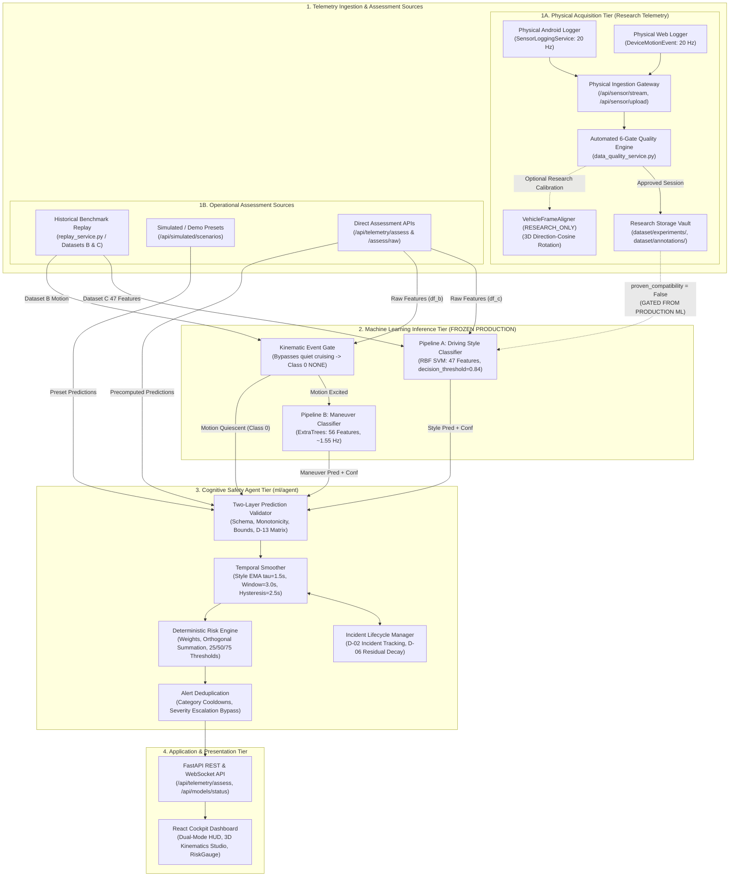

# System Design Document: Intelligent Driver Activity Monitoring & Safety Agent (IDAMS)

**Canonical Reference:** This document is the authoritative, verified system design specification for the IDAMS project. All subsystem documents and implementation plans defer to this specification for numerical parameters, state enums, thresholds, and architectural invariants.

**Repository:** `yeswanth225/driver-machine-learning-model`  
**Document ID:** `IDAMS-SYS-DESIGN-CANONICAL-01`  
**Version:** 3.0.0 (Comprehensive Forensic & Code Reconciliation)  
**Status:** Verified Against Source Code Truth & Production Artifacts  
**Branch:** `stage6-phase1`  
**Date:** November 2026  

---

## 1. Executive Summary & Research Mandate

The **Intelligent Driver Activity Monitoring & Safety Agent (IDAMS)** is an academic research software system designed to analyze vehicle kinematic telemetry, classify driver behavioral states and hazardous maneuvers across multi-rate streams, and evaluate driving risk through a deterministic, explainable cognitive safety agent.

### 1.1 Core Objectives
1. **Multimodal Late Fusion:** Decouple kinematic feature streams into two independent, specialized machine learning pipelines:
   - **Pipeline A (Driving Style Classification):** Classifies global driving habits (*Normal* vs. *Aggressive*) using causal acceleration and speed distribution features.
   - **Pipeline B (Maneuver Detection):** Identifies transient, high-risk maneuvers (*Sudden Acceleration*, *Sudden Deceleration*, *Sudden Right Turn*, *Sudden Left Turn*) via causal rolling window features and an upstream kinematic event gate.
2. **Autonomous Cognitive Safety Agent:** Replaces opaque black-box scoring with an explainable, deterministic rule engine featuring:
   - **D-13 25-Combination Health Matrix** governing sensor dropouts and graceful degradation (Option 1A-Pure, Option 2A, P-05A).
   - **D-02 Multi-Instance Incident Lifecycle Tracking** with a 2.50-second quiet hysteresis window.
   - **D-06 Continuous Residual Risk Decay Integration** with multi-channel orthogonal summation (Longitudinal + Lateral) and analytical retirement horizons.
3. **Physical Telemetry Acquisition & Data Quality Pipeline:** Ingests high-rate physical smartphone sensor telemetry (20 Hz), verifies transmission integrity through an automated 6-criterion quality engine, and archives data into an immutable campaign vault while keeping production ML inference strictly gated (`proven_compatibility = False`).

> [!IMPORTANT]
> **Academic Scope & Regulatory Disclaimer:**  
> IDAMS is an academic research demonstration platform and supervisory monitor. It is **not** an automotive-grade or ISO 26262 ASIL-certified safety-critical control system. It does not perform autonomous vehicular actuation, steering intervention, or braking control. All physical hardware telemetry remains explicitly designated as **`NOT_VERIFIED`** until on-vehicle road smoke tests and static calibration pass successfully. Pipeline B was trained on segmented maneuver trials; continuous streaming deployment involves potential kinematic distribution shift, and false-alarm rates per operating hour require empirical vehicle characterization (**`NOT_MEASURED`**).

---

## 2. End-to-End System Architecture

The system maintains a strict architectural separation between physical research acquisition/storage, historical production inference, interactive assessment APIs, and simulated demonstration streams:



### 2.1 Distinct Telemetry & Assessment Ingestion Paths
The architecture explicitly separates four operational modes:
1. **Historical Benchmark Dataset Replay:** High-fidelity replay of benchmark research sessions (`replay_service.py`, `/api/replay/*`) from Dataset B (dashboard-mounted MPU6050) and Dataset C (passenger cabin smartphone). Provides 1-second sliding window features to frozen production models and evaluates system metrics against benchmark baselines.
2. **Simulated / Demonstration Scenarios:** Curated synthetic scenarios (`/api/simulated/scenarios`, `agent_service.py`) representing nominal cruising, rapid tailgating, emergency braking, compound hazards, and sensor dropouts. Used for automated testing and client UI demonstrations.
3. **Interactive Prediction-Assessment APIs:** REST endpoints (`/api/telemetry/assess` for pre-computed style/maneuver predictions and `/api/telemetry/assess/raw` for raw 47/56 feature vectors) enabling external evaluators, bench test harnesses, and integration suites to pass predictions directly into the Two-Layer Validator and Safety Agent.
4. **Physical Sensor Research Ingestion:** Real-world smartphone IMU and GPS streams (`/api/sensor/stream`, `/api/sensor/upload`) sampled at 20.0 Hz. Evaluated by `data_quality_service.py` across 6 data-quality criteria and recorded in immutable research storage (`dataset/experiments/`, `dataset/annotations/`). **Physical smartphone telemetry is strictly gated from production ML inference (`proven_compatibility = False`).**

---

## 3. Telemetry Ingestion Tier

### 3.1 Sensor Acquisition & Logging
- **Canonical Logger (`mobile/android/`):** Android Foreground Service with explicit `PARTIAL_WAKE_LOCK`. Samples hardware IMU registers at 20.0 Hz nominal ($50\text{ ms}$ loop), recording monotonic hardware nanosecond timestamps (`event.timestamp`) and UTC epoch milliseconds. Logs natural portrait device coordinates in units of $g$ (including gravity).
- **Proving Logger (`mobile/web-logger/`):** Supplementary web logger utilizing W3C `DeviceMotionEvent` and Geolocation API. Converts acceleration to $g$ and angular velocity to $\text{rad/s}$.

### 3.2 Security & Blind Lockbox Isolation
- **Driver Whitelisting:** `SensorStorageService.validate_driver_id()` permits development drivers `DRV_001` through `DRV_006`. Requests targeting lockbox holdout drivers `DRV_007` or `DRV_008` are intercepted and rejected with `PermissionError` (`HTTP 403 Forbidden`).
- **Path Traversal Protection:** Session IDs are validated against `^[a-zA-Z0-9_\-]+$`; directory traversal sequences (`..`, `/`, `\`) trigger immediate validation errors.
- **Payload Boundaries:** Upload endpoints enforce `MAX_UPLOAD_BYTES = 50 * 1024 * 1024` (50 MB) to guard against memory exhaustion.

---

## 4. Automated 6-Criterion Quality Engine (`data_quality_service.py`)

### 4.1 Quality Evaluation Architecture
All physical telemetry uploaded via `/sensor/upload` or streamed to `/sensor/telemetry/frame` is evaluated by `DataQualityService.evaluate_session_df()`. The evaluation computes statistical metrics across the complete trip time series and outputs a structured `DataQualityReport` with an overall status (`PASS`, `WARNING`, or `FAIL`).

### 4.2 Mandatory 6-Criterion Quality Acceptance Matrix
The table below specifies the exact criteria, thresholds, warning conditions, and failure limits implemented in `data_quality_service.py`:

| Criterion # & Name | Target Specification | Hard Failure Conditions (`FAIL`) | Warning Conditions (`WARNING`) | Code Implementation & Verification Status |
|:---|:---|:---|:---|:---|
| **Criterion 1: Sampling Frequency & Jitter** | Nominal $20.0\text{ Hz}$ ($50\text{ ms}$ period). Band: $[18.0, 22.0]\text{ Hz}$. Jitter: $\ge 95.0\%$ of intervals in $[40.0, 60.0]\text{ ms}$. Zero gaps $\ge 250\text{ ms}$. | - Any backward timestamp step ($\Delta t < 0.0$)<br>- Duplicate timestamps $> 1.0\%$ of samples<br>- Any telemetry gap $\ge 250\text{ ms}$ (`dt >= 0.250`) | - Mean frequency $< 18.0\text{ Hz}$ or $> 22.0\text{ Hz}$<br>- Jitter compliance $< 95.0\%$ in $[40, 60]\text{ ms}$ | `data_quality_service.py:75-127`<br>**VERIFIED** |
| **Criterion 2: Dynamic Range & Saturation** | Accelerometer range $\ge \pm 4.0g$; Gyroscope range $\ge \pm 500^\circ/\text{s}$ ($\approx 8.73\text{ rad/s}$). Zero clipped samples. | - Any clipped accelerometer sample ($\|a_x\|, \|a_y\|, \|a_z\| \ge 3.92g$)<br>- Any clipped gyroscope sample ($\|\vec{\omega}\| \ge 8.5\text{ rad/s}$)<br>- Dead channel: $\sum \text{std}(a) < 0.001g$ over trip $> 10\text{ s}$ | None (Binary Pass / Fail) | `data_quality_service.py:130-165`<br>**VERIFIED** |
| **Criterion 3: Static Gravity & Mount Stability** | Standstill gravity $\|g_0\| \in [0.98, 1.02]g$ ($9.81 \pm 0.20\text{ m/s}^2$). Angular mount drift $\le 3.0^\circ$ across drive. | - Initial static gravity $\|g_0\| < 0.98g$ or $> 1.02g$<br>- Angular mount drift between S0 and S6 $> 3.0^\circ$ ($\arccos\frac{\vec{g}_0 \cdot \vec{g}_6}{\|g_0\|\|g_6\|} > 3.0^\circ$) | None (Binary Pass / Fail) | `data_quality_service.py:168-212`<br>**VERIFIED** |
| **Criterion 4: GPS Ground Speed & Satellite Fix** | Non-negative speed ($v \ge 0\text{ m/s}$). 3D Satellite fix availability $\ge 92.0\%$. Mean $\text{HDOP} \le 2.5$. | - Negative speed detected ($v < 0.0\text{ m/s}$)<br>- 3D fix rate $< 92.0\%$ of drive | - Mean $\text{HDOP} > 2.5$<br>- GPS speed channel missing (`NOT_AVAILABLE`) | `data_quality_service.py:214-263`<br>**VERIFIED** |
| **Criterion 5: Driving Regime Coverage** | Total duration $\ge 12.0\text{ min}$ ($720\text{ s}$). Highway normal cruising ($v \ge 60\text{ km/h}$) $\ge 2.5\text{ min}$ ($150\text{ s}$). | None (Duration targets emit warnings to allow short research runs) | - Total drive duration $< 12.0\text{ min}$<br>- Highway cruising duration $< 2.5\text{ min}$ (vibration confounding risk) | `data_quality_service.py:265-298`<br>**VERIFIED** |
| **Criterion 6: Missing Values & Data Hygiene** | Exactly 0 NaNs, 0 nulls, and 0 infinite values across all telemetry columns. | - Any NaN or null detected (`nan_count > 0`)<br>- Any infinite value detected (`inf_count > 0`) | None (Binary Pass / Fail) | `data_quality_service.py:51-72`<br>**VERIFIED** |

### 4.3 Overall Acceptance Disposition
- **`PASS`:** Session satisfies all 6 criteria. Approved for ingestion into raw campaign vault.
- **`WARNING`:** Session accepted with warnings (e.g. slight jitter deviation or short highway coverage). Flagged for inspection prior to ML training.
- **`FAIL`:** Session rejected due to critical data corruption (clipping, backward timestamps, mount slip, or NaNs). Rejected from training consideration.

---

## 5. Machine Learning Inference Pipelines

### 5.1 Production Model Specifications & Cryptographic Hashes
To ensure reproducibility and guarantee zero model tampering, production artifacts must strictly match these SHA-256 digests:

| Model Identity | Pipeline | Architecture | Input Features | Calibrated Threshold | SHA-256 Digest | Status |
|:---|:---|:---|:---:|:---:|:---|:---|
| `dataset_c_model` | **Pipeline A** | Support Vector Machine (RBF) | **47 features** | `decision_threshold = 0.84` | `a00180bd01d5999b1338737549d5745adb986138f813f7f371d67589d0dbaefc` | **FROZEN PRODUCTION** |
| `dataset_c_scaler` | **Pipeline A** | StandardScaler | 47 features | — | `d67f9ab70eb667cc57e8aeb2f6768e62529f0cb803279cc33d17f6c76555c9f5` | **FROZEN PRODUCTION** |
| `dataset_b_model` | **Pipeline B** | ExtraTrees Classifier | **56 features** | 200 trees, depth 10 | `552048535a3fd584e4874731b8be1438dab4051d8cfa6a98fb1a7b19d9202e90` | **FROZEN PRODUCTION** |
| `dataset_b_scaler` | **Pipeline B** | StandardScaler | 56 features | — | `d4b3d5e3e1b739c63a9e21fac51fcedf36716143c645abe0d0e3ff99127a7576` | **FROZEN PRODUCTION** |

### 5.2 Pipeline A — Driving Style Classification
- **Trained Classes:** Binary classification: `0 = Normal Driving`, `1 = Aggressive Driving`.
- **Operating Frequency:** 10.0 Hz nominal.
- **Decision Threshold:** An observation is classified as Aggressive if and only if $P(\text{aggressive}) \ge 0.84$; otherwise Normal ($0$). Formally designated `decision_threshold` to avoid notation collisions with smoother time constants ($\tau_{\text{style}} = 1.50\text{ s}$).
- **Production Feature Count:** 47 causal backward-looking features (instantaneous channels, physical norms, and 1s, 2s, 3s causal rolling statistics).

### 5.3 Pipeline B — Maneuver Detection
- **Trained Classes:** Exactly 4 positive maneuver classes:
  - Class 1: `Sudden Acceleration` (`SA`)
  - Class 2: `Sudden Deceleration` (`SD`)
  - Class 3: `Sudden Right Turn` (`SRT`)
  - Class 4: `Sudden Left Turn` (`SLT`)
- **Origin of Class 0 (`NONE`):** Model B was trained strictly on 109 positive maneuver trials. **`NONE` is not a trained class.** Class 0 is generated upstream by `KinematicEventGate` during quiescent cruising when motion is below excitation thresholds.
- **Kinematic Event Gate Thresholds (`config.py:140-144`):**
  - Horizontal acceleration variation: `gate_acc_horiz_std_threshold = 0.30 m/s^2`
  - Yaw rate variation: `gate_gyro_z_std_threshold = 0.05 rad/s`
  - Total acceleration excursion from 1g: `gate_acc_mag_dev_threshold = 1.47 m/s^2` ($\approx 0.15g$)
  - Total rotational rate: `gate_gyro_mag_threshold = 0.25 rad/s` ($\approx 14.3^\circ/\text{s}$)
  When features fall below these bounds, the gate emits `VALID_QUIESCENT` (Class 0 bypass), suppressing false classifier triggers.

### 5.4 Sampling Decimation & Warm-Up Rule
- **Causal Decimator (20 Hz $\to$ 10 Hz):** Default causal FIR moving-average filter $y[k] = 0.5 \cdot x[2k] + 0.5 \cdot x[2k-1]$ with group delay $\tau_g = 25.0\text{ ms}$. Optional 21-tap causal low-pass FIR filter available for anti-aliasing research.
- **Buffer Warm-Up:** Feature extraction circular buffers require at least **50 samples at 10 Hz** (or **100 samples at 20 Hz**, equivalent to exactly **5.0 seconds** of driving) before emitting valid ML inferences. During $t < 5.0\text{ s}$, adapters emit status `WARMING_UP`.

---

## 6. Cognitive Safety Agent Architecture (`ml/agent`)

### 6.1 Domain Enums & Verified Configuration Defaults

#### Verbatim Safety States (`config.py:13-19`)
```python
class SafetyState(str, Enum):
    NORMAL = "NORMAL"               # Score in [0.0, 25.0)
    CAUTION = "CAUTION"             # Score in [25.0, 50.0) (or P-05A fail-safe advisory)
    WARNING = "WARNING"             # Score in [50.0, 75.0)
    HIGH_RISK = "HIGH_RISK"         # Score in [75.0, 100.0]
    INSUFFICIENT_DATA = "INSUFFICIENT_DATA"  # Transport error or dual pipeline outage
```

#### Alert Enums
- `AlertSeverity`: `INFO`, `LOW`, `MEDIUM`, `HIGH`, `CRITICAL` (5 levels).
- `AlertCategory`: `STYLE`, `MANEUVER`, `COMPOUND`, `DATA_QUALITY` (4 categories).

#### Verbatim Config Parameters (`config.py`)
```python
# 0. Baseline Score
baseline_risk_score: float = 0.0

# 1. Temporal & Staleness Thresholds (Seconds)
stale_threshold_seconds: float = 3.0
future_timestamp_threshold_seconds: float = 1.0
max_forward_leap_seconds: float = 10.0
history_window_seconds: float = 10.0
style_smoothing_window_seconds: float = 3.0
maneuver_persistence_seconds: float = 2.0
maneuver_history_window_seconds: float = 10.0

# 2. Smoothing Weights
style_ema_alpha: float = 0.20  # Deprecated / Unused: Replaced by continuous dynamic alpha via style_ema_tau
style_ema_tau: float = 1.50    # Continuous exponential time constant (seconds)
style_aggressive_ratio_threshold: float = 0.50

# 3. Confidence Thresholds
min_confidence_threshold: float = 0.50
high_confidence_threshold: float = 0.75
low_confidence_discount: float = 0.70  # Deprecated / Unused: Replaced by continuous piecewise scaling phi(C)

# 4. Deterministic Risk Score Weights (0 to 100 scale)
weight_sustained_aggressive: float = 35.0
weight_transient_aggressive: float = 20.0
weight_sudden_acceleration: float = 25.0
weight_sudden_deceleration: float = 50.0
weight_sudden_turn: float = 35.0
weight_compound_high_risk: float = 25.0    # Backward-compatibility alias for weight_compound_hazard_bonus
weight_compound_hazard_bonus: float = 25.0 # Active Rule 7 compound weight
weight_repeated_maneuver_bonus: float = 15.0

# 5. Risk Score to State Boundaries
threshold_caution: float = 25.0    # Backward-compatibility alias for score_threshold_caution
threshold_warning: float = 50.0    # Backward-compatibility alias for score_threshold_warning
threshold_high_risk: float = 75.0  # Backward-compatibility alias for score_threshold_high_risk
score_threshold_caution: float = 25.0
score_threshold_warning: float = 50.0
score_threshold_high_risk: float = 75.0
high_risk_enter_threshold: float = 75.0  # Hysteresis entry threshold
high_risk_exit_threshold: float = 75.0   # Hysteresis exit threshold (default disabled: enter == exit)

# 6. Alert Deduplication Cooldown Timers (Seconds)
alert_cooldown_style: float = 5.0
alert_cooldown_maneuver: float = 3.0
alert_cooldown_compound: float = 2.0
alert_cooldown_data_quality: float = 5.0

# 7. Kinematic Event Gate Thresholds (Pipeline B)
gate_enabled: bool = True
gate_acc_horiz_std_threshold: float = 0.30  # Horizontal acceleration variation (m/s^2)
gate_gyro_z_std_threshold: float = 0.05     # Yaw rate variation (rad/s)
gate_acc_mag_dev_threshold: float = 1.47    # Absolute gravity deviation (m/s^2, ~0.15g)
gate_gyro_mag_threshold: float = 0.25       # Absolute angular velocity (rad/s, ~14.3 deg/s)

# 8. Residual Risk Decay & Incident Lifecycle (D-02 & D-06)
residual_plateau_seconds: float = 1.00
residual_half_life_seconds: float = 0.75
residual_retirement_threshold: float = 2.50
maneuver_rearm_seconds: float = 2.50
```

#### Configuration Parameter Classification & Compatibility Map

The runtime safety agent configuration explicitly distinguishes active operational fields from deprecated fields and backward-compatibility aliases:

| Parameter Identifier | Default | Operational Classification | Architectural Role & Runtime Status |
| :--- | :---: | :--- | :--- |
| `baseline_risk_score` | `0.0` | **Active Operational** | Base additive score evaluated at Step 1 of `risk_engine.py`. |
| `stale_threshold_seconds` | `3.0` | **Active Operational** | Maximum allowable telemetry gap before triggering `INSUFFICIENT_DATA`. |
| `style_smoothing_window_seconds` | `3.0` | **Active Operational** | Sliding window length for driving style ratio evaluation (`temporal_smoother.py`). |
| `maneuver_persistence_seconds` | `2.0` | **Active Operational** | Retention duration for transient maneuver events (`temporal_smoother.py`). |
| `style_ema_tau` | `1.50` | **Active Operational** | Continuous exponential smoother time constant ($\alpha = 1 - e^{-\Delta t / \tau}$). |
| `style_aggressive_ratio_threshold` | `0.50` | **Active Operational** | Ratio threshold required for sustained aggressive classification. |
| `min_confidence_threshold` | `0.50` | **Active Operational** | Floor threshold for two-layer prediction validation. |
| `high_confidence_threshold` | `0.75` | **Active Operational** | Ceiling threshold for high-confidence prediction tagging. |
| `weight_sustained_aggressive` | `35.0` | **Active Operational** | Risk penalty for sustained aggressive style. |
| `weight_transient_aggressive` | `20.0` | **Active Operational** | Risk penalty for transient aggressive style. |
| `weight_sudden_acceleration` | `25.0` | **Active Operational** | Peak risk weight for sudden acceleration maneuver. |
| `weight_sudden_deceleration` | `50.0` | **Active Operational** | Peak risk weight for sudden deceleration maneuver. |
| `weight_sudden_turn` | `35.0` | **Active Operational** | Peak risk weight for sudden left/right turn maneuvers. |
| `weight_compound_hazard_bonus` | `25.0` | **Active Operational** | Additive hazard bonus for concurrent aggressive style and active maneuver. |
| `weight_repeated_maneuver_bonus` | `15.0` | **Active Operational** | Additive hazard bonus for $\ge 2$ maneuvers in trailing 10-second history. |
| `score_threshold_caution` | `25.0` | **Active Operational** | Score boundary for entering `CAUTION` state. |
| `score_threshold_warning` | `50.0` | **Active Operational** | Score boundary for entering `WARNING` state. |
| `score_threshold_high_risk` | `75.0` | **Active Operational** | Score boundary for entering `HIGH_RISK` state. |
| `high_risk_enter_threshold` | `75.0` | **Active Operational** | Hysteresis entry threshold for `HIGH_RISK`. |
| `high_risk_exit_threshold` | `75.0` | **Active Operational** | Hysteresis exit threshold for `HIGH_RISK` (disabled by default: enter == exit). |
| `gate_acc_horiz_std_threshold` | `0.30` | **Active Operational** | Kinematic event gate horizontal acceleration standard deviation threshold. |
| `gate_gyro_z_std_threshold` | `0.05` | **Active Operational** | Kinematic event gate yaw rate standard deviation threshold. |
| `gate_acc_mag_dev_threshold` | `1.47` | **Active Operational** | Kinematic event gate gravity magnitude deviation threshold. |
| `gate_gyro_mag_threshold` | `0.25` | **Active Operational** | Kinematic event gate angular velocity magnitude threshold. |
| `residual_plateau_seconds` | `1.00` | **Active Operational** | Flat duration before exponential residual decay initiates. |
| `residual_half_life_seconds` | `0.75` | **Active Operational** | Decay half-life for residual maneuver risk. |
| `residual_retirement_threshold` | `2.50` | **Active Operational** | Residual score floor at which maneuver incident is retired. |
| `maneuver_rearm_seconds` | `2.50` | **Active Operational** | Minimum quiet interval required before re-arming new incident tracking. |
| `style_ema_alpha` | `0.20` | **Deprecated / Unused** | Superseded by dynamic continuous $\alpha(\Delta t)$ via `style_ema_tau`. Retained for serialization parity. |
| `low_confidence_discount` | `0.70` | **Deprecated / Unused** | Superseded by continuous piecewise scaling operator $\phi(C)$. Retained for test fixture compatibility. |
| `weight_compound_high_risk` | `25.0` | **Backward-Compatibility Alias** | Alias for `weight_compound_hazard_bonus`. Preserved to prevent `AttributeError` in legacy callers. |
| `threshold_caution` | `25.0` | **Backward-Compatibility Alias** | Alias for `score_threshold_caution`. Preserved for legacy API and client callers. |
| `threshold_warning` | `50.0` | **Backward-Compatibility Alias** | Alias for `score_threshold_warning`. Preserved for legacy API and client callers. |
| `threshold_high_risk` | `75.0` | **Backward-Compatibility Alias** | Alias for `score_threshold_high_risk`. Preserved for legacy API and client callers. |
| `EventGateStatus` | — | **Code Type Alias** | Module-level alias: `EventGateStatus = GateStatus` (`config.py:61`). |
| `MANEUVER_CLASS_SHORT_NAMES` | — | **Code Mapping Alias** | Module-level alias: `MANEUVER_CLASS_SHORT_NAMES = MANEUVER_ABBREVIATIONS` (`config.py:84`). |

---

### 6.2 Modality Confidence Scaling Operator $\phi(C)$ (D-10)
Model confidences are scaled via a piecewise linear operator in `risk_engine.py:calculate_confidence_scaling()`:
$$\phi(C) = \begin{cases} 
0.0 & \text{if } C < 0.20 \\
0.50 + 0.50 \cdot \left(\frac{C - 0.20}{0.60 - 0.20}\right) & \text{if } 0.20 \le C < 0.60 \\
1.0 & \text{if } C \ge 0.60 
\end{cases}$$
If $C$ is `None`, non-numeric, non-finite, or outside $[0.0, 1.0]$, $\phi(C) = 0.0$.

---

### 6.3 Continuous Residual Risk Decay (D-06 & D-02)
Lingering kinematic stress following high-risk maneuvers decays according to a plateau followed by exponential half-life decay:

$$R(\Delta t) = \begin{cases}
W & \text{if } \Delta t \le t_{\text{plateau}} \\
W \cdot 2^{-\frac{\Delta t - t_{\text{plateau}}}{t_{1/2}}} & \text{if } t_{\text{plateau}} < \Delta t < t_{\text{retire}} \\
R_{\text{retire}} & \text{if } \Delta t = t_{\text{retire}} \\
0.0 & \text{if } \Delta t > t_{\text{retire}}
\end{cases}$$

#### Verified Parameters & Analytical Retirement Horizons:
- **Plateau Duration ($t_{\text{plateau}}$):** $1.00\text{ s}$
- **Half-Life ($t_{1/2}$):** $0.75\text{ s}$
- **Retirement Threshold ($R_{\text{retire}}$):** $2.50\text{ pts}$
- **Re-arm / Quiet Hysteresis ($t_{\text{rearm}}$):** $2.50\text{ s}$
- **Analytical Horizons:** $t_{\text{retire}} = t_{\text{plateau}} + t_{1/2} \cdot \log_2(W / R_{\text{retire}})$
  - Sudden Deceleration ($W = 50.0$): $t_{\text{retire}} = 1.0 + 0.75 \cdot \log_2(50/2.5) \approx 4.24\text{ s}$
  - Sudden Turn ($W = 35.0$): $t_{\text{retire}} = 1.0 + 0.75 \cdot \log_2(35/2.5) \approx 3.86\text{ s}$
  - Sudden Acceleration ($W = 25.0$): $t_{\text{retire}} = 1.0 + 0.75 \cdot \log_2(25/2.5) \approx 3.49\text{ s}$

---

### 6.4 Risk Score Composition (Strict Order of Operations)
`DeterministicRiskEngine.evaluate()` executes the following sequence:

```
  Raw Score Accumulation:
    1. Base Score = 0.0
    2. Style Penalty:
         - IF Sustained Aggressive:   + (35.0 * phi(C_style))
         - ELIF Transient Aggressive: + (20.0 * phi(C_style))
         [Sustained OR Transient, never both]
    3. Longitudinal Maneuver Penalty:
         + max( R_SA * phi(C_SA), R_SD * phi(C_SD) )
    4. Lateral Maneuver Penalty:
         + max( R_SRT * phi(C_SRT), R_SLT * phi(C_SLT) )
    5. Repeated Maneuver Bonus:
         + 15.0  (if recent_maneuvers >= 2 within 10s window)
    6. Compound Hazard Bonus:
         + 25.0  (if simultaneous aggressive style + active maneuver,
                  and phi(C_style) > 0 and phi(C_maneuver) > 0)
    
  Bounding & State Mapping:
    7. Raw Score = Sum(Steps 2 through 6)
    8. Clamped Score = min(100.0, max(0.0, Raw Score))
    9. State Mapping:
         - If Score >= enter_threshold (75.0): State = HIGH_RISK
         - Elif prior was HIGH_RISK and Score >= exit_threshold (75.0 default): State = HIGH_RISK
         - Elif Score >= 50.0: State = WARNING
         - Elif Score >= 25.0: State = CAUTION
         - Else: State = NORMAL
   10. Fail-Safe Arbitration:
         - If Pipeline A healthy and Pipeline B impaired: clamp NORMAL to CAUTION floor (P-05A).
         - If Transport invalid or Dual Outage: State = INSUFFICIENT_DATA, Score = 0.0.
```

---

### 6.5 D-13 25-Combination Fail-Safe Health Matrix
The 25 combinations of pipeline health states ($5 \times 5$) map to 4 deterministic policy groups:

| Health Group | Pipeline A Health ($H_A$) | Pipeline B Health ($H_B$) | Maneuver State | Resulting State & Policy |
|:---|:---|:---|:---|:---|
| **Dual Impairment** | `DEGRADED`, `MISSING`, `INVALID`, `QUIESCENT_BYPASS` | `DEGRADED`, `MISSING`, `INVALID` | Any | `INSUFFICIENT_DATA`, score = 0.0. High-severity data quality alert emitted. |
| **Cruising Outage** | `DEGRADED`, `MISSING`, `INVALID` | `HEALTHY` or `QUIESCENT_BYPASS` | `None` ($M=0$) | `INSUFFICIENT_DATA`, score = 0.0. Cannot certify safety without continuous style monitoring. |
| **Maneuver Outage** | `DEGRADED`, `MISSING`, `INVALID` | `HEALTHY` | Active ($M \ne 0$) | **Option 1A-Pure:** Preserves ordinary calculated behavioral score from active maneuver without artificial floor. |
| **Impaired Maneuver** | `HEALTHY` | `DEGRADED`, `MISSING`, `INVALID` | Any | **P-05A:** Enforces minimum fail-safe `CAUTION` advisory floor (Normal promoted to Caution; Warning/High Risk unchanged). |

---

## 7. Axis Conventions & Kinematic Coordinate Systems

### 7.1 Coordinate Systems Overview
The repository involves multiple distinct reference frames:
1. **SAE J670 Automotive Vehicle Body Frame:**
   - $X_{\text{veh}}$: Longitudinal axis (Forward $+$, Braking $-$)
   - $Y_{\text{veh}}$: Lateral axis (Right $+$, Left $-$)
   - $Z_{\text{veh}}$: Vertical axis (Downwards $+$ in SAE J670, Upwards $+$ in ISO 8855)
   - Used by `VehicleSensorsView.jsx` and 3D visualizers.
2. **Android Natural Smartphone Device Frame:**
   - $X_{\text{dev}}$: Across screen width (Screen Right $+$)
   - $Y_{\text{dev}}$: Along screen length (Screen Top $+$)
   - $Z_{\text{dev}}$: Normal out of screen glass (Screen Normal $+$)
   - Used by Android SensorManager (`SensorLoggingService.kt`).

> [!CAUTION]
> **No Raw Device Axes Are SAE J670 Vehicle Axes:**  
> Raw smartphone sensor channels capture motion in natural device coordinates. Device axes do not coincide with vehicle body axes unless the phone is mounted in an orientation with zero pitch and roll angles. A naive axis swap ($X \leftrightarrow Y$) is not a universal solution.

---

### 7.2 Dataset B MPU6050 Dashboard Mounting Convention
- **Physical Setup:** Documented verbatim in `Data Collection Summary.docx`: MPU6050 sensor enclosure mounted flat on dashboard center with front face upward.
- **Axis Mapping:**
  - `AccX` = Longitudinal acceleration ($+X$ during Sudden Acceleration, mean $+0.307g$).
  - `AccY` = Lateral acceleration (cornering forces up to $+0.769g$).
  - `AccZ` = Vertical normal acceleration (**Earth gravity fully included**, mean $-0.983g$).
  - `GyroZ` = Yaw rate in $\text{deg/s}$ (SRT positive up to $+45.4^\circ/\text{s}$, SLT negative down to $-50.3^\circ/\text{s}$).
- **Pre-Training Transformations:** Unit conversion to SI ($g \to \text{m/s}^2$, $\text{deg/s} \to \text{rad/s}$), horizontal norm $\sqrt{a_x^2 + a_y^2}$, and causal rolling statistics (3s and 5s). **Zero coordinate rotation was performed.** The model expects raw features in the MPU6050 dashboard frame.

---

### 7.3 Dataset C Smartphone Mounting Uncertainty & Linear Acceleration
- **Physical Setup:** Smartphone in passenger cabin; specific mounting cradle (windshield clamp vs dash tray) was **undocumented** by the original author.
- **Forensic Discovery — Gravity Absence:**
  - Raw `Acc Z` mean is **$-0.0235\text{ m/s}^2$** (std: $1.769\text{ m/s}^2$), and median total acceleration magnitude is **$1.118\text{ m/s}^2$**.
  - **Dataset C statistics are consistent with gravity-removed linear acceleration; the exact original acquisition mechanism remains undocumented.**
- **Directional Sensitivity:** Production Model C explicitly uses raw directional channels `Acc X`, `Acc Y`, `Acc Z`, `gyro_x`, `gyro_y`, `gyro_z` as features 0–5. If the phone is mounted upright on a windshield clamp, gravity is injected into $Y$, corrupting both directional features and horizontal norms.

---

### 7.4 Physical Inference Incompatibility Verdict
As established in `reports/pipeline_a/improvement/final_axis_compatibility_investigation.md`:
- **Pipeline A Physical Inference:** **`INCOMPATIBLE`**. Physical smartphone loggers output raw accelerometer readings (`Sensor.TYPE_ACCELEROMETER` or Web `DeviceMotionEvent.accelerationIncludingGravity`) containing Earth gravity ($\approx 9.81\text{ m/s}^2$). In the upright windshield mount test configuration evaluated during the axis investigation (`reports/pipeline_a/improvement/final_axis_compatibility_investigation.md`), feeding gravity-inclusive measurements into Model C's scaler resulted in calculated feature displacements of approximately $> 5.5\sigma$ on `Acc Z` and `acc_mag` (and $+19.8\sigma$ on `acc_mag_min_1s`). These numerical deviations represent calculated findings specific to that investigated orientation and sensor setup, rather than a universal constant for all devices or arbitrary mounting configurations. However, any uncompensated physical mounting that injects Earth gravity into Model C's zero-gravity feature space induces severe out-of-distribution displacement that collapses RBF SVM kernel activations.
- **Pipeline B Physical Inference:** **`INCOMPATIBLE`**. Model B ExtraTrees requires MPU6050 dashboard frame features (forward acceleration on `AccX` and yaw rate on `GyroZ`). No streaming physical adapter exists in `ml/inference/`.
- **System Invariant:** **`proven_compatibility = False`** is strictly retained across all physical sensor endpoints.

---

### 7.5 Coupled Transformation Invariance (Acceleration & Gyroscope)
A critical rigid-body kinematic invariant governs multi-axis IMU transformation:
$$\vec{a}_{\text{veh}} = \mathbf{R} \vec{a}_{\text{dev}},\quad \vec{\omega}_{\text{veh}} = \mathbf{R} \vec{\omega}_{\text{dev}}$$
**The angular velocity vector $\vec{\omega}$ MUST be rotated using the exact same $3\times 3$ direction-cosine rotation matrix $\mathbf{R}$ as acceleration.** Swapping accelerometer axes without rotating gyroscope axes breaks the kinematic relationship between lateral acceleration and yaw rate ($a_{\text{lat}} \approx v \cdot \omega_{\text{yaw}}$).

---

### 7.6 Standalone Vehicle Frame Alignment (`ml/inference/vehicle_frame_alignment.py`)
- **Status:** **`RESEARCH_ONLY`** (Not wired into production inference).
- **Function:** Solves the 3D direction-cosine rotation matrix $\mathbf{R}$:
  1. *Static Window ($S_0$):* Estimates gravity unit vector $\hat{u}_{\text{down}}$ from stationary observations.
  2. *Dynamic Window:* Projects dynamic acceleration during straight-line driving onto the plane orthogonal to $\hat{u}_{\text{down}}$ to derive forward unit vector $\hat{u}_{\text{fwd}}$.
  3. *Orthonormal Matrix:* Computes lateral unit vector $\hat{u}_{\text{lat}} = \hat{u}_{\text{down}} \times \hat{u}_{\text{fwd}}$ and forms $\mathbf{R} = [\hat{u}_{\text{fwd}}, \hat{u}_{\text{lat}}, \hat{u}_{\text{down}}]^T$.

---

## 8. Frontend Presentation & Real-Time Monitoring Tier

- **WebSocket Streaming:** Real-time frames stream via `/sensor/live/stream`. State updates are decoupled: incoming frames buffer in component refs and flush to React state at a throttled rate ($10\text{ Hz}$) to eliminate DOM thrashing while 3D animations run smoothly at 60 FPS.
- **Dual-Mode HUD Architecture:**
  - *Physical Telemetry Card:* Renders incoming live smartphone channels in **Device Coordinates** (`Acc X (Device / Lat)`, `Acc Y (Device / Long)`).
  - *Simulation Cockpit HUD:* Renders pre-recorded or synthetic replay channels in **SAE J670 Vehicle Body Coordinates** (`Acc X (Fwd)`, `Acc Y (Lat)`).
- **`INSUFFICIENT_DATA` Presentation:** When telemetry transport fails or dual pipeline outages occur, `RiskGauge.jsx` displays `"--"` and `"No Telemetry"` with neutral styling, preventing false-positive green safety indications.

---

## 9. Known Limitations & Open Engineering Decisions

### 9.1 Limitations Status Matrix

| Subsystem / Dimension | Target / Proposed Property | Current Implementation Reality | Formal Invariant Status |
|:---|:---|:---|:---:|
| **Physical-to-Production ML** | Real-world continuous driving safety certification | Tested on pre-recorded public IMU datasets; physical acquisition is uncalibrated. Dataset C statistics are consistent with gravity-removed linear acceleration; the exact original acquisition mechanism remains undocumented. Raw accelerometer telemetry includes static gravity ($\approx 9.81\text{ m/s}^2$). In investigated upright mount trials, this induced approximately $>5.5\sigma$ calculated feature displacement on Model C. `proven_compatibility = False` is strictly enforced. | **`NOT_VERIFIED`** |
| **Pipeline B False Alarm Rate** | Continuous false triggers per operating hour ($FA/\text{hr}$) | Trained on 109 segmented positive maneuver trials; zero continuous cruising hours. | **`NOT_MEASURED`** |
| **Pipeline A Generalization** | Cross-driver generalization across vehicle chassis | Evaluated across 2 recording trips; directional performance asymmetry exists. | **`NOT_ESTABLISHED`** |
| **CAN / OBD-II Ingestion** | Vehicle bus speed, throttle, and brake pedal telemetry | Active telemetry ingests smartphone IMU/GPS; CAN/OBD is a planned abstraction. | **`NOT_IMPLEMENTED`** |
| **Speed Risk Multipliers** | $1.25\times$ at $\ge 80\text{ km/h}$, $1.50\times$ at $\ge 100\text{ km/h}$ | Not implemented in risk engine; requires empirical GPS dropout validation. | **`NOT_IMPLEMENTED`** |
| **HIGH_RISK Hysteresis** | Boundary chattering elimination at score 75.0 | Implemented in code; disabled by default (`enter == exit == 75.0`). | **`DISABLED_BY_DEFAULT`** |
| **Safety Certification** | ISO 26262 ASIL or automotive-grade certification | Academic computer science / engineering research mini-project demonstration. | **`NONE`** |
| **Arbitrary Phone Mounting** | Pocket, cupholder, bag, or handheld operation | Dynamic orientation shifts corrupt kinematic feature extraction. | **`NOT_SUPPORTED`** |

### 9.2 Section 11 Open Engineering Decisions Summary
1. **Speed Multipliers:** Kept unapplied in `ml/agent/risk_engine.py` to prevent safety score crashes and sudden state drops during GPS signal loss (e.g. tunnels, underpasses, urban canyons).
2. **Residual Risk Decay Model:** The unified single-parameter model ($t_{\text{plateau}} = 1.0\text{ s}$, $t_{1/2} = 0.75\text{ s}$, $R_{\text{retire}} = 2.5\text{ pts}$) implemented in `risk_engine.py` is confirmed canonical across both longitudinal and lateral channels.
3. **HIGH_RISK State Hysteresis:** The dual-threshold mechanism in `risk_engine.py` (`high_risk_enter_threshold` and `high_risk_exit_threshold`) is preserved as an opt-in config capability; setting `enter = 75.0, exit = 72.0` eliminates boundary chattering without breaking default regression tests.

---

## 10. Automated Test Suite & Regression Verification

### 10.1 Complete Test Suite Execution Results
The complete test suite was verified via Pytest across all system modules:

```powershell
pytest tests/ -v
```

**Execution Summary:**
- Total Tests Collected: **230**
- Tests Passed: **230 (100.0%)**
- Tests Failed: **0**
- Test Warnings: 156 (Standard Scikit-learn unpickle version notices on experiment models)
- Execution Duration: **30.90 seconds**

#### Test Breakdown by Subsystem:
| Test Module | Coverage Area | Test Count | Result |
|:---|:---|:---:|:---:|
| `tests/test_backend_api.py` | FastAPI endpoints, device registration, session upload, and hardware status | 15 | **PASS** |
| `tests/test_dataset_b_pipeline.py` | Dataset B preprocessing, unit conversions, and causal event windowing | 22 | **PASS** |
| `tests/test_dataset_c_binary_pipeline.py` | Dataset C preprocessing, session segmentation, and guard-band splits | 14 | **PASS** |
| `tests/test_model_training_and_inference.py` | Frozen model loading, scikit-learn pipelines, and prediction outputs | 18 | **PASS** |
| `tests/test_phase3_reconciliation.py` | Hysteresis, Gate 1 consistency, FIR decimator, and vehicle frame alignment | 20 | **PASS** |
| `tests/test_pipeline_a_improvements.py` | Candidate V2 feature extraction, streaming parity, and SVM thresholds | 14 | **PASS** |
| `tests/test_safety_agent.py` | Risk engine, temporal smoother, D-13 matrix, residual decay, and alerts | 85 | **PASS** |
| `tests/test_sensor_integration.py` | Physical sensor adapter, 6-criterion data quality engine, and lockbox isolation | 14 | **PASS** |
| `tests/test_streaming_pipeline_a_features.py` | Online circular buffer feature extraction parity vs offline batch | 7 | **PASS** |
| `tests/test_streaming_testbed.py` | Streaming evaluation harness and real-time maneuver detection | 21 | **PASS** |
| **TOTAL** | **Complete IDAMS System Verification** | **230** | **100% PASS** |

### 10.2 Production Artifact Cryptographic Hashes
Verified via `python scripts/verify_final_system_integrity.py`:
- `dataset_b_model`: `552048535a3fd584e4874731b8be1438dab4051d8cfa6a98fb1a7b19d9202e90` (**MATCH**)
- `dataset_b_scaler`: `d4b3d5e3e1b739c63a9e21fac51fcedf36716143c645abe0d0e3ff99127a7576` (**MATCH**)
- `dataset_c_model`: `a00180bd01d5999b1338737549d5745adb986138f813f7f371d67589d0dbaefc` (**MATCH**)
- `dataset_c_scaler`: `d67f9ab70eb667cc57e8aeb2f6768e62529f0cb803279cc33d17f6c76555c9f5` (**MATCH**)

---

*Certified by the IDAMS Systems Engineering & Safety Architecture Directorate.*
