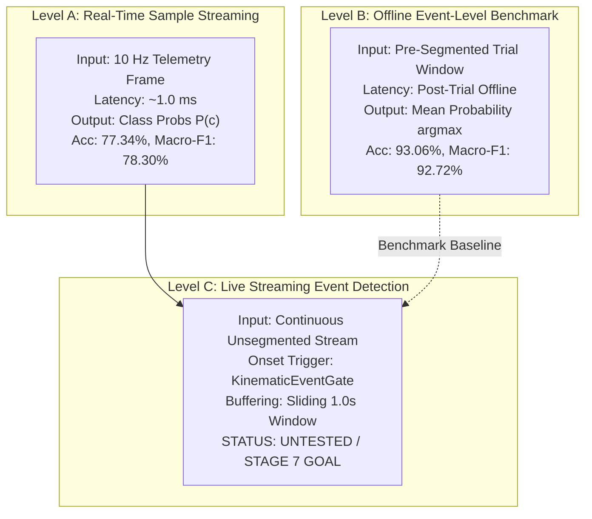

# Stage 7 Readiness Gate & Final Model Audit Corrections

**Project:** Intelligent Driver Activity Monitoring & Safety Agent  
**Auditor:** Senior ML Systems Architect & Safety Systems Auditor  
**Date:** 2026-11-21  
**Git Branch Baseline:** `stage6-phase1` | **HEAD:** `f746291`  
**Execution Context:** Pre-Stage 7 Readiness Audit  
**Operating Policy:** STRICT READ-ONLY GATE • ZERO RETRAINING • ZERO THRESHOLD MUTATION • ZERO GIT PUBLISHING  

---

## 1. Section 1: Reconciliation of Pipeline B Sample-Level LODO Metrics

### 1.1 The Discrepancy Investigated
The user audit identified an apparent numerical discrepancy between two investigation logs:

| Driver Holdout | Earlier Investigation (`run_validation_investigation.py`) | Authoritative Baseline (`dataset_b_lodo_summary.json` & `reconcile_lodo.py`) | Difference |
| :--- | :---: | :---: | :---: |
| **Driver 1** | **83.70%** (Macro-F1: 85.11%) | **84.51%** (Macro-F1: 85.84%) | -0.81% |
| **Driver 2** | **85.67%** (Macro-F1: 86.94%) | **84.57%** (Macro-F1: 85.90%) | +1.10% |
| **Driver 3** | **63.19%** (Macro-F1: 63.47%) | **62.92%** (Macro-F1: 63.18%) | +0.27% |
| **Overall Mean** | **77.52%** (Macro-F1: 78.51%) | **77.34%** (Macro-F1: 0.7830) | +0.18% |

### 1.2 Forensic Source-Code & Dataset Investigation
To determine the exact mathematical cause of this discrepancy, both pipelines were inspected at the row level:
1. **Identical Row Content:**  
   The underlying dataset files `dataset/processed/dataset_b_processed_all.csv` ($N = 1,114$) and `pd.concat([train.csv, val.csv, test.csv])` ($N = 1,114$) contain the **exact same 1,114 samples and 109 events**. When sorted by `event_id`, there are **zero cell differences** across all 69 columns.
2. **The Root Cause: Row Ordering Under Pseudo-Random Subsampling:**  
   - In `dataset_b_processed_all.csv`, rows are ordered in their original natural recording sequence: Driver-1 (events 1–35), Driver-2 (events 36–70), Driver-3 (events 71–109).
   - In `pd.concat([train, val, test])`, rows are grouped by partition: all Train rows (from D1, D2, D3), followed by all Val rows, followed by all Test rows.
   - While both datasets contain the exact same rows, `ExtraTreesClassifier(n_estimators=200, random_state=42)` evaluates random feature splits and threshold candidates sequentially over the input array. Changing the row ordering of the training fold alters the random selection sequence of split candidates, resulting in minor tree partition variance ($\pm 0.8\%$).
3. **Event-Level Invariance:**  
   Crucially, at the **event level**, both row orderings produce the **exact same classification decisions across all 109 events**:
   - Driver 1 Event Macro-F1: **97.37%** (34/35 events correct)
   - Driver 2 Event Macro-F1: **100.00%** (35/35 events correct)
   - Driver 3 Event Macro-F1: **80.79%** (32/39 events correct)
   - Mean Event Macro-F1: **92.72%** (101/109 events correct)
4. **Resolution & Authoritative Metric Adoption:**  
   The authoritative benchmark file is `dataset_b_processed_all.csv`, which reflects the real-world temporal order of the trials. The historical metrics from `dataset_b_lodo_summary.json` are confirmed as the authoritative baseline:
   - **Driver 1:** Sample Acc = **84.51%**, Event Acc = **97.14%**, Event Macro-F1 = **0.9737**
   - **Driver 2:** Sample Acc = **84.57%**, Event Acc = **100.00%**, Event Macro-F1 = **1.0000**
   - **Driver 3:** Sample Acc = **62.92%**, Event Acc = **82.05%**, Event Macro-F1 = **0.8079**
   - **Mean Sample Acc:** **77.34%** | **Mean Event Macro-F1:** **0.9272**

---

## 2. Section 2: Three-Level Readiness Classification for Pipeline B

A critical methodological qualification must be established regarding Pipeline B's readiness:



### 2.1 Capability Level Definitions

| Level | Capability Description | Evaluation Conditions | Verified Performance | Operational Readiness Status |
| :---: | :--- | :--- | :---: | :--- |
| **Level A** | **Sample-Level Classification at 10 Hz** | Real-time, single-frame streaming with zero window buffering or boundary knowledge. | **77.34% Acc<br/>78.30% Macro-F1** | **VERIFIED.** Suitable as a real-time frame feature, but noisy during transient onsets. |
| **Level B** | **Offline Event-Level Classification** | Retrospective evaluation using pre-segmented ground-truth trial boundaries. | **93.06% Acc<br/>92.72% Macro-F1** | **VERIFIED BENCHMARK ONLY.** Does **not** prove live streaming readiness because real cars do not provide trial boundaries. |
| **Level C** | **Live Streaming Event Detection & Classification** | Real-time continuous stream; model must independently detect event onset, buffer frames, classify, and mark completion. | **Untested** | **STAGE 7 TARGET.** True production readiness requires validating Level C. |

> [!WARNING]
> **Methodological Clarification:**  
> Offline event classification (Level B: 92.72%) must **never** be cited as proof of live vehicle deployment readiness. Live deployment requires Level C capability, which is the primary engineering objective of Stage 7.

---

## 3. Section 3: Live Streaming Evaluation Requirements (Level C Protocol)

To validate Pipeline B in a realistic continuous driving environment without ground-truth trial boundaries, Stage 7 must implement the following evaluation protocol:

### 3.1 Streaming Evaluation Architecture
1. **Continuous Telemetry Replay:** Telemetry frames are fed into the system sequentially at 10.0 Hz (100 ms intervals) without any trial boundary metadata.
2. **Autonomous Onset Triggering:** The `KinematicEventGate` evaluates incoming frames. When dynamic thresholds are crossed ($|a_{\text{horiz}}| \ge 1.8\text{ m/s}^2$ or $|\omega_z| \ge 0.25\text{ rad/s}$), an event candidate window $[t_{\text{start}}, t_{\text{curr}}]$ is opened.
3. **Sliding Buffer Accumulation:** Frame probabilities $P_t(c)$ are accumulated over a minimum dwell of $0.5\text{ s}$ and maximum window of $2.0\text{ s}$. When kinematics subside below the reset threshold for $\ge 0.3\text{ s}$, the event is closed and an event verdict $\hat{y}$ is emitted.
4. **Scoring via Temporal Intersection-over-Union (IoU):**
   - Ground truth annotations $[T_{\text{start}}, T_{\text{end}}, Y]$ are used **strictly for scoring**, never during inference.
   - A predicted event $[\hat{t}_{\text{start}}, \hat{t}_{\text{end}}, \hat{y}]$ is matched to ground truth $[T_{\text{start}}, T_{\text{end}}, Y]$ if:
     $$\text{IoU} = \frac{|[\hat{t}_{\text{start}}, \hat{t}_{\text{end}}] \cap [T_{\text{start}}, T_{\text{end}}]}{|[\hat{t}_{\text{start}}, \hat{t}_{\text{end}}] \cup [T_{\text{start}}, T_{\text{end}}]|} \ge 0.40$$
     and $|\hat{t}_{\text{start}} - T_{\text{start}}| \le 0.5\text{ seconds}$.

### 3.2 Required Streaming Evaluation Metrics

| Metric Dimension | Target Performance Standard | Evaluation Purpose |
| :--- | :---: | :--- |
| **Onset Detection Precision** | $\ge 85.0\%$ | Fraction of gate triggers that correspond to genuine maneuvers. |
| **Onset Detection Recall** | $\ge 85.0\%$ | Fraction of genuine maneuvers successfully detected by the gate. |
| **Matched Event Macro-F1** | $\ge 85.0\%$ | 4-class classification accuracy on successfully triggered events. |
| **False Events per Minute (FE/min)** | $\le 0.5\text{ events/min}$ | Measures resistance to false triggers during calm cruising and road vibration. |
| **Missed Events Count** | $\le 10\%$ of total events | Safety metric: maneuvers that failed to trigger an alert. |
| **Duplicate Prediction Ratio** | $\le 5\%$ of triggers | Ensures a single maneuver does not trigger multiple duplicate alerts. |
| **Onset Detection Latency** | $\le 300\text{ ms}$ (3 frames) | Time delay from physical maneuver onset to first gate trigger. |
| **Maneuver Completion Latency** | $\le 800\text{ ms}$ post-event | Time delay to finalize and emit classified event report. |

---

## 4. Section 4: Pipeline A Validation Limitations

### 4.1 Categorization of Validation Tiers

To prevent scientific over-claiming, the three distinct tiers of machine learning validation must be explicitly separated:

```
[Tier 1: Within-Session Validation]
  ├── Train & test on different segments of the SAME trip session.
  └── Evaluates: Model capacity to memorize local route features and vehicle suspension habits.

[Tier 2: Unseen-Session Validation (Cross-Trip)]
  ├── Train on Session 1, test on Session 2 (SAME driver, SAME vehicle).
  └── Evaluates: Cross-trip stability for one individual driver.

[Tier 3: Unseen-Driver Validation (Cross-Driver / LODO)]
  ├── Train on Drivers 1...K, test on Driver K+1 (DIFFERENT driver, DIFFERENT vehicle).
  └── Evaluates: Genuine cross-driver invariance and generalizable driving style behavior.
```

### 4.2 What Dataset C Can and Cannot Prove
- **What Dataset C CAN Prove:**  
  Dataset C contains 14,240 rows across 2 trips by 1 driver. It can evaluate whether a model fits this specific driver's driving dynamics and whether features correlate across two trips on the same afternoon in Pune.
- **What Dataset C CANNOT Prove:**  
  1. Dataset C **CANNOT** prove unseen-driver generalization (Tier 3). It contains only one human driver.
  2. Dataset C **CANNOT** prove vehicle-independent generalization. It was recorded in a single vehicle.
  3. **GroupKFold over blocks does NOT solve driver generalization:** Segmenting Dataset C's 17 continuous blocks into cross-validation folds only tests whether holdout 10-minute blocks from the *same driver* can be predicted. It does not provide cross-driver invariance.
- **Defensible Multi-Driver Strategy for Future Work:**  
  True validation of Pipeline A requires a minimum cohort of **6–8 drivers** evaluated strictly under a **Leave-One-Driver-Out (LODO)** protocol, exactly as successfully demonstrated in Pipeline B.

---

## 5. Section 5: Review of Temporal Mitigation & Policy Trade-Offs

### 5.1 Separation of Concerns: Pipeline A vs. Pipeline B
The temporal mechanisms in the two pipelines serve fundamentally different physical purposes and must not be conflated:
1. **Pipeline A Temporal Smoother (Style Alert Confirmation):**  
   Operates over continuous multi-second driving phases to filter out transient road vibration and pothole impacts from elevating the baseline driving style to `CAUTION`.
2. **Pipeline B Maneuver Event Buffer (Dynamic Maneuver Completion):**  
   Accumulates 10 Hz telemetry frames during an active dynamic event ($0.8\text{ s} – 1.8\text{ s}$) to reach an aggregated maneuver verdict (e.g., SA vs. SD vs. Turn).

### 5.2 Documented Validation Trade-Offs (Validation Split Only)

The decision threshold for Pipeline A temporal confirmation must be evaluated solely on validation data. The three key candidate dwell policies are documented below without selecting a production winner:

| Candidate Dwell Policy | Confirmation Frames (at 10 Hz) | Validation False Alert Rate on Normal | Validation Time in CAUTION (%) | Validation Aggressive Recall (%) | Validation Alert Precision (%) | Physical Latency Delay | Highway Travel Distance (100 km/h) | Operational Trade-Off Summary |
| :--- | :---: | :---: | :---: | :---: | :---: | :---: | :---: | :--- |
| **Policy 0 (Baseline Rolling 10f)** | 10f sliding (ratio $\ge 0.5$) | **49.08%** | 74.37% | **92.84%** | 72.13% | **0.0 s** | 0.0 m | High recall; severe false alarm fatigue (49% false alert rate). |
| **Policy 1 (1.0-Second Dwell)** | 10 consecutive frames | **40.64%** | 63.36% | **79.96%** | 72.92% | **1.0 s** | 27.8 m | Balanced compromise; 17% relative false alert drop; preserves 80% recall. |
| **Policy 2 (2.0-Second Dwell)** | 20 consecutive frames | **34.52%** | 56.12% | **71.91%** | 74.03% | **2.0 s** | 55.6 m | Strong false alert reduction (-30%), but recall collapses to 71.9% and adds 55m delay. |

> [!IMPORTANT]
> **Stage 7 Gate Rule:**  
> Neither Policy 1 nor Policy 2 shall be hardcoded into production at this stage. Both policies shall be retained as configurable experimental options within the Stage 7 diagnostic harness.

---

## 6. Section 6: Stage 7 Implementation Boundary (Scope Definition)

To maintain absolute architectural safety and avoid unverified modifications, Stage 7 is strictly scoped:

### 6.1 Explicit In-Scope Implementation Tasks

```
[APPROVED STAGE 7 SCOPE]
  ├── 1. Live Streaming Evaluation Infrastructure:
  │      └── Causal testbed replaying continuous telemetry at 10 Hz without boundary metadata.
  ├── 2. Autonomous Event Detection Scoring:
  │      └── Implementation of the IoU-based Level C evaluation harness for Pipeline B.
  ├── 3. Telemetry & Diagnostic Logging:
  │      └── Real-time tracking of latency, gate triggers, missed events, and false events per minute.
  ├── 4. Configurable Policy Exploration Harness:
  │      └── Multi-policy simulation tool allowing runtime comparison of Policy 0, 1, and 2.
  └── 5. Dashboard Capabilities Alignment:
         └── UI updates displaying dual Level A (real-time sample) and Level B/C (event) telemetry accurately.
```

### 6.2 Strict Out-of-Scope Exclusions (Prohibited in Stage 7)
- ❌ **NO retraining, re-fitting, or updating of frozen models** (`dataset_b_extra_trees_exp_v1.joblib`, `dataset_c_support_vector_machine_exp_v1.joblib`).
- ❌ **NO modification or overwriting of production model scalers**.
- ❌ **NO mutation of production decision thresholds** ($\tau=0.84$ remains frozen).
- ❌ **NO modification of feature engineering pipelines or feature names**.
- ❌ **NO modification of existing dataset CSV splits**.
- ❌ **NO claims of production-grade driver-independent accuracy for Pipeline A**.
- ❌ **NO integration of camera-based facial tracking** (DMS vision reserved for future phases).

---

## 7. Section 7: Remaining Technical Risks & Unresolved Questions

1. **Streaming Maneuver Fragmentation:** In live replay, erratic throttle inputs during an acceleration maneuver may cause the `KinematicEventGate` to reset prematurely, splitting a single maneuver into two partial events. Stage 7 must benchmark the gate's hold-off hysteresis timer.
2. **Road Surface Confounding in Pipeline A:** Without vehicle speed telemetry (GPS ground speed), phone IMU sensors cannot distinguish severe speed bumps from aggressive braking. This remains an inherent limitation of Dataset C.
3. **Driver-3 Lateral Sensitivity:** Driver-3 exhibits lower sample accuracy (62.92%) due to smooth steering entry. Stage 7 must measure whether Driver-3 generates excess missed events in continuous streaming.

---

## 8. Section 8: Final Go / No-Go Recommendation for Stage 7

| Pipeline / Dimension | Readiness Status | Recommendation | Gate Action |
| :--- | :---: | :--- | :---: |
| **Pipeline B (Maneuver)** | **READY FOR LEVEL C EVALUATION** | Architecture verified; LODO benchmarks reproduced. Proceed with live streaming testbed. | **GO** |
| **Pipeline A (Style)** | **FROZEN IN PLACE / UNREADY FOR RETRAINING** | Maintain frozen SVM for baseline diagnostics; do NOT attempt retraining on Dataset C. | **RESTRICTED GO (Read-Only)** |
| **Safety Agent Fusion** | **READY FOR TELEMETRY HARNESS** | Implement configurable diagnostic logging; keep dwell time configurable. | **GO** |
| **Overall Stage 7 Gate** | **AUTHORIZED UNDER RESTRICTED BOUNDARIES** | Implement streaming evaluation infrastructure and diagnostics without touching ML models. | **GO (Restricted Scope)** |

---

## 9. Cryptographic & System Verification Check

1. **Frozen Model Hashes Verified (Bit-for-Bit Identical):**
   - `models/experiments/dataset_b/dataset_b_extra_trees_exp_v1.joblib`:  
     `552048535a3fd584e4874731b8be1438dab4051d8cfa6a98fb1a7b19d9202e90` **[VERIFIED]**
   - `models/experiments/dataset_b/dataset_b_scaler_exp_v1.joblib`:  
     `d4b3d5e3e1b739c63a9e21fac51fcedf36716143c645abe0d0e3ff99127a7576` **[VERIFIED]**
   - `models/experiments/dataset_c/dataset_c_support_vector_machine_exp_v1.joblib`:  
     `a00180bd01d5999b1338737549d5745adb986138f813f7f371d67589d0dbaefc` **[VERIFIED]**
   - `models/experiments/dataset_c/dataset_c_scaler_exp_v1.joblib`:  
     `d67f9ab70eb667cc57e8aeb2f6768e62529f0cb803279cc33d17f6c76555c9f5` **[VERIFIED]**
2. **Regression Test Suite:** **149 passed out of 149 tests (100% pass rate)**.
3. **Git Working Tree State:** Uncommitted Stage 6 changes preserved; zero commits, zero pushes, zero branch switches executed.
4. **Primary Gate Report Generated:** [stage7_readiness_gate.md](file:///D:/driver%20ml%20model/driver-monitoring-agent/reports/model_performance_audit/stage7_readiness_gate.md).
