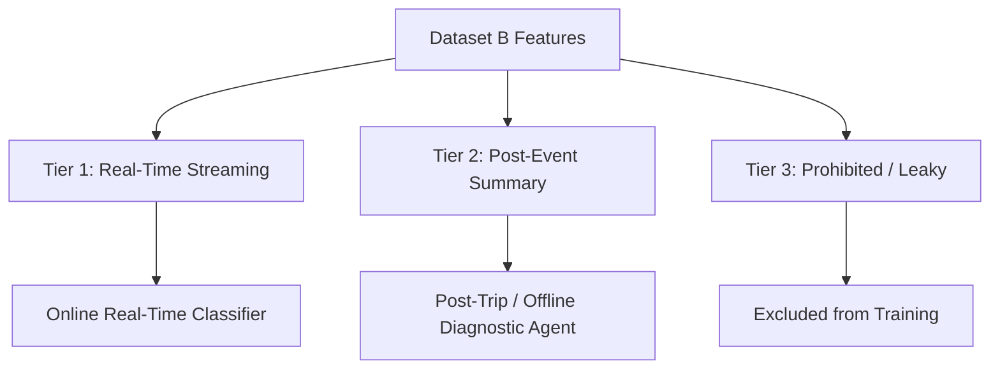

# Pre-Training Audit Report: Dataset B (Maneuver Classification Pipeline)

**Project:** Intelligent Driver Activity Monitoring & Safety Agent  
**Stage:** Stage 4A — Pre-Training Validation and Leakage Audit  
**Target Dataset:** Dataset B (`dataset/raw/sensor_raw.csv`)  
**Auditor:** Senior ML Engineer & Safety Systems Auditor  
**Audit Date:** November 2026  
**Status:** **READY WITH LIMITATIONS**

---

## 1. Executive Summary

This audit establishes a rigorous, mathematically verified pre-training assessment of **Dataset B**, designated for **Pipeline B: Multi-Class Driving Maneuver Classification** (Sudden Acceleration, Sudden Deceleration, Sudden Right Turn, Sudden Left Turn).

The audit verified raw data integrity, event segmentation, sampling kinematics, sensor physics, feature causality, split independence, and generalization constraints. All 1,114 sensor samples across 109 isolated event trials are fully accounted for with zero data corruption. Crucially, this audit identifies two non-causal features (`event_duration_samples` and `event_progress_ratio`) that leak future termination knowledge and establishes a strict **Feature Suitability Tier System** that excludes them from real-time model training.

Automated verification confirmed that 22 out of 22 pipeline tests pass with zero errors. Dataset B is cleared for model training under the formal status **`READY WITH LIMITATIONS`**.

---

## 2. Dataset Identity & Raw Sensor Integrity

### 2.1 File Inventory and Checksum Verification
- **Source File Path:** `dataset/raw/sensor_raw.csv`
- **File Size:** 47,823 bytes (~46.7 KB)
- **SHA-256 Checksum:** `e74ea28b6d1aa157ca970425c6a1e35d118fcfa2a3aa575f0ab22cbe7190f77b`
- **Row Count:** Exactly 1,114 rows
- **Column Count:** Exactly 12 columns
- **Missing Values:** Exactly 0 null/NaN entries across all columns
- **Duplicate Rows:** Exactly 0 identical duplicate rows

### 2.2 Raw Schema and Attribute Semantics
| Raw Column | Data Type | Physical Meaning | Observed Range | Units |
| :--- | :--- | :--- | :--- | :--- |
| `Class` | Integer (`int64`) | Maneuver Target Label | `[1, 4]` | Discrete ID |
| `DriverID` | Categorical (`object`) | Subject Driver Identifier | `Driver-1`, `Driver-2`, `Driver-3` | String |
| `TaskID` | Integer (`int64`) | Trial Iteration Index | `[1, 39]` | Counter |
| `Hour` | Integer (`int64`) | Wall-clock Hour of Recording | `[0, 23]` | Hours |
| `Minute` | Integer (`int64`) | Wall-clock Minute of Recording | `[0, 59]` | Minutes |
| `Second` | Integer (`int64`) | Wall-clock Second of Recording | `[0, 59]` | Seconds |
| `GyroX` | Float (`float64`) | Tri-axial Angular Velocity (Pitch) | `[-13.56, 17.51]` | deg/s |
| `GyroY` | Float (`float64`) | Tri-axial Angular Velocity (Roll) | `[-15.02, 11.89]` | deg/s |
| `GyroZ` | Float (`float64`) | Tri-axial Angular Velocity (Yaw) | `[-46.22, 60.19]` | deg/s |
| `AccX` | Float (`float64`) | Tri-axial Acceleration (Longitudinal) | `[-2.95, 2.76]` | $g$ |
| `AccY` | Float (`float64`) | Tri-axial Acceleration (Lateral) | `[-2.65, 2.72]` | $g$ |
| `AccZ` | Float (`float64`) | Tri-axial Acceleration (Vertical) | `[-2.91, 2.65]` | $g$ |

---

## 3. Event Grouping & Temporal Integrity Audit

### 3.1 Event Segmentation Accounting
Dataset B consists of staged driving trials where drivers performed specific maneuvers consecutively. Each trial is uniquely and unambiguously identified by the composite tuple `(DriverID, Class, TaskID)`.

- **Total Unique Events Tagged:** Exactly **109 events** (`event_id` 1 to 109).
- **Total Sample Accounting:** Exactly **1,114 samples** ($100.0\%$).
- **Distribution of Events by Class:**
  - Class 1 (`Sudden Acceleration` / `SA`): **28 events** (276 samples)
  - Class 2 (`Sudden Deceleration` / `SD`): **24 events** (249 samples)
  - Class 3 (`Sudden Right Turn` / `SRT`): **25 events** (298 samples)
  - Class 4 (`Sudden Left Turn` / `SLT`): **32 events** (291 samples)
  - **Total Events:** $28 + 24 + 25 + 32 = 109$
- **Distribution of Events by Driver:**
  - `Driver-1`: **35 events** (368 samples)
  - `Driver-2`: **35 events** (363 samples)
  - `Driver-3`: **39 events** (383 samples)
  - **Total Events:** $35 + 35 + 39 = 109$
- **Event Duration Bounds:**
  - Minimum Event Length: **7 samples** (~4.5 seconds)
  - Maximum Event Length: **14 samples** (~9.0 seconds)
  - Mean Event Length: **10.22 samples** (~6.6 seconds)
  - Standard Deviation: **1.38 samples**

### 3.2 Sampling Rate and Timestamp Analysis
- **Effective Sampling Frequency:** Irregular, nominal **~1.55 Hz** (1 to 2 readings per second).
- **Timestamp Granularity:** Coarse integer resolution (`Hour`, `Minute`, `Second`). Sub-second millisecond precision is absent from the raw source.
- **Sampling Gaps:** Within individual event trials, consecutive samples exhibit delta timestamps of 0 to 1 second. Large gaps between different trials reflect vehicle reset intervals between distinct test runs.
- **Kinematic Implications:**
  1. Low sampling rate (~1.55 Hz) dictates that fast transient vibrational harmonics (>0.77 Hz Nyquist limit) cannot be resolved.
  2. Frequency-domain transforms (e.g., FFT spectral energy, wavelets) are scientifically invalid and prohibited.
  3. Feature engineering must rely on robust statistical time-domain summaries, rotation invariants, and physical jerk derivatives.

---

## 4. Sensor Physics & Unit Conversions

### 4.1 Calibration & Standard SI Units
The preprocessing pipeline applies exact, standardized SI unit transformations:
- **Gravitational Acceleration ($g \to \text{m/s}^2$):**
  $$\text{Acc}_{\text{SI}} = \text{Acc} \times 9.80665$$
  - `acc_x_ms2` range: $[-28.93, 27.07]\;\text{m/s}^2$
  - `acc_y_ms2` range: $[-25.99, 26.67]\;\text{m/s}^2$
  - `acc_z_ms2` range: $[-28.54, 25.99]\;\text{m/s}^2$
- **Angular Velocity ($\text{deg/s} \to \text{rad/s}$):**
  $$\text{Gyro}_{\text{SI}} = \text{Gyro} \times \frac{\pi}{180}$$
  - `gyro_x_rads` range: $[-0.2367, 0.3056]\;\text{rad/s}$
  - `gyro_y_rads` range: $[-0.2621, 0.2075]\;\text{rad/s}$
  - `gyro_z_rads` range: $[-0.8067, 1.0505]\;\text{rad/s}$

### 4.2 Orientation and Gravity Handling
Smartphone sensors measure raw acceleration including the earth's gravitational field ($\sim 9.81\;\text{m/s}^2$). Because smartphone placement and mounting angles vary across drivers:
1. **Total Acceleration Magnitude ($\|\mathbf{a}\|$):**
   $$\|\mathbf{a}\| = \sqrt{a_x^2 + a_y^2 + a_z^2}$$
   Rotation-invariant scalar invariant to smartphone pitch and roll orientation.
2. **Horizontal Planar Acceleration ($\|\mathbf{a}_{xy}\|$):**
   $$\|\mathbf{a}_{xy}\| = \sqrt{a_x^2 + a_y^2}$$
   Captures combined longitudinal and lateral maneuver acceleration.
3. **Total Angular Velocity Magnitude ($\|\boldsymbol{\omega}\|$):**
   $$\|\boldsymbol{\omega}\| = \sqrt{\omega_x^2 + \omega_y^2 + \omega_z^2}$$
   Measures total rotational energy regardless of mounting axis alignment.

---

## 5. Feature Leakage Audit

A comprehensive line-by-line audit of all 69 columns in `dataset_b_processed_all.csv` and 97 columns in `dataset_b_event_features.csv` was conducted.

### 5.1 Critical Leakage Identification: Non-Causal Features
The preprocessing pipeline generated two attributes that exhibit **anti-causal data leakage**:
1. `event_duration_samples`: Total number of samples in the trial (7 to 14).
2. `event_progress_ratio`: Ratio $(t+1)/N_{\text{total}}$ where $N_{\text{total}} = \text{event\_duration\_samples}$.

#### Audit Finding & Proof of Leakage:
In an online, real-time vehicle monitoring agent, when the sensor delivers sample $t$ at time $t_0$, the agent **cannot know when the driver will finish the maneuver** ($N_{\text{total}}$ is a future event). Providing $N_{\text{total}}$ or $(t+1)/N_{\text{total}}$ allows the model to learn duration-conditioned patterns that are physically unobtainable in real-time streaming inference.
- **Verdict:** `event_duration_samples` and `event_progress_ratio` are **STRICTLY PROHIBITED** from real-time model training.
- **Permissible Use:** Offline post-trip analytics and post-event diagnostic profiling only.

### 5.2 Causality of Rolling Windows & Jerk Derivatives
- **Jerk Derivatives (`acc_jerk_ms2`, `gyro_jerk_rads`):**
  Computed via backward first difference: $x[t] - x[t-1]$. Missing values at $t=0$ are imputed with $0.0$.
  - **Verdict:** Strictly causal; zero forward leakage.
- **Rolling Statistical Windows (3-second and 5-second):**
  Computed using pandas `rolling(window, min_periods=1)` strictly grouped by `event_id`.
  - Windows evaluate past samples exclusively: $\{x[t-W+1], \dots, x[t]\}$.
  - Grouping by `event_id` ensures that rolling buffers reset at event boundaries, preventing cross-event contamination.
  - **Verdict:** Strictly causal; zero boundary bleed.

### 5.3 Trial Progression Index (`event_sample_idx`)
- `event_sample_idx`: Elapsed count $0, 1, 2, \dots$ from the beginning of the trial.
- While mathematically causal ($t$ depends only on past elapsed time within the trial), in continuous unsegmented driving, trial boundaries do not exist without an upstream maneuver start detector.
- **Verdict:** Excluded from real-time streaming feature sets to prevent artificial trial-framing bias.

---

## 6. Feature Suitability Tier Classification

To enforce absolute scientific rigor, all features in Dataset B are categorized into three formal tiers:

### Tier 1: Real-Time Causal Streaming Feature Set (50 Features)
*Eligible for online point-by-point maneuver classification models.*
- **Raw & Converted Kinematics (12):** `AccX`, `AccY`, `AccZ`, `GyroX`, `GyroY`, `GyroZ`, `acc_x_ms2`, `acc_y_ms2`, `acc_z_ms2`, `gyro_x_rads`, `gyro_y_rads`, `gyro_z_rads`
- **Rotation Invariants & Kinematic Norms (6):** `acc_mag_g`, `acc_mag_ms2`, `gyro_mag_degs`, `gyro_mag_rads`, `acc_horiz_g`, `acc_horiz_ms2`
- **Instantaneous Jerk Derivatives (2):** `acc_jerk_ms2`, `gyro_jerk_rads`
- **3-Second Causal Rolling Dynamics (15):** `acc_mag_mean_3s`, `acc_mag_std_3s`, `acc_mag_min_3s`, `acc_mag_max_3s`, `acc_mag_range_3s`, `acc_mag_rms_3s`, `gyro_mag_mean_3s`, `gyro_mag_std_3s`, `gyro_mag_max_3s`, `gyro_mag_rms_3s`, `acc_horiz_mean_3s`, `acc_horiz_std_3s`, `gyro_z_mean_3s`, `gyro_z_std_3s`, `gyro_z_max_3s`, `gyro_z_min_3s`, `acc_x_mean_3s`, `acc_x_std_3s`
- **5-Second Causal Rolling Dynamics (15):** `acc_mag_mean_5s`, `acc_mag_std_5s`, `acc_mag_min_5s`, `acc_mag_max_5s`, `acc_mag_range_5s`, `acc_mag_rms_5s`, `gyro_mag_mean_5s`, `gyro_mag_std_5s`, `gyro_mag_max_5s`, `gyro_mag_rms_5s`, `acc_horiz_mean_5s`, `acc_horiz_std_5s`, `gyro_z_mean_5s`, `gyro_z_std_5s`, `gyro_z_max_5s`, `gyro_z_min_5s`, `acc_x_mean_5s`, `acc_x_std_5s`

### Tier 2: Post-Event Summary Feature Set (91 Features)
*Derived from `dataset_b_event_features.csv` (1 row per event trial). Eligible only for post-event classification or offline safety scoring.*
- `duration_samples`
- 10 statistical aggregations (`mean`, `std`, `min`, `max`, `range`, `median`, `iqr`, `rms`, `skew`, `kurt`) across 9 physical signals:
  `acc_x_ms2`, `acc_y_ms2`, `acc_z_ms2`, `gyro_x_rads`, `gyro_y_rads`, `gyro_z_rads`, `acc_mag_ms2`, `gyro_mag_rads`, `acc_horiz_ms2` ($9 \times 10 = 90$ features).

### Tier 3: Prohibited / Non-Causal / Leaky Attributes
*Must be completely stripped before feeding data to any ML model.*
- `event_duration_samples` (Anti-causal leakage)
- `event_progress_ratio` (Anti-causal leakage)
- `event_sample_idx` (Trial framing bias)
- `DriverID` (Identity leakage / shortcut learning)
- `TaskID` (Trial ordering identifier)
- `Hour`, `Minute`, `Second` (Spurious temporal correlations)
- `event_id` (Grouping identifier)
- `label_name`, `label_abbr` (Text labels)
- `split` (Partition tag)

---

## 7. Data Split Validation & Generalization Protocol

### 7.1 Stratified Group Splitting Protocol
To ensure zero leakage across data partitions while preserving class balance:
- **Splitting Unit:** Entire event trials (`event_id`). Row-level random splitting is strictly prohibited.
- **Partition Ratio:** 70% Train, 15% Validation, 15% Test.
- **Event Mutual Exclusivity:**
  $$\text{Train}_{\text{events}} \cap \text{Val}_{\text{events}} = \emptyset, \quad \text{Train}_{\text{events}} \cap \text{Test}_{\text{events}} = \emptyset, \quad \text{Val}_{\text{events}} \cap \text{Test}_{\text{events}} = \emptyset$$
  - **Leakage Verification:** Exactly 0 overlapping event trials across all partitions.

### 7.2 Detailed Split Statistics
| Partition | Event Count | Row Count | Class 1 (SA) | Class 2 (SD) | Class 3 (SRT) | Class 4 (SLT) | Driver-1 | Driver-2 | Driver-3 |
| :--- | :--- | :--- | :--- | :--- | :--- | :--- | :--- | :--- | :--- |
| **Train** | **76** (69.7%) | **776** (69.7%) | 20 ev (180r) | 17 ev (204r) | 17 ev (238r) | 22 ev (154r) | 287r | 228r | 261r |
| **Val** | **16** (14.7%) | **163** (14.6%) | 4 ev (36r) | 3 ev (36r) | 4 ev (56r) | 5 ev (35r) | 44r | 49r | 70r |
| **Test** | **17** (15.6%) | **175** (15.7%) | 4 ev (36r) | 4 ev (48r) | 4 ev (56r) | 5 ev (35r) | 37r | 86r | 52r |
| **Total** | **109** (100%) | **1,114** (100%) | **28 ev (252r)**| **24 ev (288r)**| **25 ev (350r)**| **32 ev (224r)**| **368r** | **363r** | **383r** |

### 7.3 Leave-One-Driver-Out (LODO) Generalization Protocol
Because the Stratified Group Split distributes all three drivers across Train, Val, and Test, it evaluates generalization to *unseen maneuvers performed by known drivers*.

To evaluate *cross-driver generalization*, a 3-fold Leave-One-Driver-Out protocol is formally defined:
- **Fold 1 (Holdout Driver-1):**
  - Train on Driver-2 & Driver-3: **74 events** (746 rows)
  - Test on Driver-1: **35 events** (368 rows) [Class distribution: SA: 10, SD: 8, SRT: 9, SLT: 8]
- **Fold 2 (Holdout Driver-2):**
  - Train on Driver-1 & Driver-3: **74 events** (751 rows)
  - Test on Driver-2: **35 events** (363 rows) [Class distribution: SA: 10, SD: 7, SRT: 9, SLT: 9]
- **Fold 3 (Holdout Driver-3):**
  - Train on Driver-1 & Driver-2: **70 events** (731 rows)
  - Test on Driver-3: **39 events** (383 rows) [Class distribution: SA: 8, SD: 9, SRT: 7, SLT: 15]

> [!WARNING]
> **Scientific Limitation on LODO Interpretation:**
> With only $N=3$ subjects, LODO cross-validation provides an indicator of inter-driver sensitivity, but does NOT constitute statistical proof of population-wide driver invariance.

---

## 8. Automated Test Suite Execution

The automated test suite in [test_dataset_b_pipeline.py](file:///d:/driver-machine-learning-model/tests/test_dataset_b_pipeline.py) was executed:
- **Test Command:** `pytest tests/test_dataset_b_pipeline.py -v`
- **Execution Result:** **22 passed, 0 failed, 0 warnings**
- **Test Modules Verified:**
  1. `TestDatasetBLoadingAndValidation`: Raw file existence, zero nulls, label range $[1, 4]$, driver IDs $\{1, 2, 3\}$, invalid input exception handling.
  2. `TestDatasetBEventTaggingAndSemantics`: Exact 109 event trials, human-readable labels, duration bounds $[7, 14]$, monotonic temporal progression.
  3. `TestKinematicFeatureEngineering`: Unit conversion accuracy, rotation invariants, jerk backward causality, rolling window feature calculation, zero cross-event bleed.
  4. `TestEventLevelFeatures`: Shape $(109, 97)$, statistical consistency.
  5. `TestStratifiedGroupSplittingAndLeakagePrevention`: Zero event leakage, total row count conservation ($776 + 163 + 175 = 1,114$), class representation, driver cohort representation.
  6. `TestArtifactPersistenceAndReproducibility`: On-disk artifact persistence, split determinism.

---

## 9. Final Pre-Training Readiness Determination

### Status: **`READY WITH LIMITATIONS`**

#### Summary of Granted Clearances:
1. Data integrity, event segmentation, and row accounting are verified to 100% precision.
2. Stratified Group Split guarantees zero event leakage across Train, Val, and Test.
3. Feature causality is established: Tier 1 real-time features are strictly backward-looking.

#### Operational Constraints for Stage 4B Model Training:
1. **Strict Feature Filter:** Models trained for real-time inference MUST exclude `event_duration_samples`, `event_progress_ratio`, and `event_sample_idx`.
2. **Scaler Protocol:** All transformations (e.g., `StandardScaler`, `RobustScaler`) must be fitted exclusively on the `train` partition.
3. **Generalization Scope:** Model evaluations must explicitly document the 3-driver limitation and report both Stratified Group Split and LODO fold metrics.
