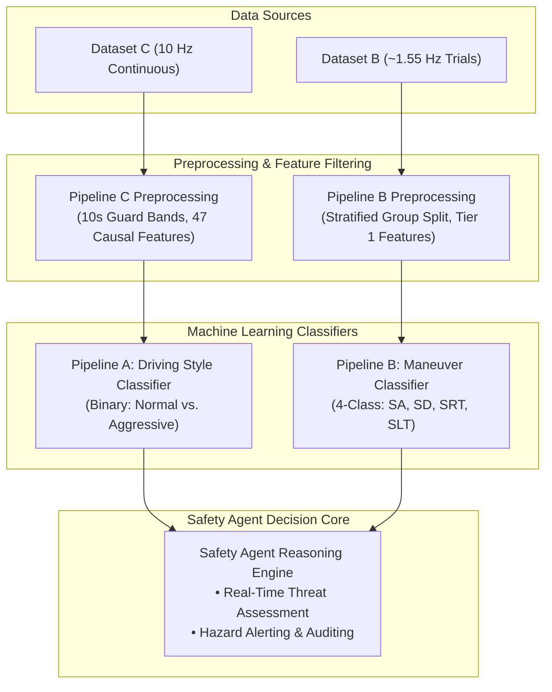
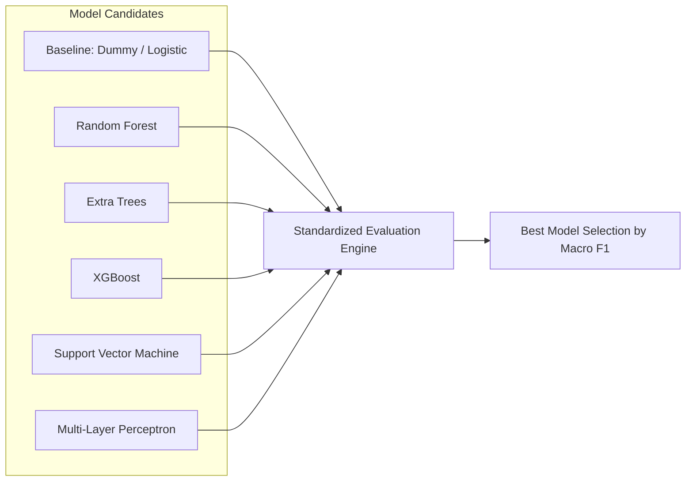

# Model Training Specification: Dual-Pipeline Driver Monitoring System

**Project:** Intelligent Driver Activity Monitoring & Safety Agent  
**Stage:** Stage 4A — Pre-Training Specification & Architecture Blueprint  
**Auditor:** Senior ML Engineer & Safety Systems Architect  
**Specification Date:** November 2026  
**Status:** **APPROVED FOR IMPLEMENTATION (STAGE 4B PENDING USER APPROVAL)**

---

## 1. System Architecture & Dual-Pipeline Decoupling

The Intelligent Driver Activity Monitoring & Safety Agent is architected as a **decoupled, two-tier machine learning pipeline**. The two operational tasks address fundamentally distinct safety questions, operate on distinct temporal scales, and train on distinct, scientifically validated datasets:



### 1.1 Pipeline A: Driving Style Classifier (Dataset C)
- **Objective:** Continuous real-time binary classification of driver behavior into **Normal Driving (`0`)** vs. **Aggressive Driving (`1`)**.
- **Temporal Nature:** High-frequency (10.0 Hz) continuous streaming.
- **Physical Focus:** Sustained longitudinal/lateral acceleration envelopes, continuous yaw rate variance, and rapid jerk impulses.

### 1.2 Pipeline B: Maneuver Classifier (Dataset B)
- **Objective:** Discrete 4-class categorization of specific abrupt driving maneuvers:
  1. `Class 1`: **Sudden Acceleration (`SA`)**
  2. `Class 2`: **Sudden Deceleration (`SD`)**
  3. `Class 3`: **Sudden Right Turn (`SRT`)**
  4. `Class 4`: **Sudden Left Turn (`SLT`)**
- **Temporal Nature:** Low-frequency (~1.55 Hz) event-segmented sensor sequences.
- **Physical Focus:** Directional peak acceleration signatures ($a_x > 0$ vs. $a_x < 0$) and directional yaw rotation rates ($\omega_z > 0$ vs. $\omega_z < 0$).

> [!CAUTION]
> **Dataset Separation Mandate:**
> Dataset B and Dataset C must NEVER be merged. Merging them would corrupt sampling frequencies (1.55 Hz vs. 10.0 Hz), destroy label definitions (discrete maneuvers vs. continuous driving styles), and introduce catastrophic data leakage.

---

## 2. Feature Set Specifications

### 2.1 Pipeline A Feature Set (Dataset C — 47 Features)
All 47 features are strictly causal backward-looking rolling statistics computed over $W \in \{1.0\text{s}, 2.0\text{s}, 3.0\text{s}\}$ lookbacks.

| Category | Count | Feature Names |
| :--- | :--- | :--- |
| **Instantaneous Raw Signals** | 6 | `Acc X`, `Acc Y`, `Acc Z`, `gyro_x`, `gyro_y`, `gyro_z` |
| **Rotation Invariants & Jerk** | 5 | `acc_mag`, `gyro_mag`, `acc_horiz`, `acc_jerk`, `gyro_jerk` |
| **1-Second Rolling Window (10 samples)** | 12 | `acc_mag_mean_1s`, `acc_mag_std_1s`, `acc_mag_max_1s`, `acc_mag_min_1s`, `acc_mag_range_1s`, `gyro_mag_mean_1s`, `gyro_mag_std_1s`, `gyro_mag_max_1s`, `acc_horiz_mean_1s`, `acc_horiz_std_1s`, `gyro_z_std_1s`, `gyro_z_max_1s` |
| **2-Second Rolling Window (20 samples)** | 12 | `acc_mag_mean_2s`, `acc_mag_std_2s`, `acc_mag_max_2s`, `acc_mag_min_2s`, `acc_mag_range_2s`, `gyro_mag_mean_2s`, `gyro_mag_std_2s`, `gyro_mag_max_2s`, `acc_horiz_mean_2s`, `acc_horiz_std_2s`, `gyro_z_std_2s`, `gyro_z_max_2s` |
| **3-Second Rolling Window (30 samples)** | 12 | `acc_mag_mean_3s`, `acc_mag_std_3s`, `acc_mag_max_3s`, `acc_mag_min_3s`, `acc_mag_range_3s`, `gyro_mag_mean_3s`, `gyro_mag_std_3s`, `gyro_mag_max_3s`, `acc_horiz_mean_3s`, `acc_horiz_std_3s`, `gyro_z_std_3s`, `gyro_z_max_3s` |
| **Excluded / Targets** | 3 | `label` (Target), `session` (Metadata), `split` (Partition) |

---

### 2.2 Pipeline B Feature Sets (Dataset B)

#### Tier 1: Real-Time Streaming Feature Set (50 Features)
*Eligible for online point-by-point maneuver inference.*

```
Instantaneous SI Kinematics (12):
  acc_x_ms2, acc_y_ms2, acc_z_ms2, gyro_x_rads, gyro_y_rads, gyro_z_rads,
  AccX, AccY, AccZ, GyroX, GyroY, GyroZ

Rotation Invariants & Vector Norms (6):
  acc_mag_g, acc_mag_ms2, gyro_mag_degs, gyro_mag_rads, acc_horiz_g, acc_horiz_ms2

Temporal Jerk Derivatives (2):
  acc_jerk_ms2, gyro_jerk_rads

3-Second Causal Rolling Features (15):
  acc_mag_mean_3s, acc_mag_std_3s, acc_mag_min_3s, acc_mag_max_3s, acc_mag_range_3s, acc_mag_rms_3s,
  gyro_mag_mean_3s, gyro_mag_std_3s, gyro_mag_max_3s, gyro_mag_rms_3s,
  acc_horiz_mean_3s, acc_horiz_std_3s,
  gyro_z_mean_3s, gyro_z_std_3s, gyro_z_max_3s, gyro_z_min_3s,
  acc_x_mean_3s, acc_x_std_3s

5-Second Causal Rolling Features (15):
  acc_mag_mean_5s, acc_mag_std_5s, acc_mag_min_5s, acc_mag_max_5s, acc_mag_range_5s, acc_mag_rms_5s,
  gyro_mag_mean_5s, gyro_mag_std_5s, gyro_mag_max_5s, gyro_mag_rms_5s,
  acc_horiz_mean_5s, acc_horiz_std_5s,
  gyro_z_mean_5s, gyro_z_std_5s, gyro_z_max_5s, gyro_z_min_5s,
  acc_x_mean_5s, acc_x_std_5s
```

#### Tier 2: Post-Event Summary Feature Set (91 Features)
*Derived from `dataset_b_event_features.csv` (1 row per event trial). Eligible only for post-event classification or offline safety scoring.*
- `duration_samples`
- 10 statistical aggregations (`mean`, `std`, `min`, `max`, `range`, `median`, `iqr`, `rms`, `skew`, `kurt`) across 9 physical signals:
  `acc_x_ms2`, `acc_y_ms2`, `acc_z_ms2`, `gyro_x_rads`, `gyro_y_rads`, `gyro_z_rads`, `acc_mag_ms2`, `gyro_mag_rads`, `acc_horiz_ms2`.

#### Strictly Excluded Features (Tier 3 — Prohibited)
The following columns MUST be stripped prior to training Pipeline B:
- `event_duration_samples` (Anti-causal future leak)
- `event_progress_ratio` (Anti-causal future leak)
- `event_sample_idx` (Trial framing bias)
- `DriverID`, `TaskID`, `Hour`, `Minute`, `Second`, `event_id`, `label_name`, `label_abbr`, `split`

---

## 3. Candidate Model Families & Architectures

For both Pipeline A and Pipeline B, a competitive multi-model benchmark is mandated across 5 distinct algorithmic paradigms:



### 3.1 Algorithm Specifications
1. **Baseline Reference Models:**
   - `DummyClassifier`: Stratified and Most-Frequent strategies to establish random-chance baselines.
   - `LogisticRegression`: ElasticNet penalty with L1/L2 regularization to test linear separability.
2. **Ensemble Tree Models:**
   - `RandomForestClassifier`: Bagging ensemble resilient to feature collinearity and sensor noise.
   - `ExtraTreesClassifier`: Extremely randomized trees with randomized split thresholds, reducing variance on low-frequency sensor data.
3. **Gradient Boosted Decision Trees:**
   - `XGBoostClassifier` / `LGBMClassifier`: Scalable gradient tree boosting optimized with histogram-based binning and leaf-wise tree growth.
4. **Kernel Methods:**
   - `SVC` (Support Vector Classifier): Radial Basis Function (RBF) kernel mapping non-linear sensor dynamics into high-dimensional Hilbert spaces.
5. **Neural Network Models:**
   - `MLPClassifier` (Multi-Layer Perceptron): 2 hidden layers (e.g., $(64, 32)$ or $(128, 64)$) with ReLU activations, Adam optimizer, dropout/weight decay regularization ($L_2$), and early stopping on validation loss.

---

## 4. Hyperparameter Search Grids

Hyperparameter optimization must use `GridSearchCV` or `StratifiedKFold` / `PredefinedSplit` cross-validation on the `train` partition:

| Model Family | Hyperparameters to Tune | Candidate Search Space |
| :--- | :--- | :--- |
| **Random Forest** | `n_estimators`, `max_depth`, `min_samples_split`, `class_weight` | `n_estimators`: $[100, 200, 300]$, `max_depth`: $[6, 10, 15, \text{None}]$, `class_weight`: `['balanced', 'balanced_subsample']` |
| **Extra Trees** | `n_estimators`, `max_depth`, `min_samples_leaf`, `max_features` | `n_estimators`: $[100, 200]$, `max_depth`: $[8, 12, \text{None}]$, `max_features`: `['sqrt', 'log2']` |
| **XGBoost** | `n_estimators`, `learning_rate`, `max_depth`, `subsample`, `colsample_bytree` | `n_estimators`: $[100, 200]$, `learning_rate`: $[0.03, 0.1, 0.2]$, `max_depth`: $[3, 5, 7]$, `subsample`: $[0.8, 1.0]$ |
| **SVM (RBF)** | `C`, `gamma`, `class_weight` | `C`: $[0.1, 1.0, 10.0, 50.0]$, `gamma`: `['scale', 'auto', 0.01, 0.001]`, `class_weight`: `['balanced', None]` |
| **MLP** | `hidden_layer_sizes`, `alpha` ($L_2$), `learning_rate_init`, `batch_size` | `hidden_layer_sizes`: $[(64, 32), (128, 64)]$, `alpha`: $[1e-4, 1e-3, 1e-2]$, `learning_rate_init`: $[0.001, 0.005]$ |

---

## 5. Data Scaling & Feature Normalization Protocol

> [!IMPORTANT]
> **Strict Training-Set Fitting Rule:**
> Scalers must be fitted **exclusively on the training partition**. Fitting scalers across the full dataset prior to splitting is a catastrophic leakage violation.

- **Scaling Implementations:**
  - `StandardScaler`: Computes empirical mean $\mu_{\text{train}}$ and standard deviation $\sigma_{\text{train}}$. Mandatory for SVM, MLP, and Logistic Regression.
  - `RobustScaler`: Uses median and interquartile range ($IQR$), recommended if sensor outliers are prevalent.
  - Tree-based models (Random Forest, Extra Trees, XGBoost) do not require feature scaling, but evaluating on scaled inputs ensures benchmark parity.
- **Artifact Persistence:**
  - Fitted scalers must be serialized as standalone `.joblib` artifacts alongside the trained model (e.g., `ml/saved_models/dataset_b_scaler_v1.0.0.joblib`).

---

## 6. Evaluation Protocols & Acceptance Criteria

### 6.1 Evaluation Partitions
- **Pipeline A (Dataset C):**
  - Evaluated on the held-out `test` partition ($N=2,138$ samples) separated by 10-second guard bands.
- **Pipeline B (Dataset B):**
  - **Primary Evaluation:** Evaluated on the held-out `test` partition ($N=175$ samples, 17 events) from the Stratified Group Split.
  - **Generalization Study:** Evaluated across the 3 Leave-One-Driver-Out (LODO) folds ($N=368, 363, 383$ test samples).

### 6.2 Primary & Secondary Metrics
1. **Primary Selection Metric:** **Macro-Averaged F1-Score ($\text{Macro } F_1$)**:
   $$\text{Macro } F_1 = \frac{1}{K} \sum_{k=1}^K F_{1, k}$$
   Treats all classes equally, preventing majority-class bias from masking poor minority-class detection.
2. **Secondary Metrics:**
   - **Balanced Accuracy:** Unweighted average of per-class recalls.
   - **Per-Class Precision, Recall, and F1-Score.**
   - **Confusion Matrix:** Explicit $K \times K$ integer counts of True Positives, False Positives, True Negatives, and False Negatives.
   - **PR-AUC (Precision-Recall Area Under Curve):** Critical for evaluating classification confidence under temporal class imbalance.
   - **ROC-AUC (Receiver Operating Characteristic AUC):** Macro-averaged one-vs-rest.

### 6.3 Performance Acceptance Thresholds
To be accepted as a production candidate:
- **Pipeline A (Binary Style Classifier):**
  - $\text{Macro } F_1 \ge 0.65$
  - Aggressive Recall $\ge 0.80$ (safety requirement: agent must catch $\ge 80\%$ of dangerous driving)
  - Balanced Accuracy $\ge 0.65$
- **Pipeline B (4-Class Maneuver Classifier):**
  - $\text{Macro } F_1 \ge 0.70$ on Stratified Group Test Split
  - Per-class Recall $\ge 0.60$ for all 4 maneuver classes
  - LODO Cross-Driver Average $\text{Macro } F_1 \ge 0.55$ (acknowledging 3-driver limitation)

---

## 7. Compute Environment & Runtime Estimates

- **Host Environment:** Windows, Python 3.11.9, Scikit-Learn 1.9.1, XGBoost 3.2.0.
- **Hardware Acceleration:** Multi-threaded CPU processing (`n_jobs=-1`).
- **Estimated Execution Times for Full Benchmark:**
  - Pipeline A (Dataset C, 9,767 train rows, 47 features): ~45 to 90 seconds total across all 5 models and grid searches.
  - Pipeline B (Dataset B, 776 train rows, 50 features, Stratified Split + 3 LODO folds): ~30 to 60 seconds total.
  - Total Stage 4B Training Runtime: $< 3$ minutes.
