# Stage 5 Report: Latency, Throughput & Memory Benchmark

**Project:** Intelligent Driver Activity Monitoring & Safety Agent  
**Stage:** Stage 5 — Inference Validation, Performance Benchmarking & Readiness  
**Target Pipelines:** Pipeline A (Dataset C — SVM) & Pipeline B (Dataset B — Extra Trees)  
**Auditor:** Senior ML Engineer & Safety Systems Architect  
**Benchmark Date:** November 2026  
**Status:** **REAL-TIME FEASIBILITY VERIFIED**

---

## 1. Executive Summary

This report establishes the empirical latency, throughput, and memory footprint benchmarks for both selected production models of the **Intelligent Driver Activity Monitoring & Safety Agent**.

Measurements were conducted on the local development environment using warm-up runs, high-precision performance timers (`time.perf_counter()`), and exact memory tracking (`tracemalloc`). Benchmarking covered:
1. **Cold Initialization & Model Loading Time** (10 repetitions)
2. **Single-Record Streaming Latency** (100 warm-ups, 1,000 measured repetitions)
3. **Batch Prediction Latency** across batch sizes from 10 to full test partitions
4. **Memory Footprint** (peak memory allocation during loading and execution)

### Key Benchmark Takeaways:
- **Pipeline A (Dataset C — SVM):** Single-record prediction latency averages **4.75 ms** (Median: **4.49 ms**, P95: **6.98 ms**), achieving a throughput of **210.4 samples/second**. Because streaming sensor data arrives at 10.0 Hz (every 100 ms), the model consumes only **6.98%** of the allowable real-time time budget.
- **Pipeline B (Dataset B — Extra Trees):** Single-record streaming prediction latency averages **91.45 ms** (Median: **73.42 ms**, P95: **163.17 ms**), achieving a throughput of **10.9 samples/second**. Because maneuver sensor data arrives at ~1.55 Hz (every ~645 ms), the model consumes only **25.3%** of the allowable time budget.
- **Memory Footprint:** Pipeline A requires **0.86 MB** peak RAM; Pipeline B requires **3.74 MB** peak RAM. Both are suitable for resource-constrained edge or vehicle gateway environments.

---

## 2. Test Environment & Measurement Methodology

### 2.1 Hardware and Runtime Environment
- **Host Operating System:** Microsoft Windows 10/11 (AMD64)
- **CPU Architecture:** Intel64 Family 6 Model 142 Stepping 12, GenuineIntel (Multi-core)
- **Python Version:** 3.11.9 (64-bit)
- **Key Libraries:** `scikit-learn` 1.9.1, `joblib` 1.6.0, `numpy` 2.4.6, `pandas` 3.1.1
- **Timing Instrument:** `time.perf_counter()` (sub-microsecond resolution monotonic clock)
- **Memory Instrument:** `tracemalloc` (captures exact peak heap allocation)

### 2.2 Measurement Protocol
1. **Initialization Benchmarks:** 10 cold loadings of model artifacts, scalers, and configs from disk.
2. **Streaming Warm-up:** 100 unmeasured inference runs to ensure CPU caches, Python bytecode, and internal threadpools are primed.
3. **Single-Record Streaming Latency:** 1,000 consecutive single-row predictions evaluated sequentially to simulate point-by-point telemetry arrival.
4. **Batch Benchmarking:** 50 repetitions per batch size ($N \in \{10, 50, 100, 500, \text{full partition}\}$).

---

## 3. Model Loading & Cold-Start Benchmarks

| Metric | Pipeline A: Dataset C (SVM) | Pipeline B: Dataset B (Extra Trees) |
| :--- | :--- | :--- |
| **Artifact File Size** | 610.8 KB (Model) + 1.7 KB (Scaler) | 2,832.1 KB (Model) + 1.9 KB (Scaler) |
| **Mean Loading Time** | **7.75 ms $\pm$ 2.28 ms** | **181.81 ms $\pm$ 13.32 ms** |
| **Median Loading Time** | **7.14 ms** | **179.88 ms** |
| **Min Loading Time** | 5.49 ms | 162.94 ms |
| **Max Loading Time** | 11.98 ms | 212.18 ms |
| **Peak Heap Allocation** | **0.86 MB** | **3.74 MB** |

*Both models load in under 200 ms with negligible memory overhead (< 4 MB).*

---

## 4. Single-Record Streaming Latency (Real-Time Simulation)

Single-record latency simulates real-world in-vehicle telemetry streaming, where individual sensor frames arrive sequentially over a CAN bus or smartphone socket:

| Latency Metric | Pipeline A: Dataset C (SVM) | Pipeline B: Dataset B (Extra Trees) |
| :--- | :--- | :--- |
| **Sample Repetitions** | 1,000 records | 1,000 records |
| **Mean Latency** | **4.753 ms** | **91.447 ms** |
| **Median Latency** | **4.491 ms** | **73.420 ms** |
| **P95 Latency** | **6.984 ms** | **163.168 ms** |
| **P99 Latency** | **8.511 ms** | **206.967 ms** |
| **Min Latency** | 2.935 ms | 48.443 ms |
| **Max Latency** | 47.431 ms | 252.718 ms |
| **Standard Deviation** | 1.815 ms | 37.865 ms |
| **Effective Throughput** | **210.4 req/second** | **10.9 req/second** |

```mermaid
xychart-beta
    title "Single-Record Latency Distribution (ms)"
    x-axis ["Min", "Median", "Mean", "P95", "P99"]
    y-axis "Latency (ms)" 0 --> 220
    bar [4.49, 4.49, 4.75, 6.98, 8.51]
    bar [48.44, 73.42, 91.45, 163.17, 206.97]
```


*(Blue = Pipeline A SVM, Green = Pipeline B Extra Trees)*

---

## 5. Batch Latency & Scalability Benchmarks

Batch inference measures efficiency when processing windowed buffers or retrospective trip logs:

### 5.1 Pipeline A: Dataset C (SVM)
| Batch Size ($N$) | Total Mean Latency | Median Latency | P95 Latency | Latency Per Sample | Effective Throughput |
| :--- | :--- | :--- | :--- | :--- | :--- |
| **10 records** | 10.98 ms | 10.81 ms | 14.61 ms | 1.098 ms / record | 910 req/s |
| **50 records** | 22.74 ms | 21.84 ms | 33.92 ms | 0.455 ms / record | 2,198 req/s |
| **100 records** | 31.23 ms | 29.03 ms | 43.92 ms | 0.312 ms / record | 3,202 req/s |
| **500 records** | 131.33 ms | 126.59 ms | 169.92 ms | 0.263 ms / record | 3,807 req/s |
| **2,138 records (Test)** | **512.42 ms** | 487.42 ms | 640.33 ms | **0.240 ms / record** | **4,172 req/s** |

### 5.2 Pipeline B: Dataset B (Extra Trees)
| Batch Size ($N$) | Total Mean Latency | Median Latency | P95 Latency | Latency Per Sample | Effective Throughput |
| :--- | :--- | :--- | :--- | :--- | :--- |
| **10 records** | 157.30 ms | 150.53 ms | 217.74 ms | 15.730 ms / record | 64 req/s |
| **50 records** | 170.27 ms | 159.73 ms | 263.17 ms | 3.405 ms / record | 294 req/s |
| **100 records** | 171.84 ms | 162.25 ms | 240.39 ms | 1.718 ms / record | 582 req/s |
| **175 records (Test)** | **282.25 ms** | 203.00 ms | 602.06 ms | **1.613 ms / record** | **620 req/s** |

*Notice:* When batching Extra Trees predictions, per-sample inference cost drops precipitously from **91.45 ms** down to **1.61 ms** due to CPU SIMD vectorization and parallel tree traversal across CPU cores.

---

## 6. Real-Time Feasibility Analysis

```mermaid
flowchart TD
    subgraph Pipeline A: 10.0 Hz Telemetry
        ArrivalA["Sensor Arrival Interval: 100.0 ms"]
        ProcA["SVM P95 Latency: 6.98 ms"]
        MarginA["Safety Margin: 93.02 ms (93.0% Idle)"]
        ArrivalA --> ProcA --> MarginA
    end

    subgraph Pipeline B: ~1.55 Hz Telemetry
        ArrivalB["Sensor Arrival Interval: ~645.0 ms"]
        ProcB["Extra Trees P95 Latency: 163.17 ms"]
        MarginB["Safety Margin: 481.83 ms (74.7% Idle)"]
        ArrivalB --> ProcB --> MarginB
    end
```

### 6.1 Feasibility Sign-Off:
1. **Pipeline A (Driving Style):** At 10.0 Hz, a new sample arrives every 100.0 ms. The single-record P95 latency is 6.98 ms. The CPU remains idle 93% of the time, allowing simultaneous execution of telemetry ingestion, socket handling, and safety agent logic.
2. **Pipeline B (Maneuver Detection):** At ~1.55 Hz, a new sample arrives every ~645.0 ms. The single-record P95 latency is 163.17 ms. The CPU remains idle 74.7% of the time, guaranteeing zero queuing delay or buffer overflow.
3. **Causal Event Aggregation:** The event-level aggregator consumes $< 0.1\text{ ms}$ to average the probability vector over a completed maneuver trial.

---

## 7. Performance Limitations & Recommendations

1. **Host Environment Context:** Benchmarking was conducted on an x86-64 laptop under Windows OS scheduling. Jitter from OS background tasks accounted for the maximum observed spikes (e.g., 47 ms for SVM, 252 ms for Extra Trees).
2. **Mobile / Embedded Deployment Recommendation:** For low-power ARM microcontrollers (e.g., Raspberry Pi, Android automotive head units), serializing the Extra Trees model into **ONNX Runtime** or **TreeLite C-code** will compress tree depths and reduce P95 latency from 163 ms to $< 5\text{ ms}$.
