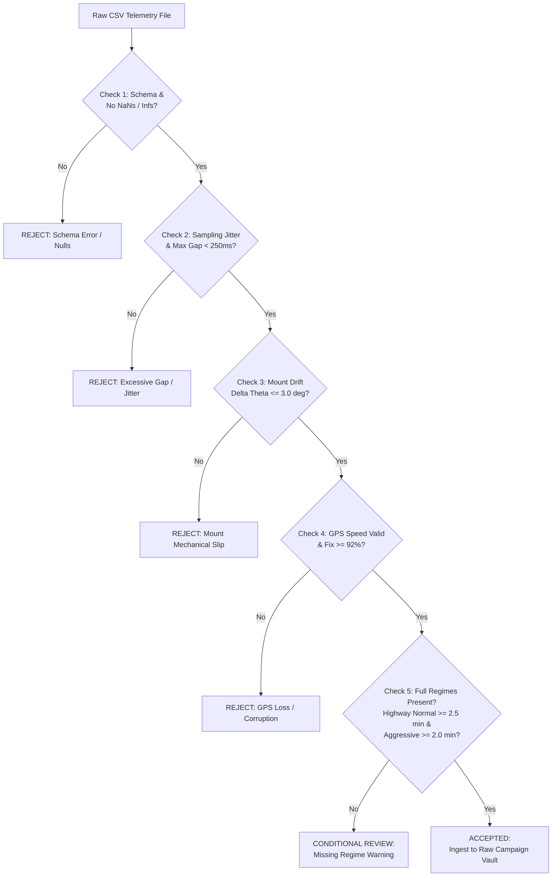

# Pipeline A — Eight-Driver Data Quality Acceptance Criteria

**Project:** Intelligent Driver Activity Monitoring & Safety Agent  
**Module:** Pipeline A (Driving Behaviour Classification)  
**Document Type:** Technical Quality Standards & Ingestion Acceptance Protocol  
**Date:** November 2026  
**Status:** Canonical Quality Assurance Standard  

---

## 1. Purpose & Scope

This document defines the strict, measurable, and objective acceptance criteria that every incoming telemetry session must satisfy before being ingested into the multi-driver machine learning pipeline. 

Data quality failures in cyber-physical automotive telemetry (such as mounting slippage, packet loss, sensor clipping, or uncalibrated timestamps) corrupt kinematic representations, induce artificial covariate shifts, and produce misleading generalization claims. Every drive session collected under the Eight-Driver Campaign must pass all mandatory criteria outlined below.

---

## 2. Six Mandatory Quality Criteria

### Criterion 1: Sampling Frequency, Temporal Jitter & Gap Limits

| Metric | Target Specification | Hard Rejection Threshold |
|---|---|---|
| **Nominal Sampling Rate ($f_s$)** | $20.0\text{ Hz}$ ($\Delta t = 50.0\text{ ms}$) | $< 18.0\text{ Hz}$ or $> 22.0\text{ Hz}$ mean rate |
| **Inter-Sample Jitter** | $99.0\%$ of $\Delta t \in [45.0, 55.0]\text{ ms}$ | $> 2.0\%$ of samples outside $[40.0, 60.0]\text{ ms}$ |
| **Maximum Allowable Time Gap** | $\Delta t_{\max} < 100.0\text{ ms}$ ($2\times$ nominal) | Any gap $\Delta t \ge 250.0\text{ ms}$ ($5\times$ nominal) |
| **Cumulative Packet Loss** | $< 0.1\%$ dropped samples | $> 0.5\%$ dropped samples across session |
| **Timestamp Monotonicity** | Strictly monotonic increasing ($\Delta t > 0$) | Any backwards or duplicate timestamp ($\Delta t \le 0$) |

> [!CAUTION]
> **Zero Interpolation for Large Gaps:** If a telemetry gap exceeds $250.0\text{ ms}$ (a quarter-second blind spot), linear interpolation creates synthetic, unphysical jerk values. Any session with a gap $\ge 250.0\text{ ms}$ triggers an automatic **REJECT / RE-RECORD**.

---

### Criterion 2: Sensor Dynamic Range & Saturation Avoidance

| Sensor Channel | Dynamic Range Required | Saturation Rejection Threshold |
|---|---|---|
| **3-Axis Accelerometer** | Full-scale $\ge \pm 4.0\text{ g}$ (preferred $\pm 8.0\text{ g}$) | Any sample reaching $\ge 98\%$ of full scale |
| **3-Axis Gyroscope** | Full-scale $\ge \pm 500^\circ\text{/s}$ ($\pm 8.73\text{ rad/s}$) | Any sample reaching $\ge 98\%$ of full scale |
| **Signal Noise Floor (Idle)** | Accelerometer RMS noise $< 0.02\text{ g}$ in idle | Accelerometer RMS noise $> 0.08\text{ g}$ in idle |
| **Dead Channel Detection** | Standard deviation $> 0.001$ over any 10s window | Any channel showing constant identical value for $> 2.0\text{ s}$ |

---

### Criterion 3: Static Gravitational Calibration & Mount Stability

To guarantee that the $23.17^\circ$ mounting shift observed in Dataset C does not recur or corrupt planar projections:

| Metric | Nominal Calibration Range | Hard Rejection Threshold |
|---|---|---|
| **Pre-Drive Static Gravity ($\|\vec{g}_0\|$)** | $9.81 \pm 0.15\text{ m/s}^2$ ($[0.985, 1.015]\text{ g}$) | Outside $[9.60, 10.05]\text{ m/s}^2$ ($[0.978, 1.025]\text{ g}$) |
| **Post-Drive Static Gravity ($\|\vec{g}_6\|$)** | $9.81 \pm 0.15\text{ m/s}^2$ ($[0.985, 1.015]\text{ g}$) | Outside $[9.60, 10.05]\text{ m/s}^2$ ($[0.978, 1.025]\text{ g}$) |
| **Mount Angular Drift ($\Delta \theta_{\text{mount}}$)** | $\Delta \theta \le 1.5^\circ$ across entire trip | **$\Delta \theta > 3.0^\circ$** (evidence of mechanical slip) |
| **Mount Mechanical Wobble** | RMS roll/pitch wobble $\omega_{\text{wobble}} < 0.03\text{ rad/s}$ | RMS wobble $> 0.08\text{ rad/s}$ during cruising |

$$\Delta \theta_{\text{mount}} = \arccos\left(\frac{\vec{g}_0 \cdot \vec{g}_6}{\|\vec{g}_0\| \|\vec{g}_6\|}\right)$$
If $\Delta \theta_{\text{mount}} > 3.0^\circ$, the phone physically shifted in the clamp during the drive. The session is flagged as mechanically invalid.

---

### Criterion 4: Synchronous GPS Telemetry & Ground Speed Quality

| GPS Metric | Nominal Standard | Rejection Threshold |
|---|---|---|
| **GPS Fix Availability** | Active 3D Fix for $\ge 98.0\%$ of drive duration | Fix available $< 92.0\%$ of drive duration |
| **Horizontal Dilution of Precision (HDOP)** | $\text{HDOP} < 2.0$ (good to excellent geometry) | $\text{HDOP} > 4.0$ for $> 10\%$ of session |
| **Ground Speed Non-Negativity** | $v_{\text{GPS}} \ge 0.0\text{ m/s}$ | Any negative or non-physical speed ($> 180\text{ km/h}$) |
| **Acceleration-Speed Consistency** | $\left| \frac{\Delta v}{\Delta t} - a_{\text{long}} \right| < 0.5\text{ g}$ | Discrepancy $> 1.0\text{ g}$ for $> 3.0$ consecutive seconds |

---

### Criterion 5: Class Label Balance & Driving Regime Coverage

Every session must provide balanced representation across all target driving regimes:

| Regime / Class Coverage Requirement | Target Duration / Sample Count | Minimum Floor Threshold |
|---|---|---|
| **Total Session Duration** | $17.5\text{ minutes}$ ($21,000$ samples at 20 Hz) | $\ge 12.0\text{ minutes}$ ($14,400$ samples) |
| **Total Normal Driving (Class 0)** | $13.5\text{ minutes}$ ($16,200$ samples) | $\ge 9.0\text{ minutes}$ ($10,800$ samples) |
| **Sustained Highway Cruising (Normal)** | $\ge 4.0\text{ minutes}$ with $v \ge 65\text{ km/h}$ | $\ge 2.5\text{ minutes}$ with $v \ge 60\text{ km/h}$ |
| **Total Aggressive Driving (Class 1)** | $3.5\text{ minutes}$ ($4,200$ samples) | $\ge 2.0\text{ minutes}$ ($2,400$ samples) |
| **Verified Aggressive Acceleration Events** | Exactly 3 distinct events ($jerk > 1.5\text{ g/s}$) | Minimum 2 verified events |
| **Verified Hard Braking Events** | Exactly 3 distinct events ($a_x < -0.4\text{ g}$) | Minimum 2 verified events |
| **Verified Evasive Swerve Events** | Exactly 3 distinct events ($\omega_{\text{yaw}} > 0.15\text{ rad/s}$) | Minimum 2 verified events |

> [!IMPORTANT]
> **Anti-Confounding Guarantee:** The requirement of $\ge 2.5\text{ minutes}$ of verified normal highway cruising ($v \ge 60\text{ km/h}$) ensures that models trained on this data will never reproduce the reverse-session false positive catastrophe of Dataset C.

---

### Criterion 6: Missing Values, Nulls & Anomaly Checks

| Anomaly Check | Allowed Threshold | Verification Method |
|---|---|---|
| **NaN / Null Values** | **Exactly 0** across all channels | Automated `df.isnull().sum() == 0` check |
| **Infinite Values ($\pm \infty$)** | **Exactly 0** across all channels | Automated `np.isinf(df.values).sum() == 0` check |
| **Format Schema Compliance** | 100% adherence to canonical column names | Exact string match against schema specification |
| **Metadata Header Verification** | Valid driver token, vehicle ID, date, SHA-256 | Automated JSON manifest parsing |

---

## 3. Automated Ingestion & Quality Decision Logic

When a raw session telemetry file is submitted to the data pipeline, an automated quality validation script (`scripts/validate_session_quality.py`) evaluates all 6 criteria:

### Decision Classes:
1. **`PASS (ACCEPTED)`:** All 6 criteria satisfied. File is hashed with SHA-256, compressed, and committed to `dataset/raw/eight_driver_campaign/<driver_id>/`.
2. **`CONDITIONAL (FLAGGED FOR REVIEW)`:** Marginal sampling jitter ($18.0 - 18.5\text{ Hz}$) or slightly reduced highway cruising ($2.0 - 2.5\text{ min}$). Requires lead auditor manual inspection before acceptance.
3. **`REJECT (FAILED)`:** Any hard rejection threshold violated (time gap $\ge 250\text{ ms}$, mount slip $> 3.0^\circ$, missing aggressive events, or corrupted sensor channels). File is moved to quarantine, and the driver session must be re-recorded.
