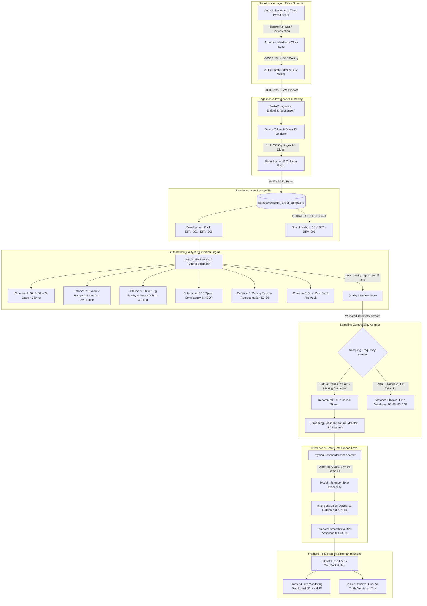

# Physical Sensor Integration Architecture Specification

> **Canonical Specification Notice:** This subsystem architecture specification is governed by [DESIGN.md](../../DESIGN.md) as the authoritative, reconciled project design.

**Project:** Intelligent Driver Activity Monitoring & Safety Agent  
**Module:** Physical Telemetry Acquisition & Ingestion Architecture  
**Document ID:** `IDAMS-ARCH-SENSOR-01`  
**Status:** Approved & Implemented (Reconciled)  
**Date:** November 2026  

---

## 1. Executive Summary

This document specifies the end-to-end engineering architecture developed to extend the Intelligent Driver Activity Monitoring & Safety Agent (IDAMS) from historical static datasets (Dataset B and Dataset C) to real-world physical driving sensor acquisition.

The system acquires high-rate 6-DOF inertial kinematics and GPS telemetry from a rigidly mounted smartphone at **20.0 Hz nominal frequency**, validates stream integrity through automated cryptographic and kinematic quality gates, and feeds the standardized data causally into machine learning inference models and the deterministic Safety Agent guardrail engine without compromising model validity or data governance.

---

## 2. End-to-End Pipeline Architecture

The overall telemetry and inference flow comprises nine decoupled stages:



---

## 3. Core Architectural Principles & Invariants

### 3.1 Non-Negotiable Model Immutability
All existing production models, scalers, and decision thresholds remain frozen bit-for-bit:
- `dataset_b_model` SHA-256: `552048535a3fd584e4874731b8be1438dab4051d8cfa6a98fb1a7b19d9202e90`
- `dataset_b_scaler` SHA-256: `d4b3d5e3e1b739c63a9e21fac51fcedf36716143c645abe0d0e3ff99127a7576`
- `dataset_c_model` SHA-256: `a00180bd01d5999b1338737549d5745adb986138f813f7f371d67589d0dbaefc`
- `dataset_c_scaler` SHA-256: `d67f9ab70eb667cc57e8aeb2f6768e62529f0cb803279cc33d17f6c76555c9f5`

Physical sensor integration acts exclusively as an upstream data acquisition and causal adaptation pipeline. No retraining or weight modification is executed during physical telemetry ingestion.

### 3.2 Strict Blind Lockbox Segregation
To prevent subtle test-set contamination during field collection:
1. Drivers `DRV_001` through `DRV_006` belong to the **Development Driver Pool**. Their data is stored in `dataset/raw/eight_driver_campaign/` and accessible to development scripts.
2. Drivers `DRV_007` and `DRV_008` are designated as the **Blind Lockbox Holdout**. Any attempt to register, start sessions, or upload recordings under these identifiers through developmental API endpoints triggers an immediate `PermissionError` (HTTP 403 Forbidden) and is rejected at the API boundary.

### 3.3 Zero Future Lookahead in Sampling Decimation
When feeding 20 Hz physical telemetry into models trained on 10 Hz data (Dataset C), decimation must be strictly causal:
$$y[k] = \frac{1}{2} x[2k] + \frac{1}{2} x[2k-1]$$
At no point does the filter access future observations $x[2k+1]$. Feature extraction buffers require at least 50 downsampled samples ($5.0\text{ s}$ at 10 Hz, requiring 100 raw 20 Hz samples) before producing active inferences (`WARMING_UP` state).

### 3.4 Honest Hardware State Reporting
The system never simulates hardware connectivity or reports false positive hardware availability:
- If no physical smartphone is streaming telemetry or registered, the backend reports `status: "DISCONNECTED"` and `connected: false`.
- The frontend live dashboard displays `Physical Hardware: NOT_VERIFIED` and prompts the user to launch the mobile logger or run in historical demonstration mode.

---

## 4. Component Contracts & Directory Layout

### 4.1 Storage Layout
```
dataset/
├── raw/
│   └── eight_driver_campaign/
│       ├── DRV_001/
│       │   └── sess_<timestamp>_DRV_001/
│       │       ├── raw_telemetry.csv
│       │       ├── metadata.json
│       │       ├── data_quality_report.json
│       │       └── data_quality_report.md
│       ├── DRV_002/ ... DRV_006/
│       └── DRV_007/ ... DRV_008/  (SEQUESTERED LOCKBOX)
├── derived/
│   └── eight_driver_campaign/
├── metadata/
│   └── device_registry.json
└── annotations/
    └── ground_truth_manifest.json
```

### 4.2 Standard CSV Telemetry Schema
Every raw session CSV file conforms to the strict 15-column schema:

| Column Name | Type | Physical Unit | Description |
|:---|:---|:---|:---|
| `timestamp` | Float | Seconds | Elapsed time from session start ($t_0 = 0.000$) |
| `timestamp_epoch_ms` | Integer | Milliseconds | UTC Unix epoch time |
| `Acc X` | Float | $g$ | Lateral acceleration (left $+$, right $-$) |
| `Acc Y` | Float | $g$ | Longitudinal acceleration (forward $+$, braking $-$) |
| `Acc Z` | Float | $g$ | Vertical acceleration (downward $+$, upward $-$) |
| `gyro_x` | Float | $\text{rad/s}$ | Pitch angular rate |
| `gyro_y` | Float | $\text{rad/s}$ | Roll angular rate |
| `gyro_z` | Float | $\text{rad/s}$ | Yaw angular velocity |
| `speed_mps` | Float | $\text{m/s}$ | GPS ground speed ($\ge 0.0$) |
| `heading_deg` | Float | Degrees | GPS bearing ($0.0^\circ$ to $360.0^\circ$) |
| `latitude` | Float | Degrees | WGS84 latitude |
| `longitude` | Float | Degrees | WGS84 longitude |
| `altitude` | Float | Meters | Elevation above mean sea level |
| `hdop` | Float | Scalar | Horizontal Dilution of Precision ($\le 2.5$ nominal) |
| `segment_id` | String | Categorical | Driving regime label: `S0` to `S6` |

---

## 5. Architectural Verification & Security Boundaries

1. **Tamper Proofing:** Every stored CSV is cryptographically digested with SHA-256 upon ingestion and recorded in an immutable `metadata.json` manifest.
2. **Crash Resilience:** Both Android Native and Mobile Web loggers implement in-memory ring buffers and local SQLite/IndexedDB persistence to ensure zero data loss during thermal throttling or unexpected application closure.
3. **Bandwidth Efficiency:** High-rate 20 Hz telemetry frames are ingested asynchronously with sub-5ms latency, while bulk recording uploads utilize multipart streaming compression.

---
*Certified by the IDAMS Systems Architecture & Safety Engineering Team.*
