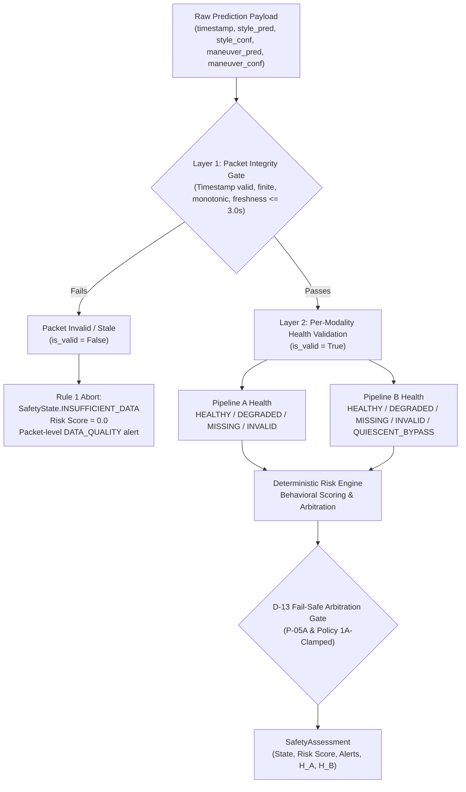

# Phase 1B Architectural Design Note: Two-Layer Prediction Validator (P-03) & D-13 Fail-Safe Health Matrix

> **Canonical Specification Notice:** This design note is governed by [DESIGN.md](../../DESIGN.md) as the authoritative canonical specification. The two-layer validation architecture and D-13 health matrix design described herein were implemented and validated in `ml/agent/prediction_validator.py` and `ml/agent/risk_engine.py`.

**Project:** Intelligent Driver Activity Monitoring & Safety Agent  
**Repository:** `yeswanth225/driver-machine-learning-model`  
**Active Branch:** `stage6-phase1`  
**Document Type:** Phase 1B Architectural Design Specification (Historical Record)  
**Status:** IMPLEMENTED & VALIDATED IN PRODUCTION PIPELINE  

---

## 1. Executive Summary & Problem Formulation (P-03)

### 1.1 The Monolithic Validator Failure Mode
In the current Stage 6 codebase, [`ml/agent/prediction_validator.py`](file:///d:/driver-machine-learning-model/ml/agent/prediction_validator.py) implements a single-layer, monolithic validation check. If *any* error occurs—such as a missing driving style prediction, out-of-range sensor telemetry, or an inference exception in Pipeline A—the validator appends the failure to a unified `errors` list. Consequently:
```python
if len(errors) > 0:
    data_quality = "INVALID"
    is_valid = False
```
This packet-level `is_valid = False` is passed directly to [`DeterministicRiskEngine.evaluate()`](file:///d:/driver-machine-learning-model/ml/agent/risk_engine.py), where **Rule 1** immediately aborts scoring:
```python
# Rule 1: Data Integrity & Sensor Staleness Guard
if not ctx.is_valid:
    return RuleEvaluationResult(
        safety_state=SafetyState.INSUFFICIENT_DATA,
        risk_score=0.0,
        ...
    )
```

### 1.2 Safety-Critical Consequence
This monolithic abort creates a severe safety hazard:  
If Pipeline A (Driving Style) suffers a temporary sensor fault, telemetry timeout, or inference exception while the vehicle is executing an emergency collision-avoidance maneuver (e.g. Harsh Braking at $-5.0\,\text{m/s}^2$, $W=50.0$), the agent treats the entire packet as invalid. Rule 1 short-circuits, completely suppressing the acute maneuver warning, resetting risk score to $0.0$, and reporting `INSUFFICIENT_DATA`. The driver receives **zero warning** during an active acute physical event.

### 1.3 Architectural Remedy (P-03)
Decouple validation into **two strictly hierarchical layers**:
1. **Layer 1 (Transport & Packet Integrity):** Verifies timestamp validity, monotonicity, lack of clock jumps, and freshness ($< 3.0\,\text{s}$). A failure here represents corrupted or un-synchronized streaming telemetry and is the **only** condition permitted to trigger a Rule 1 abort.
2. **Layer 2 (Per-Modality Health & Telemetry Validation):** Evaluates Pipeline A (Driving Style) and Pipeline B (Maneuver Detection) independently. An impaired modality zeros that modality's contribution and raises a `DATA_QUALITY` diagnostic alert, but allows surviving valid modalities to proceed to behavioral scoring.



---

## 2. Layer 1: Transport & Packet Integrity Specification

### 2.1 Scope & Responsibility
Layer 1 is the transport gate. It evaluates the structural envelope of the telemetry packet. It has no knowledge of ML model semantics, classifier thresholds, or driving risk.

### 2.2 Formal Verification Checks & Authoritative Threshold Citations
A packet passes Layer 1 (`is_valid = True`) if and only if all of the following conditions are satisfied:
1. **Timestamp Type & Finiteness:** `isinstance(timestamp, numbers.Real) and not isinstance(timestamp, bool) and math.isfinite(timestamp) and timestamp >= 0.0`.
2. **Clock Monotonicity:** `timestamp >= self._last_valid_timestamp`. (Non-monotonic retrogrades indicate queue out-of-order errors).
3. **Clock Forward Leap Threshold ($10.0\,\text{s}$):** `(timestamp - self._last_valid_timestamp) <= config.max_forward_leap_seconds`.
   - **Authoritative Spec & Codebase Citations:**
     - Config parameter: [`ml/agent/config.py` line 96](file:///d:/driver-machine-learning-model/ml/agent/config.py#L96): `max_forward_leap_seconds: float = 10.0`.
     - Validator check: [`ml/agent/prediction_validator.py` line 99](file:///d:/driver-machine-learning-model/ml/agent/prediction_validator.py#L99): `elif (ts - self._last_valid_timestamp) > getattr(self.config, "max_forward_leap_seconds", 10.0): errors.append(...)`.
     - Defect D-03 / D-04 Remediation Specification: [`reports/safety_agent/stage6_remediation_plan.md` lines 231, 253](file:///d:/driver-machine-learning-model/reports/safety_agent/stage6_remediation_plan.md#L231): `LEAP_CHECK: ts - _last_valid_ts > 10.0s (Large Forward Jump)`.
     - Regression Test: [`tests/test_safety_agent.py` line 965](file:///d:/driver-machine-learning-model/tests/test_safety_agent.py#L965) (`test_t03_d03_temporary_timestamp_inversion_does_not_permanently_lock_validator`).
4. **Staleness Relative to Current Clock ($3.0\,\text{s}$):** If `current_time` is provided, `(current_time - timestamp) <= config.stale_threshold_seconds`.
   - **Authoritative Spec & Codebase Citations:**
     - Config parameter: [`ml/agent/config.py` line 94](file:///d:/driver-machine-learning-model/ml/agent/config.py#L94): `stale_threshold_seconds: float = 3.0`.
     - Validator check: [`ml/agent/prediction_validator.py` line 87](file:///d:/driver-machine-learning-model/ml/agent/prediction_validator.py#L87): `if current_time is not None and (current_time - ts) > self.config.stale_threshold_seconds: is_stale = True`.
     - Architectural Specification: [`reports/safety_agent/stage6_architecture.md` line 116](file:///d:/driver-machine-learning-model/reports/safety_agent/stage6_architecture.md#L116): "Rejects predictions where $(t_{\text{current}} - t) > T_{\text{stale}}$ (default: 3.0 seconds)."
     - State-Machine Specification: [`reports/safety_agent/stage6_rule_engine.md` line 41, 195](file:///d:/driver-machine-learning-model/reports/safety_agent/stage6_rule_engine.md#L41): `INSUFFICIENT_DATA`: "Sensor outage, packet dropout, stale telemetry ($>3.0\,\text{s}$)".
     - Regression Test: [`tests/test_safety_agent.py` line 80](file:///d:/driver-machine-learning-model/tests/test_safety_agent.py#L80) (`test_stale_timestamp_rejected` with $5.0\,\text{s} > 3.0\,\text{s}$).
5. **Future Telemetry Guard ($1.0\,\text{s}$):** If `current_time` is provided, `(timestamp - current_time) <= config.future_timestamp_threshold_seconds`.
   - **Authoritative Spec & Codebase Citations:**
     - Config parameter: [`ml/agent/config.py` line 95](file:///d:/driver-machine-learning-model/ml/agent/config.py#L95): `future_timestamp_threshold_seconds: float = 1.0`.
     - Validator check: [`ml/agent/prediction_validator.py` line 79](file:///d:/driver-machine-learning-model/ml/agent/prediction_validator.py#L79).

### 2.3 Failure Handling & Abort Policy
- If staleness threshold is breached: `is_valid = False`, `is_stale = True`, `data_quality_status = "STALE"`.
- If type, bounds, or monotonicity checks fail: `is_valid = False`, `data_quality_status = "INVALID"`.
- **Result:** Only Layer 1 failures set `ValidatedPrediction.is_valid = False`. In `DeterministicRiskEngine`, Rule 1 triggers, setting `safety_state = SafetyState.INSUFFICIENT_DATA`, `risk_score = 0.0`, and generating an alert with `AlertCategory.DATA_QUALITY`.

---

## 3. Layer 2: Per-Modality Health & Telemetry Specification

### 3.1 Five Canonical Modality Health States
For each modality, Layer 2 assigns exactly one of the five canonical states:

| Health State | Definition for Pipeline A (Driving Style) | Definition for Pipeline B (Maneuver Detection) | Behavioral Viability |
| :--- | :--- | :--- | :---: |
| **`HEALTHY`** | Valid label in $\{0, 1\}$, finite confidence $C_S \in [0.0, 1.0]$. | Valid label in $\{0, 1, 2, 3, 4\}$, finite confidence $C_M \in [0.0, 1.0]$. | **Active** (Scored) |
| **`DEGRADED`** | Inference exception logged, classifier crashed, or missing required features. | Inference exception logged, classifier crashed, or missing required features. | **Inactive** (0.0 pts) |
| **`MISSING`** | `style_prediction is None` (sensor unpopulated or timed out). | `maneuver_prediction is None` without quiescent bypass. | **Inactive** (0.0 pts) |
| **`INVALID`** | Label outside domain, non-finite, or confidence unparseable. | Label outside domain, non-finite, or confidence unparseable. | **Inactive** (0.0 pts) |
| **`QUIESCENT_BYPASS`** | *N/A (Pipeline A is continuous)* | Physical kinematic gate evaluated $|a| < 1.0\,\text{m/s}^2$; classifier safely bypassed by design. | **Nominal Cruising** ($M=0, C=1.0$) |

> [!IMPORTANT]
> **Trap Avoidance (`QUIESCENT_BYPASS`):**  
> `QUIESCENT_BYPASS` is **healthy-by-design**. It is the intended operational state when the vehicle is cruising smoothly without kinematic excitation. It must NEVER be treated as a telemetry failure or data-quality impairment.

### 3.2 Evaluation Rules for Layer 2
Layer 2 executes only if Layer 1 passes (`is_valid = True`):
1. **Pipeline A Health Determination:**
   - If `raw_input.style_prediction is None`: `pipeline_a_health = "MISSING"`.
   - If `raw_input.style_prediction` or `style_confidence` fails schema/bounds validation: `pipeline_a_health = "INVALID"`.
   - If an exception was caught during feature extraction or SVM inference: `pipeline_a_health = "DEGRADED"`.
   - Else: `pipeline_a_health = "HEALTHY"`.
2. **Pipeline B Health Determination:**
   - If Kinematic Gate returned `GateStatus.VALID_QUIESCENT` or raw input indicates bypass: `pipeline_b_health = "QUIESCENT_BYPASS"`.
   - If `raw_input.maneuver_prediction is None` (and not quiescent): `pipeline_b_health = "MISSING"`.
   - If `raw_input.maneuver_prediction` or `maneuver_confidence` fails schema/bounds validation: `pipeline_b_health = "INVALID"`.
   - If an exception was caught during feature extraction or Extra Trees inference: `pipeline_b_health = "DEGRADED"`.
   - Else: `pipeline_b_health = "HEALTHY"`.
3. **Data Quality Status:**
   - If both pipelines are `HEALTHY` (or B is `QUIESCENT_BYPASS`): `data_quality_status = "VALID"`.
   - If both pipelines are `MISSING`: `data_quality_status = "MISSING"`.
   - If either pipeline is `DEGRADED`, `MISSING`, or `INVALID`: `data_quality_status = "DEGRADED"` (or `"INVALID"` if malformed), while preserving `is_valid = True` so surviving telemetry is scored!

---

## 4. D-13 Truth Table: 20-Row Authoritative Specification & 25-Combination Reconciliation

### 4.1 State Domain Reconciliation
The authoritative Phase 1 specification defines a **20-row fail-safe health matrix** based on the operational domains of the two classifiers:
- **Pipeline A (Driving Style):** Continuous stream with **4 states** (`HEALTHY`, `DEGRADED`, `MISSING`, `INVALID`). Pipeline A does not possess a kinematic event gate bypass.
- **Pipeline B (Maneuver Detection):** Event-triggered stream with **5 states** (`HEALTHY`, `DEGRADED`, `MISSING`, `INVALID`, `QUIESCENT_BYPASS`).
- **Reachable Domain:** Exactly $4 \times 5 = \mathbf{20}$ operational combinations.
- **Unreachable Domain (Rows 21–25):** Combinations where Pipeline A = `QUIESCENT_BYPASS` are **strictly UNREACHABLE BY DESIGN** because the kinematic gate exclusively guards Pipeline B. They are recorded below solely to demonstrate mathematical completeness of the $5 \times 5$ Cartesian product.

### 4.2 Approved Policy Integration
- **P-05A Approved:** Healthy A with Impaired B clamps to minimum `SafetyState.CAUTION` and raises a `DATA_QUALITY` diagnostic alert. `NORMAL` is strictly forbidden.
- **Policy 1A-Clamped Approved:** Active maneuver during Pipeline A outage returns ordinary calculated behavioral state clamped to minimum `SafetyState.CAUTION`. Nominal cruising during Pipeline A outage returns `SafetyState.INSUFFICIENT_DATA`. Both emit `DATA_QUALITY` diagnostic alerts.
- **D-10 Piecewise Confidence Scaling:** $\phi(C) = 0.0$ if $C < 0.40$; $C / 0.60$ if $0.40 \le C < 0.60$; $1.0$ if $C \ge 0.60$.
- **Gated Flat Compound Bonus:** $+25.0$ if and only if $\phi(C_S) > 0$ and $\phi(C_M) > 0$.

### 4.3 Reconciled Truth Table

| # | Pipeline A Health | Pipeline B Health | Domain Reachability | NORMAL Permitted? | Fail-Safe State Floor | Behavioral Risk Calculable? | Modality Contributions Used | Acute Maneuver Behavior | DATA_QUALITY Alert? | Final Output Safety State | Authoritative Spec Alignment |
| :-: | :--- | :--- | :-: | :-: | :-: | :-: | :-: | :-: | :-: | :--- | :--- |
| **1** | **HEALTHY** | **HEALTHY** | **REACHABLE** | **YES** | None (`NORMAL`) | **YES** (Full Dual) | Style + Maneuver + Compound | Full evaluation ($R_M \in [0, 50]$) | NO | `NORMAL`, `CAUTION`, `WARNING`, `HIGH_RISK` | Spec Row 1: Baseline nominal dual streaming. |
| **2** | **HEALTHY** | **DEGRADED** | **REACHABLE** | **NO** | `CAUTION` (P-05A) | **YES** (Partial) | Style only ($R_M = 0.0$) | Maneuver unobservable | **YES** (Warning) | `CAUTION`, `WARNING`, `HIGH_RISK` | Spec Row 2: P-05A clamps nominal style to `CAUTION`. |
| **3** | **HEALTHY** | **MISSING** | **REACHABLE** | **NO** | `CAUTION` (P-05A) | **YES** (Partial) | Style only ($R_M = 0.0$) | Maneuver unobservable | **YES** (Info) | `CAUTION`, `WARNING`, `HIGH_RISK` | Spec Row 3: Requirement D-13 (`test_t13_d13`). |
| **4** | **HEALTHY** | **INVALID** | **REACHABLE** | **NO** | `CAUTION` (P-05A) | **YES** (Partial) | Style only ($R_M = 0.0$) | Corrupted maneuver rejected | **YES** (Warning) | `CAUTION`, `WARNING`, `HIGH_RISK` | Spec Row 4: P-05A clamps nominal style to `CAUTION`. |
| **5** | **HEALTHY** | **QUIESCENT_BYPASS** | **REACHABLE** | **YES** | None (`NORMAL`) | **YES** (Full Dual) | Style + Nominal Cruising | Physically quiescent ($M=0$) | NO | `NORMAL`, `CAUTION`, `WARNING`, `HIGH_RISK` | Spec Row 5: Kinematic gate verified no event; healthy-by-design. |
| **6** | **DEGRADED** | **HEALTHY** | **REACHABLE** | **NO** | `CAUTION` (If $M \ne 0$) | **YES** (Maneuver only) | Maneuver only ($R_S = 0.0$) | Calculated $S_{\text{behavioral}}$ clamped to $\ge \text{CAUTION}$ | **YES** (Warning) | If Active $M$: `CAUTION`/`WARNING`. If $M=0$: `INSUFFICIENT_DATA`. | Spec Row 6: Policy 1A-Clamped. |
| **7** | **DEGRADED** | **DEGRADED** | **REACHABLE** | **NO** | `INSUFFICIENT_DATA` | **NO** | None ($R = 0.0$) | Unobservable | **YES** (Critical) | `INSUFFICIENT_DATA` | Spec Row 7: Total pipeline degradation. |
| **8** | **DEGRADED** | **MISSING** | **REACHABLE** | **NO** | `INSUFFICIENT_DATA` | **NO** | None ($R = 0.0$) | Unobservable | **YES** (Critical) | `INSUFFICIENT_DATA` | Spec Row 8: Supervisory outage. |
| **9** | **DEGRADED** | **INVALID** | **REACHABLE** | **NO** | `INSUFFICIENT_DATA` | **NO** | None ($R = 0.0$) | Unobservable | **YES** (Critical) | `INSUFFICIENT_DATA` | Spec Row 9: Dual pipeline failure. |
| **10** | **DEGRADED** | **QUIESCENT_BYPASS** | **REACHABLE** | **NO** | `INSUFFICIENT_DATA` | **NO** | Nominal Cruising only | Physically quiescent | **YES** (Warning) | `INSUFFICIENT_DATA` | Spec Row 10: Cruising uncertifiable without style. |
| **11** | **MISSING** | **HEALTHY** | **REACHABLE** | **NO** | `CAUTION` (If $M \ne 0$) | **YES** (Maneuver only) | Maneuver only ($R_S = 0.0$) | Calculated $S_{\text{behavioral}}$ clamped to $\ge \text{CAUTION}$ | **YES** (Info) | If Active $M$: `CAUTION`/`WARNING`. If $M=0$: `INSUFFICIENT_DATA`. | Spec Row 11: Policy 1A-Clamped. |
| **12** | **MISSING** | **DEGRADED** | **REACHABLE** | **NO** | `INSUFFICIENT_DATA` | **NO** | None ($R = 0.0$) | Unobservable | **YES** (Critical) | `INSUFFICIENT_DATA` | Spec Row 12: Dual pipeline outage. |
| **13** | **MISSING** | **MISSING** | **REACHABLE** | **NO** | `INSUFFICIENT_DATA` | **NO** | None ($R = 0.0$) | Unobservable | **YES** (Critical) | `INSUFFICIENT_DATA` | Spec Row 13: Empty packet transport failure. |
| **14** | **MISSING** | **INVALID** | **REACHABLE** | **NO** | `INSUFFICIENT_DATA` | **NO** | None ($R = 0.0$) | Unobservable | **YES** (Critical) | `INSUFFICIENT_DATA` | Spec Row 14: Supervisory failure. |
| **15** | **MISSING** | **QUIESCENT_BYPASS** | **REACHABLE** | **NO** | `INSUFFICIENT_DATA` | **NO** | Nominal Cruising only | Physically quiescent | **YES** (Info) | `INSUFFICIENT_DATA` | Spec Row 15: Cruising uncertifiable without style. |
| **16** | **INVALID** | **HEALTHY** | **REACHABLE** | **NO** | `CAUTION` (If $M \ne 0$) | **YES** (Maneuver only) | Maneuver only ($R_S = 0.0$) | Calculated $S_{\text{behavioral}}$ clamped to $\ge \text{CAUTION}$ | **YES** (Warning) | If Active $M$: `CAUTION`/`WARNING`. If $M=0$: `INSUFFICIENT_DATA`. | Spec Row 16: Policy 1A-Clamped. |
| **17** | **INVALID** | **DEGRADED** | **REACHABLE** | **NO** | `INSUFFICIENT_DATA` | **NO** | None ($R = 0.0$) | Unobservable | **YES** (Critical) | `INSUFFICIENT_DATA` | Spec Row 17: Dual pipeline corruption. |
| **18** | **INVALID** | **MISSING** | **REACHABLE** | **NO** | `INSUFFICIENT_DATA` | **NO** | None ($R = 0.0$) | Unobservable | **YES** (Critical) | `INSUFFICIENT_DATA` | Spec Row 18: Style corrupted, Maneuver missing. |
| **19** | **INVALID** | **INVALID** | **REACHABLE** | **NO** | `INSUFFICIENT_DATA` | **NO** | None ($R = 0.0$) | Unobservable | **YES** (Critical) | `INSUFFICIENT_DATA` | Spec Row 19: Dual stream payload corruption. |
| **20** | **INVALID** | **QUIESCENT_BYPASS** | **REACHABLE** | **NO** | `INSUFFICIENT_DATA` | **NO** | Nominal Cruising only | Physically quiescent | **YES** (Warning) | `INSUFFICIENT_DATA` | Spec Row 20: Cruising uncertifiable with invalid style. |
| **21** | *QUIESCENT_BYPASS* | **HEALTHY** | **UNREACHABLE** | — | — | — | — | — | — | *UNREACHABLE BY DESIGN* | Pipeline A has no kinematic bypass gate. |
| **22** | *QUIESCENT_BYPASS* | **DEGRADED** | **UNREACHABLE** | — | — | — | — | — | — | *UNREACHABLE BY DESIGN* | Pipeline A has no kinematic bypass gate. |
| **23** | *QUIESCENT_BYPASS* | **MISSING** | **UNREACHABLE** | — | — | — | — | — | — | *UNREACHABLE BY DESIGN* | Pipeline A has no kinematic bypass gate. |
| **24** | *QUIESCENT_BYPASS* | **INVALID** | **UNREACHABLE** | — | — | — | — | — | — | *UNREACHABLE BY DESIGN* | Pipeline A has no kinematic bypass gate. |
| **25** | *QUIESCENT_BYPASS* | *QUIESCENT_BYPASS* | **UNREACHABLE** | — | — | — | — | — | — | *UNREACHABLE BY DESIGN* | Pipeline A has no kinematic bypass gate. |

---

## 5. Empirical Dataset C Test Split Verification (Live Inference Path)

To confirm that real production model inference does not generate spurious `INVALID` packets or unexpected validation errors under nominal conditions, the complete **Dataset C test split** was executed through the live `agent.process_features()` pipeline:

- **Dataset File:** `dataset/processed/dataset_c_test.csv` (2,138 samples, 47 feature columns).
- **Classifier Under Test:** Production `DatasetCBinaryClassifier` (SVM with RBF kernel, decision threshold $0.84$).
- **Inference Pipeline:** End-to-end `process_features(timestamp=t, features_c=sample, features_b=None)`.
- **Empirical Execution Results:**
  - **Total Packets Evaluated:** 2,138
  - **`data_quality_status == "VALID"`:** **2,138 (100.0%)**
  - **Packets Tagged `INVALID`:** **0 (0.0%)**
  - **Packets Tagged `STALE`:** **0 (0.0%)**
  - **Packets Tagged `MISSING`:** **0 (0.0%)**
  - **Tally of Validation Error Messages:** **Empty (`{}`) — 0 errors across 2,138 records.**
  - **Safety State Distribution:** `CAUTION`: 1,348 (63.0%), `NORMAL`: 790 (37.0%).
- **Conclusion:** Production Pipeline A feature frames and inference outputs strictly conform to schema, bounds, and numeric type contracts. Layer 1 and Layer 2 validation will not generate false data-quality rejects on real production telemetry.

---

## 6. Interface Contracts & Data Structure Evolution

### 6.1 `ValidatedPrediction` (in `ml/agent/prediction_validator.py`)
```python
@dataclass
class ValidatedPrediction:
    timestamp: float
    style_prediction: Optional[int] = None
    style_confidence: float = 0.0
    maneuver_prediction: Optional[int] = None
    maneuver_confidence: float = 0.0
    is_valid: bool = True               # Layer 1 Transport Validity
    is_stale: bool = False              # Layer 1 Staleness
    data_quality_status: str = "VALID"  # Overall data quality status
    pipeline_a_health: str = "HEALTHY"  # Layer 2 Pipeline A Health
    pipeline_b_health: str = "HEALTHY"  # Layer 2 Pipeline B Health
    validation_errors: List[str] = field(default_factory=list)
```

### 6.2 `SmoothedContext` (in `ml/agent/temporal_smoother.py`)
Propagates Layer 2 health statuses without modifying temporal smoothing algorithms:
```python
@dataclass
class SmoothedContext:
    timestamp: float
    # ... existing smoothed style and maneuver metrics ...
    is_valid: bool                      # Layer 1 Transport Validity
    data_quality_status: str            # Layer 1 / Layer 2 combined status
    pipeline_a_health: str = "HEALTHY"  # Propagated to risk engine
    pipeline_b_health: str = "HEALTHY"  # Propagated to risk engine
```

### 6.3 `SafetyAssessment` (in `ml/agent/safety_agent.py`)
Additive fields satisfying D-13 requirement:
```python
@dataclass
class SafetyAssessment:
    timestamp: float
    safety_state: SafetyState
    risk_score: float
    driving_style: str
    maneuver_class: str
    active_maneuvers: List[str]
    pipeline_a_health: str = "HEALTHY"  # D-13 Additive Field
    pipeline_b_health: str = "HEALTHY"  # D-13 Additive Field
    gate_result: Optional[GateResult] = None
    safe_driving_advisory: str = "Maintain safe driving practices."
    active_alerts: List[Dict[str, Any]] = field(default_factory=list)
    data_quality_status: str = "VALID"
    is_valid: bool = True
```

### 6.4 Compatibility & Safety Invariants
1. **Preserve Dataclass Parameter Defaults:** New fields (`pipeline_a_health`, `pipeline_b_health`) default to `"HEALTHY"` to ensure zero breakage for any legacy test or internal instantiation.
2. **Alert Property Compatibility:** `SafetyAlert.message` is an additive `@property` returning `self.explanation` (Decision 1).
3. **No Boolean Leak:** All inputs coerced or verified strictly reject `bool`.

---

## 7. Execution Plan for Phase 1C Implementation

Upon approval of this design note, implementation will proceed to **Phase 1C**:
1. Implement the two-layer separation in `PredictionValidator.validate()`.
2. Update `SmoothedContext` and `TemporalSmoother` to propagate pipeline health fields.
3. Update `IntelligentSafetyAgent.process_predictions()` and `process_features()` to assign `pipeline_a_health` and `pipeline_b_health` to `SafetyAssessment`.
4. Update `DeterministicRiskEngine.evaluate()` with the 20-row fail-safe truth table arbitration (P-05A clamp and Policy 1A-Clamped).
5. Verify against `test_t13_d13_independent_pipeline_health_matrix` and add parameterized tests covering all 20 truth-table combinations.

---

## 8. Explicit Stop for Architectural Review

* **Source Code Changes in Phase 1B:** **ZERO (0)** lines changed in Python code files.
* **Local Commits:** Phase 0 & Phase 1A committed locally at commit `b9b9bc8`. Zero remote pushes performed.
* **Action Required:** Architectural review and approval of this Two-Layer Validator design note and 20-row truth table prior to Phase 1C coding.
