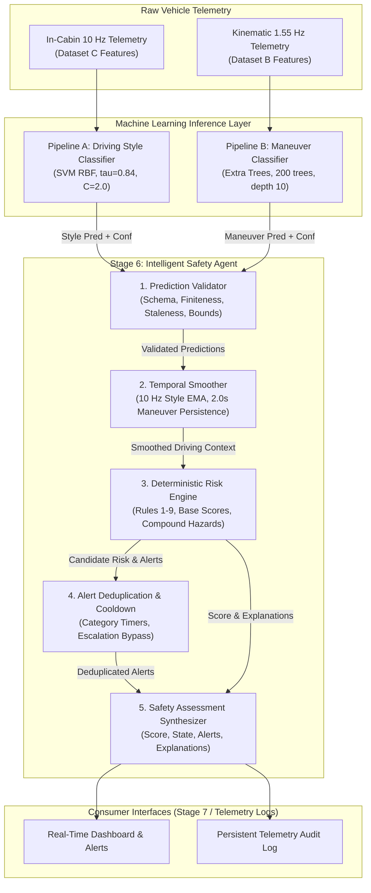
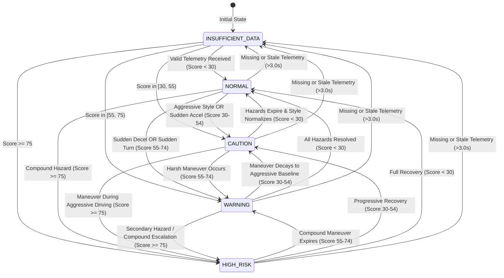

# Stage 6 Architecture Specification: Intelligent Safety Monitoring Agent

**Project:** Intelligent Driver Activity Monitoring & Safety Agent  
**Module:** `ml/agent`  
**Stage:** Stage 6 — Intelligent Safety Monitoring Agent  
**Status:** Completed & Validated  
**Version:** 1.0.0  

---

## 1. Executive Summary

The **Intelligent Safety Monitoring Agent** serves as the top-level cognitive supervisory layer of the Intelligent Driver Activity Monitoring & Safety system. Positioned downstream of two independently trained machine learning inference pipelines—**Pipeline A (Dataset C: Support Vector Machine Driving Style Classifier)** and **Pipeline B (Dataset B: Extra Trees 4-Class Maneuver Classifier)**—the agent synthesizes high-frequency continuous style estimates (~10 Hz) and lower-frequency discrete maneuver events (~1.55 Hz) into a unified, deterministic, and explainable driving safety assessment.

### Core Architectural Mandates
1. **Deterministic Risk Scoring:** No opaque "black-box" meta-models. Risk scores (0–100) and safety states are derived exclusively via an auditable, deterministic rule engine.
2. **Multi-Rate Asynchronous Telemetry Alignment:** Reconciles the distinct sampling characteristics of continuous style signals (10 Hz) and discrete maneuver trials (1.55 Hz) using causal exponential moving averages (EMA) and temporal persistence windows.
3. **Rigorous Data Quality & Staleness Validation:** Validates schema integrity, numerical finiteness, probability bounds, class membership, and timestamp staleness before state computation.
4. **Alert Fatigue Prevention:** Implements category-specific cooldown deduplication (3–5 seconds) while providing zero-latency bypass for critical safety escalations.
5. **Strict Supervisory Scope:** The agent is an advisory safety monitor. It strictly issues human-interpretable alerts and contextual explanations; it does **not** execute autonomous vehicular actuators or direct vehicular control.

---

## 2. End-to-End System Architecture

The agent is organized into a modular pipeline with clear separation of concerns across five stages:

---

## 3. Telemetry Ingress & Multi-Rate Synchronization

### 3.1 The Multi-Rate Challenge
A primary engineering challenge is the stark discrepancy in sampling frequency and semantics between the two underlying classifiers:
- **Pipeline A (Dataset C - Driving Style):** Predicts continuously at ~10 Hz ($T_s \approx 0.10\,\text{s}$). The model classifies general driving conduct as either `NORMAL` (0) or `AGGRESSIVE` (1). At 10 Hz, transient sensor noise or momentary throttle inputs can produce isolated false-positive spikes.
- **Pipeline B (Dataset B - Maneuvers):** Operates on segmented kinematic windows at ~1.55 Hz ($T_s \approx 0.64\,\text{s}$). Predictions classify discrete, short-duration maneuvers: `SA` (Sudden Acceleration), `SD` (Sudden Deceleration), `SRT` (Sudden Right Turn), and `SLT` (Sudden Left Turn). When no maneuver is detected, Pipeline B emits `NONE` (0).

### 3.2 Temporal Smoother Mechanics
The `TemporalSmoother` reconciles these asynchronous multi-rate streams using strict causal mathematics:

#### 1. Continuous Style Exponential Moving Average (EMA)
To prevent single-frame flickers from triggering premature state changes, continuous style confidence is smoothed using an EMA with a characteristic time constant $\tau = 1.0\,\text{s}$:
$$\alpha = 1.0 - \exp\left(-\frac{\Delta t}{\tau}\right)$$
$$S_{\text{EMA}}(t) = \alpha \cdot P(\text{Aggressive})_t + (1 - \alpha) \cdot S_{\text{EMA}}(t - \Delta t)$$
For typical 10 Hz sampling ($\Delta t = 0.1\,\text{s}$), $\alpha \approx 0.0952$, providing smooth continuous filtering over an effective 1-second horizon.

#### 2. Rolling Aggressive Sample Ratio
A sliding temporal window of length $T_{\text{window}} = 3.0\,\text{s}$ tracks the fraction of raw samples classified as aggressive:
$$R_{\text{agg}}(t) = \frac{\sum_{i \in W(t)} \mathbb{I}(\hat{y}_i = \text{AGGRESSIVE})}{|W(t)|}$$
A driving style is declared **sustained aggressive** only if:
$$R_{\text{agg}}(t) \ge \theta_{\text{agg}} \quad (\text{Default: } 0.60)$$
with a minimum requirement of $N_{\text{min}} = 5$ samples in the window.

#### 3. Maneuver Event Persistence & Exponential Decay
Because maneuvers are physical kinematic events taking 1.5 to 3.0 seconds to execute, a discrete classification from Pipeline B cannot be treated as an instantaneous 1-sample impulse. The smoother applies a **persistence window** ($T_{\text{persist}} = 2.0\,\text{s}$):
- For $t - t_{\text{event}} \le T_{\text{persist}}$: The maneuver remains actively latched with its original confidence $C_{\text{event}}$.
- For $t - t_{\text{event}} > T_{\text{persist}}$: The effective confidence decays exponentially according to half-life $t_{1/2} = 1.0\,\text{s}$:
  $$C_{\text{decay}}(t) = C_{\text{event}} \cdot \exp\left(-\frac{\ln(2) \cdot (t - t_{\text{event}} - T_{\text{persist}})}{t_{1/2}}\right)$$
- If $C_{\text{decay}}(t) < 0.10$ or $t - t_{\text{event}} > 5.0\,\text{s}$, the maneuver is fully expired to `NONE`.

#### 4. Causal History Window Pruning
Telemetry older than $T_{\text{history}} = 10.0\,\text{s}$ is strictly pruned from internal circular buffers, ensuring memory consumption is $O(1)$ and bounded under infinite streaming.

---

## 4. Component Specification & Module Contracts

### 4.1 Configuration: `ml/agent/config.py`
Defines strongly-typed enumerations, operational dataclasses, and immutable thresholds.
- **`SafetyState`**: `NORMAL`, `CAUTION`, `WARNING`, `HIGH_RISK`, `INSUFFICIENT_DATA`.
- **`DrivingStyle`**: `NORMAL` (0), `AGGRESSIVE` (1).
- **`ManeuverClass`**: `NONE` (0), `SUDDEN_ACCELERATION` (1), `SUDDEN_DECELERATION` (2), `SUDDEN_RIGHT_TURN` (3), `SUDDEN_LEFT_TURN` (4).
- **`AlertSeverity`**: `INFO`, `WARNING`, `CRITICAL`.
- **`AlertCategory`**: `DATA_QUALITY`, `DRIVING_STYLE`, `MANEUVER`, `COMPOUND_HAZARD`.
- **`SafetyAgentConfig`**: Immutable configuration parameterizing thresholds, time constants, cooldown periods, and confidence discounts.

### 4.2 Prediction Validator: `ml/agent/prediction_validator.py`
Enforces strict gatekeeping on incoming raw predictions before admission to the temporal smoother.
- **Timestamp Validation:** Asserts non-negativity, finiteness, and temporal monotonicity. Rejects predictions where $(t_{\text{current}} - t) > T_{\text{stale}}$ (default: 3.0 seconds).
- **Domain Verification:** Enforces discrete class membership ($\{0, 1\}$ for style; $\{0, 1, 2, 3, 4\}$ for maneuvers).
- **Finiteness & Clamping:** Verifies confidence probabilities are finite floats, clamping any floating-point deviations strictly to $[0.0, 1.0]$.
- **Data Quality Tagging:** Classifies telemetry records into `VALID`, `MISSING`, `INVALID`, or `STALE`.

### 4.3 Temporal Smoother: `ml/agent/temporal_smoother.py`
Ingests validated predictions and maintains running state buffers to produce a `SmoothedContext`:
- `current_style`: Actively sustained driving style.
- `smoothed_style_confidence`: Filtered confidence via causal EMA.
- `sustained_aggressive_duration`: Cumulative continuous seconds under sustained aggressive driving.
- `active_maneuver`: Currently latched kinematic maneuver.
- `active_maneuver_confidence`: Persistence-adjusted effective confidence.
- `time_since_maneuver`: Seconds elapsed since maneuver onset.
- `data_quality_status`: Propagated telemetry quality flag.

### 4.4 Deterministic Risk Engine: `ml/agent/risk_engine.py`
Evaluates the `SmoothedContext` against Rules 1–9.
- **Score Accumulation:** Base score computed from individual hazard contributions plus non-linear compound bonuses (e.g., simultaneous aggressive driving during sudden braking or turning).
- **Confidence Discounting:** Telemetry below $C_{\text{discount}} = 0.60$ is scaled down proportionally:
  $$\text{Penalty}_{\text{effective}} = \text{Penalty}_{\text{base}} \cdot \left(\frac{C}{C_{\text{discount}}}\right)$$
- **Score Clamping:** Bounded strictly to $[0.0, 100.0]$.
- **State Partitioning:**
  - $0.0 \le \text{Score} < 30.0 \implies \mathbf{NORMAL}$
  - $30.0 \le \text{Score} < 55.0 \implies \mathbf{CAUTION}$
  - $55.0 \le \text{Score} < 75.0 \implies \mathbf{WARNING}$
  - $75.0 \le \text{Score} \le 100.0 \implies \mathbf{HIGH\_RISK}$
- **Alert Deduplication:** Category-specific cooldown timers suppress duplicate alerts within 3–5 seconds, unless a higher severity occurs (immediate escalation bypass).

### 4.5 Agent Coordinator: `ml/agent/safety_agent.py`
The facade exposing the unified API:
- `process_predictions(raw_input, current_time) -> SafetyAssessment`: Synchronous evaluation of incoming model predictions.
- `process_features(dataset_c_features, dataset_b_features, timestamp) -> SafetyAssessment`: End-to-end evaluation executing real feature inference via Pipeline A and Pipeline B wrappers, followed by agent safety assessment.
- `reset()`: Flushes all smoothing buffers and cooldown timers (for session restart).

---

## 5. State Machine Specification

---

## 6. Execution Latency & Memory Footprint

### 6.1 Computational Complexity
All operations within the agent are $O(1)$:
- Prediction validation: Scalar checks and bounded string generation ($< 0.05\,\text{ms}$).
- Temporal smoothing: Fixed-size circular buffer lookup and scalar exponential math ($< 0.10\,\text{ms}$).
- Risk engine evaluation: 9 deterministic if/else conditions ($< 0.05\,\text{ms}$).
- Deduplication: Hash map lookup across 4 categories ($< 0.02\,\text{ms}$).

### 6.2 Empirical Benchmarks
- **Agent Evaluation Latency:** $< 0.35\,\text{ms}$ per telemetry update on standard laptop CPU.
- **Combined Inference + Agent Latency:**
  - Pipeline A (SVM): $4.75\,\text{ms}$
  - Pipeline B (Extra Trees): $91.45\,\text{ms}$
  - Agent Supervisory Overhead: $0.35\,\text{ms}$
  - **Total Pipeline Execution:** $\approx 96.5\,\text{ms}$, well within the $645\,\text{ms}$ window available at 1.55 Hz maneuver streaming.
- **Memory Footprint:** The agent maintains fewer than 200 items in sliding telemetry queues, consuming less than $120\,\text{KB}$ of heap memory per active driver session.
