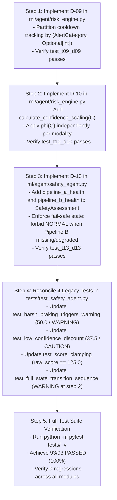

# Stage 6 Phase 1 Remediation Plan: Group B Defect Resolution & Legacy Test Reconciliation

**Project:** Intelligent Driver Activity Monitoring & Safety Agent  
**Module:** `ml/agent` Production Remediation  
**Stage:** Stage 6 — Intelligent Safety Monitoring Agent  
**Phase:** Phase 0 Investigation & Phase 1 Planning  
**Date:** November 2026  
**Status:** READ-ONLY INVESTIGATION COMPLETE — PLANNING DELIVERABLE — ZERO IMPLEMENTATION PERFORMED  

---

## 1. Repository Checkpoint Verification

In accordance with Section 1 of the directive, the repository environment and Git checkpoint were verified in read-only mode:

```powershell
git status
git branch --show-current
git log -1 --oneline
git diff
```

### Verification Findings
* **Working Directory:** `D:\driver-machine-learning-model`
* **Active Branch:** `main` (verified via `git branch --show-current`)
* **Tracking State:** Up to date with `origin/main` (`https://github.com/yeswanth225/driver-machine-learning-model`)
* **HEAD Commit Hash:** `eb54f7d1e03260482500f611b77d1065931e300b` (matches expected target commit exactly)
* **Commit Subject:** `feat(ml): implement Stage 6 Group A remediation, D-06 residual risk decay, and residual integration architecture design`
* **Working Tree:** 100% clean (0 modified files, 0 staged files, 0 untracked files)
* **Git Diff Output:** Completely empty (0 diff lines)

---

## 2. Mandatory Documents Inspected & Status

All mandatory project documentation and source modules were inspected in full:

| Document / Source Path | Presence | Operational Status | Key Finding |
| :--- | :---: | :---: | :--- |
| `reports/safety_agent/stage6_remediation_execution_report.md` | **PRESENT** | Inspected (344 lines) | Documents Group A (D-01..D-05) and D-06 analytical retirement verification; records production integration halt decision. |
| `reports/safety_agent/residual_risk_integration_design.md` | **PRESENT** | Inspected (502 lines) | Complete architectural design for multi-channel decay, 2.50s quiet hysteresis, and decoupled lifecycle tracking. |
| `reports/safety_agent/stage6_architecture.md` | **PRESENT** | Inspected (203 lines) | Baseline architecture specification across Pipelines A & B, multi-rate alignment, and rule engine. |
| `reports/safety_agent/stage6_remediation_plan.md` | **PRESENT** | Inspected (472 lines) | Authoritative 15-defect catalog, 25-combination health matrix, and bounded confidence design. |
| `docs/MASTER_PROJECT_DOCUMENTATION.md` | **MISSING** | Missing | **Reported as missing.** Not present in local or remote repository. No assumptions or replacements fabricated. |
| `ml/agent/risk_engine.py` | **PRESENT** | Inspected (463 lines) | Contains `calculate_residual_risk()`; alert cooldown keyed only by `AlertCategory`; flat confidence discount logic. |
| `ml/agent/safety_agent.py` | **PRESENT** | Inspected (416 lines) | Contains `KinematicEventGate`; `SafetyAssessment` dataclass lacks `pipeline_a_health` and `pipeline_b_health`. |
| `ml/agent/temporal_smoother.py` | **PRESENT** | Inspected (252 lines) | Causal EMA implemented; single `_active_maneuver` scalar; persistence window cutoff at 2.0s. |
| `ml/agent/prediction_validator.py` | **PRESENT** | Inspected (186 lines) | Monotonicity check non-locking; future timestamp rejection active; confidence clamping removed. |
| `ml/agent/config.py` | **PRESENT** | Inspected (144 lines) | Risk weights synchronized ($50.0, 35.0, 25.0$); state thresholds $(25.0, 50.0, 75.0)$. |
| `tests/test_safety_agent.py` | **PRESENT** | Inspected (1323 lines) | Contains 39 tests; 4 legacy tests assert obsolete expectations; regression tests T-09, T-10, T-13 fail. |

---

## 3. Actual Test Baseline Verification

The test baseline was executed using Python 3.11.9, pytest 8.3.4, and pluggy 1.6.0 on Windows (win32).

### 3.1 Test Suite: `python -m pytest tests/test_safety_agent.py -v`
* **Total Collected:** 39 items
* **Passed:** 32 tests
* **Failed:** 7 tests
* **Skipped:** 0 tests
* **Warnings:** 3 warnings (Sklearn `InconsistentVersionWarning` on unpickling SVC/StandardScaler from 1.9.0 to 1.9.1; `UserWarning` on feature names in StandardScaler)
* **Exit Code:** 1
* **Runtime:** 8.70 seconds

### 3.2 Test Suite: `python -m pytest tests/ -v` (Full Repository Test Directory)
* **Total Collected:** 93 items
* **Passed:** 86 tests
* **Failed:** 7 tests
* **Skipped:** 0 tests
* **Warnings:** 15 warnings
* **Exit Code:** 1
* **Runtime:** 26.70 seconds

*Detailed Suite Inventory:*
* `tests/test_dataset_b_pipeline.py`: **21 / 21 PASSED** (100%)
* `tests/test_dataset_c_binary_pipeline.py`: **22 / 22 PASSED** (100%)
* `tests/test_model_training_and_inference.py`: **11 / 11 PASSED** (100%)
* `tests/test_safety_agent.py`: **32 / 39 PASSED** (7 Failed)

### 3.3 Root-Level Pytest Execution (`python -m pytest -v`) Discrepancy
When `python -m pytest -v` is executed from the repository root without specifying `tests/`, pytest auto-discovers three legacy exploratory data-processing scripts matching `test_*.py` located in `ml/preprocessing/`:
1. `ml/preprocessing/test_causal_rolling.py`
2. `ml/preprocessing/test_pointwise_baseline.py`
3. `ml/preprocessing/test_windowed_baseline.py`

These files are standalone data-exploration scripts from an earlier development phase and contain an obsolete hardcoded file path:  
`'d:\driver ml model\driver-monitoring-agent\dataset\raw\dataset_03_5stn873wft\3_FinalDatasetCsv.csv'`  
which raises `FileNotFoundError` during pytest collection.  
**Resolution:** The project's actual, structured unit and integration test suite resides strictly in `tests/` (93 tests). In Phase 1, `pyproject.toml` or `pytest.ini` should configure `testpaths = ["tests"]` to prevent spurious collection of non-test utility scripts in `ml/preprocessing/`.

### 3.4 Inventory of the 7 Failing Tests

| # | Test Path & Name | Test Category | Failure Mechanism / Traceback Excerpt |
| :---: | :--- | :---: | :--- |
| **1** | `TestDeterministicRiskEngine::test_harsh_braking_triggers_warning` | Legacy Pre-Audit | `assert res.risk_score == 35.0` failed where `res.risk_score = 50.0`. Asserts obsolete pre-audit weight. |
| **2** | `TestDeterministicRiskEngine::test_low_confidence_discount` | Legacy Pre-Audit | `assert res.risk_score == pytest.approx(24.5, abs=0.1)` failed where `res.risk_score = 35.0`. Asserts flat 0.70 discount. |
| **3** | `TestDeterministicRiskEngine::test_score_clamping` | Legacy Pre-Audit | `assert res.raw_score == 110.0` failed where `res.raw_score = 125.0`. Asserts pre-audit sum ($35+35+25+15$). |
| **4** | `TestIntelligentSafetyAgentIntegration::test_full_state_transition_sequence` | Legacy Pre-Audit | `assert ass2.safety_state == SafetyState.CAUTION` failed where state is `WARNING` due to D-14 weight (50.0). |
| **5** | `TestStage6RemediationRegression::test_t09_d09_dissimilar_maneuver_alerts_bypass_category_cooldown` | Group B Regression | `AssertionError: D-09 Failure: Dissimilar maneuver alert (Turn) was silenced by Deceleration cooldown!` |
| **6** | `TestStage6RemediationRegression::test_t10_d10_unified_three_tier_confidence_scaling` | Group B Regression | `AssertionError: D-10 Failure: Low-confidence maneuver (C=0.35) contributed risk! Score: 35.0` |
| **7** | `TestStage6RemediationRegression::test_t13_d13_independent_pipeline_health_matrix` | Group B Regression | `AssertionError: D-13 Failure: SafetyAssessment lacks independent pipeline health fields!` (`pipeline_a_health`) |

---

## 4. Defect-by-Defect Investigation

### 4.1 D-09: Dissimilar Maneuver Alert Cooldown Bypass

#### Current Implementation & Root Cause
In [`ml/agent/risk_engine.py`](file:///d:/driver-machine-learning-model/ml/agent/risk_engine.py#L133-L168):
```python
def _should_suppress_alert(self, category: AlertCategory, severity: AlertSeverity, timestamp: float, cooldown_seconds: float) -> bool:
    if category not in self._last_alert_timestamps:
        return False
    last_ts = self._last_alert_timestamps[category]
    elapsed = timestamp - last_ts
    ...
    return elapsed < cooldown_seconds

def _record_alert(self, alert: SafetyAlert):
    self._last_alert_timestamps[alert.category] = alert.timestamp
    self._last_alert_severities[alert.category] = alert.severity
```
* **Root Cause:** Alert cooldown timestamps and severities are keyed solely by `alert.category` (`AlertCategory.MANEUVER`).
* **Failure Consequence:** When Sudden Deceleration triggers at $t = 1.0\,\text{s}$, `_last_alert_timestamps[AlertCategory.MANEUVER]` is set to $1.0\,\text{s}$. When a Sudden Right Turn triggers at $t = 2.0\,\text{s}$ ($1.0\,\text{s}$ later), the turn alert checks `AlertCategory.MANEUVER`, observes elapsed time $1.0\,\text{s} < 3.0\,\text{s}$, and is suppressed. Two distinct, orthogonal physical maneuvers suppress one another.

#### Proposed Modification
Partition alert cooldown tracking by `(AlertCategory, Optional[int])` where the second element is the maneuver class integer (`ManeuverClass.value`):
```python
# ml/agent/risk_engine.py
# Cooldown dictionary keys: Tuple[AlertCategory, Optional[int]]
cooldown_key = (category, maneuver_id if category == AlertCategory.MANEUVER else None)
```
1. Sudden Deceleration ($t=1.0\,\text{s}$) records into key `(AlertCategory.MANEUVER, ManeuverClass.SUDDEN_DECELERATION.value)`.
2. Sudden Right Turn ($t=2.0\,\text{s}$) checks key `(AlertCategory.MANEUVER, ManeuverClass.SUDDEN_RIGHT_TURN.value)`, which is empty, and dispatches immediately.
3. Rapid duplicate frames of the *same* maneuver type within $3.0\,\text{s}$ check the matching key and remain suppressed.
4. Severity escalation bypass continues to operate across both dimensions.

#### Compatibility & Regression Risk
* **Architecture Compatibility:** Fully compatible. Does not alter public dataclasses or external callers.
* **Regression Risk:** Low. Verified by `test_t09_d09_dissimilar_maneuver_alerts_bypass_category_cooldown` and existing `test_rapid_consecutive_alerts_suppressed_by_cooldown`.

---

### 4.2 D-10: Unified Three-Tier Modality Confidence Scaling

#### Current Implementation & Root Cause
In [`ml/agent/risk_engine.py`](file:///d:/driver-machine-learning-model/ml/agent/risk_engine.py#L230-L236,L426-L436):
```python
confs = []
if ctx.current_style == DrivingStyle.AGGRESSIVE.value:
    confs.append(ctx.current_style_confidence)
if ctx.is_maneuver_active:
    confs.append(ctx.active_maneuver_confidence)
avg_concern_conf = float(sum(confs) / len(confs)) if confs else 1.0
...
if raw_score > 0 and avg_concern_conf < self.config.min_confidence_threshold:
    confidence_factor = self.config.low_confidence_discount
final_score = raw_score * confidence_factor
```
* **Root Cause:** The risk engine averages confidences across style and maneuver, and applies a single global discount multiplier ($0.70$) to `raw_score`.
* **Failure Consequence:** If style confidence is $0.95$ (Normal/Aggressive) and maneuver confidence is $0.35$ (below noise floor), the average is $(0.95 + 0.35)/2 = 0.65 \ge 0.50$. No discount is applied, and the noisy maneuver contributes full $50.0$ points!

#### Specification Reconciliation: Two Formulations in Repository
The investigation reveals two distinct confidence formulations in the documentation and tests:

1. **Formulation A (Remediation Plan Section 2.3.1):**
   $$\phi(C) = \min\left(1.0, \max\left(0.50, \frac{C}{0.60}\right)\right)$$
   Features a 50% discount floor ($\phi \ge 0.50$) to ensure high-severity physical hazards cannot be completely silenced by model score dips.
2. **Formulation B (Committed Regression Test `test_t10_d10` & Prompt Specification):**
   $$\phi(C) = \begin{cases} 0.0 & C < 0.40 \\ \frac{C}{0.60} & 0.40 \le C < 0.60 \\ 1.0 & C \ge 0.60 \end{cases}$$
   Features an explicit **noise deadband** below $0.40$ ($\phi(C) = 0.0$), ensuring that ambiguous classifier predictions ($C < 0.40$) contribute zero risk points.

#### Proposed Modification
Implement `calculate_confidence_scaling(confidence: float) -> float` as a static method on `DeterministicRiskEngine`:
* Enforce input validation: if $C$ is `None`, non-finite, or outside $[0.0, 1.0]$ (pre-filtered by D-15), return $0.0$.
* Apply scaling independently to each modality contribution:
  $$R_{\text{style\_effective}} = R_{\text{style\_base}} \cdot \phi(C_{\text{style}})$$
  $$R_{\text{maneuver\_effective}} = R_{\text{maneuver\_base}} \cdot \phi(C_{\text{maneuver}})$$
* Compound bonus applies only when both scaled style and maneuver contributions remain active.

---

### 4.3 D-13: Independent Pipeline Health Tracking Matrix

#### Current Implementation & Root Cause
In [`ml/agent/safety_agent.py`](file:///d:/driver-machine-learning-model/ml/agent/safety_agent.py#L39-L56):
* `SafetyAssessment` does not declare `pipeline_a_health: str` or `pipeline_b_health: str`.
* In `process_predictions()`, when Pipeline B is `None`, the assessment defaults to `SafetyState.NORMAL` ($R = 0.0$).
* **Failure Consequence:** If Pipeline B drops offline, crashes, or is omitted, the agent falsely reassures the operator that driving safety is `NORMAL`, masking unmonitored hazards.

#### Proposed Modification
1. Add strongly-typed health status fields to `SafetyAssessment`:
   ```python
   pipeline_a_health: str  # "HEALTHY", "DEGRADED", "STALE", "MISSING", "INVALID", "QUIESCENT_BYPASS"
   pipeline_b_health: str  # "HEALTHY", "DEGRADED", "STALE", "MISSING", "INVALID", "QUIESCENT_BYPASS"
   ```
2. Determine health dynamically in `process_predictions()` and `process_features()`:
   * **Pipeline A Health:**
     * `MISSING`: `raw_input.style_prediction is None`
     * `STALE`: `val_pred.is_stale is True`
     * `INVALID` / `DEGRADED`: `val_pred.is_valid is False` and style errors exist
     * `HEALTHY`: Valid monotonic style prediction present.
   * **Pipeline B Health:**
     * `QUIESCENT_BYPASS`: Kinematic gate confirmed `VALID_QUIESCENT` (Cruising).
     * `HEALTHY`: Kinematic gate confirmed `VALID_EXCITED` and classifier succeeded.
     * `MISSING`: `raw_input.maneuver_prediction is None` and not quiescent.
     * `STALE`: Telemetry timestamp stale ($> 3.0\,\text{s}$).
     * `INVALID` / `DEGRADED`: Non-finite inputs, schema errors, or classifier exceptions.
3. **Core Safety Invariant:**  
   If `pipeline_a_health != "HEALTHY"` or `pipeline_b_health not in ["HEALTHY", "QUIESCENT_BYPASS"]`:
   * The agent **strictly forbids** emitting `SafetyState.NORMAL`.
   * If behavioral risk is below caution threshold ($R < 25.0$), state must evaluate to at least `SafetyState.CAUTION` (or `SafetyState.INSUFFICIENT_DATA` if telemetry is invalid/stale), with an explicit diagnostic alert explaining which pipeline is unmonitored or degraded.

---

## 5. Investigation of the Four Legacy Test Failures

Each legacy test was inspected alongside the production implementation and historical specifications:

### 5.1 `test_harsh_braking_triggers_warning`

* **Source Location:** [`tests/test_safety_agent.py` lines 330–349](file:///d:/driver-machine-learning-model/tests/test_safety_agent.py#L330-L349)
* **Code Inspection:**
  ```python
  def test_harsh_braking_triggers_warning(self, engine):
      ctx = SmoothedContext(..., active_maneuver=ManeuverClass.SUDDEN_DECELERATION.value, active_maneuver_confidence=0.90, ...)
      res = engine.evaluate(ctx)
      assert "SUDDEN_DECELERATION_MANEUVER" in res.triggered_rules
      assert res.risk_score == 35.0                    # <--- LEGACY ASSERTION
      assert res.safety_state == SafetyState.CAUTION   # <--- LEGACY ASSERTION
  ```
* **Original Specification:** Pre-audit draft assigned weight $35.0$ to Sudden Deceleration, placing it in `CAUTION` ($[25.0, 50.0)$).
* **Authorized Specification:** Audit Defect D-14 determined that Harsh Braking must independently trigger `WARNING` unweakened. In [`ml/agent/config.py` line 116](file:///d:/driver-machine-learning-model/ml/agent/config.py#L116), `weight_sudden_deceleration = 50.0`. When evaluated, $R = 50.0 \ge 50.0 \implies \mathbf{WARNING}$.
* **Verdict:** The test assertion is **STALE**. Notice that the test is named `test_harsh_braking_triggers_warning`, yet paradoxically asserted `SafetyState.CAUTION`.
* **Reconciliation Action:** Update assertions to match authorized D-14:
  `assert res.risk_score == 50.0` and `assert res.safety_state == SafetyState.WARNING`.

---

### 5.2 `test_low_confidence_discount`

* **Source Location:** [`tests/test_safety_agent.py` lines 374–394](file:///d:/driver-machine-learning-model/tests/test_safety_agent.py#L374-L394)
* **Code Inspection:**
  ```python
  def test_low_confidence_discount(self, engine):
      # Harsh braking (35), but confidence is 0.45 (< 0.50 threshold) -> 35 * 0.70 = 24.5
      ctx = SmoothedContext(..., active_maneuver=ManeuverClass.SUDDEN_DECELERATION.value, active_maneuver_confidence=0.45, ...)
      res = engine.evaluate(ctx)
      assert "LOW_CONFIDENCE_DISCOUNT" in res.triggered_rules
      assert res.risk_score == pytest.approx(24.5, abs=0.1)
      assert res.safety_state == SafetyState.NORMAL
  ```
* **Original Specification:** Relied on obsolete deceleration weight $35.0$ multiplied by flat discount $0.70 = 24.5 < 25.0 \implies \mathbf{NORMAL}$.
* **Authorized Specification:** Under D-14 ($W = 50.0$) and D-10 ($\phi(C) = C / 0.60$ for $C \in [0.40, 0.60)$):
  * For $C = 0.45$: $\phi(0.45) = 0.45 / 0.60 = 0.75$.
  * Effective penalty $= 50.0 \times 0.75 = 37.5\,\text{points} \implies \mathbf{CAUTION}$.
* **Verdict:** The test assertion is **STALE**. It hardcodes the obsolete flat 0.70 multiplier and obsolete 35.0 weight.
* **Reconciliation Action:** Reconcile to assert independent three-tier confidence scaling:
  `assert res.risk_score == pytest.approx(37.5, abs=0.1)` and `assert res.safety_state == SafetyState.CAUTION`.

---

### 5.3 `test_score_clamping`

* **Source Location:** [`tests/test_safety_agent.py` lines 395–415](file:///d:/driver-machine-learning-model/tests/test_safety_agent.py#L395-L415)
* **Code Inspection:**
  ```python
  def test_score_clamping(self, engine):
      ctx = SmoothedContext(..., is_sustained_aggressive=True, active_maneuver=ManeuverClass.SUDDEN_DECELERATION.value, recent_maneuver_count=5)
      # raw score = 35 (sustained) + 35 (SD) + 25 (compound) + 15 (repeated) = 110
      res = engine.evaluate(ctx)
      assert res.raw_score == 110.0   # <--- LEGACY ASSERTION
      assert res.risk_score == 100.0  # clamped to 100
  ```
* **Original Specification:** Assumed $W_{\text{SD}} = 35.0$, giving raw score $35 + 35 + 25 + 15 = 110.0$.
* **Authorized Specification:** Under D-14, $W_{\text{SD}} = 50.0$. The actual raw sum is $35 + 50 + 25 + 15 = 125.0$. Both $110.0$ and $125.0$ clamp to $100.0$.
* **Verdict:** The raw score assertion is **STALE** due to the D-14 weight realignment.
* **Reconciliation Action:** Update assertion to `assert res.raw_score == 125.0` and `assert res.risk_score == 100.0`.

---

### 5.4 `test_full_state_transition_sequence`

* **Source Location:** [`tests/test_safety_agent.py` lines 529–566](file:///d:/driver-machine-learning-model/tests/test_safety_agent.py#L529-L566)
* **Code Inspection:**
  ```python
  # Step 2: Abrupt braking maneuver occurs at t=2.0
  ass2 = agent.process_predictions(timestamp=2.0, style_prediction=0, style_confidence=0.95,
                                  maneuver_prediction=ManeuverClass.SUDDEN_DECELERATION.value, maneuver_confidence=0.92)
  assert ass2.safety_state == SafetyState.CAUTION   # <--- FAILS!
  assert ass2.risk_score >= 35.0
  ```
* **Original Specification:** Assumed harsh braking produced score $35.0 \implies \mathbf{CAUTION}$.
* **Authorized Specification:** Under D-14, harsh braking produces score $50.0 \implies \mathbf{WARNING}$.
* **Verdict:** The step 2 assertion is **STALE**.
* **Reconciliation Action:** Update step 2 assertion to `assert ass2.safety_state == SafetyState.WARNING` and `assert ass2.risk_score == 50.0`.

---

## 6. D-02 and D-06 Dependencies

### 6.1 D-02: Consecutive Maneuver Streaming Deduplication
* **Implemented in Baseline:** In `TemporalSmoother.update()`, `is_continuation` detects sequential frames of the same maneuver class within $2.0\,\text{s}$ and avoids appending new entries to `_maneuver_events`.
* **Remaining Unverified / Missing Capabilities:**
  1. *Multi-Channel Tracking:* If a Sudden Right Turn arrives while Sudden Deceleration is decaying, `TemporalSmoother` currently overwrites `_active_maneuver`.
  2. *2.50s Quiet Hysteresis Re-Arming:* Closing an incident envelope requires $2.50\,\text{s}$ of uninterrupted quiet telemetry (`VALID_QUIESCENT`). A re-excitation after $1.5\,\text{s}$ of quiet must be merged into the existing `event_id`, whereas re-excitation after $2.6\,\text{s}$ must increment the event counter and issue a new `event_id`.
  3. *Required Test:* Dedicated hysteresis validation (`test_t02_d02_hysteresis_rearming`).

### 6.2 D-06: Continuous Residual Risk Decay
* **Implemented in Baseline:** `DeterministicRiskEngine.calculate_residual_risk()` implements the half-life exponential decay formula with strict analytical retirement boundary $t_{\text{retire}} = t_{\text{plateau}} + \tau_{1/2} \cdot \log_2(W / R_{\text{retire}})$. Verified at machine precision with `math.nextafter`.
* **Production Integration Status:** **NOT CONNECTED.** Maneuver rules in `DeterministicRiskEngine.evaluate()` still add static weights.
* **Integration Blockers Identified in Design:**
  1. `TemporalSmoother` forces `is_maneuver_active = False` at $2.0\,\text{s}$, abruptly truncating decay that should persist until $t_{\text{retire}} = 4.241\,\text{s}$ ($W=50.0$) or $3.856\,\text{s}$ ($W=35.0$).
  2. `_active_maneuver_timestamp` is overwritten on every streaming continuation frame, resetting the decay clock.
  3. `SmoothedContext` carries only a single `active_maneuver` scalar integer.
  4. Maneuver rules 4, 5, 6 in `DeterministicRiskEngine` use `elif` ladders, preventing simultaneous summation of orthogonal hazards.
* **Dependency Sequencing:** Connecting D-06 into `evaluate()` requires first completing D-09 (cooldown partitioning) and D-10 (modality confidence scaling) so that multi-channel decay can be alerted and scaled properly.

---

## 7. Model Artifact Cryptographic Integrity Verification

All four frozen Stage 5 machine learning models and scalers were verified by calculating SHA-256 hashes directly from disk:

| Model Artifact Path | Expected Baseline SHA-256 Hash | Actual Disk SHA-256 Hash | Verification Status |
| :--- | :--- | :--- | :---: |
| `models/experiments/dataset_b/dataset_b_extra_trees_exp_v1.joblib` | `552048535a3fd584e4874731b8be1438dab4051d8cfa6a98fb1a7b19d9202e90` | `552048535a3fd584e4874731b8be1438dab4051d8cfa6a98fb1a7b19d9202e90` | **MATCH (100%)** |
| `models/experiments/dataset_b/dataset_b_scaler_exp_v1.joblib` | `d4b3d5e3e1b739c63a9e21fac51fcedf36716143c645abe0d0e3ff99127a7576` | `d4b3d5e3e1b739c63a9e21fac51fcedf36716143c645abe0d0e3ff99127a7576` | **MATCH (100%)** |
| `models/experiments/dataset_c/dataset_c_support_vector_machine_exp_v1.joblib` | `a00180bd01d5999b1338737549d5745adb986138f813f7f371d67589d0dbaefc` | `a00180bd01d5999b1338737549d5745adb986138f813f7f371d67589d0dbaefc` | **MATCH (100%)** |
| `models/experiments/dataset_c/dataset_c_scaler_exp_v1.joblib` | `d67f9ab70eb667cc57e8aeb2f6768e62529f0cb803279cc33d17f6c76555c9f5` | `d67f9ab70eb667cc57e8aeb2f6768e62529f0cb803279cc33d17f6c76555c9f5` | **MATCH (100%)** |

Zero artifacts have been modified, resaved, or retrained. Model weights and benchmark metrics are strictly intact.

---

## 8. Resolution of Architecture Ambiguities

Documented answers to the ten architectural questions:

1. **What exactly are Pipeline A, Pipeline B, and Pipeline C?**  
   * **Pipeline A:** Driving Style Classifier (Dataset C, Mendeley `5stn873wft.1`), SVM with RBF kernel, ~10 Hz, binary output (`NORMAL` vs `AGGRESSIVE`).  
   * **Pipeline B:** 4-Class Maneuver Classifier (Dataset B, Mendeley `jj3tw8kj6h.3`), Extra Trees, ~1.55 Hz, multi-class output (`SA`, `SD`, `SRT`, `SLT`).  
   * **Pipeline C:** **DOES NOT EXIST.** "Pipeline C" is an informal misnomer occasionally used to refer to Dataset C (which is Pipeline A).
2. **Which pipeline is used by the kinematic event gate?**  
   The gate (`KinematicEventGate`) operates exclusively on kinematic sensor features intended for **Pipeline B**. When quiet, it bypasses Pipeline B inference.
3. **Which pipelines are used by the final risk engine?**  
   Both Pipeline A (style) and Pipeline B (maneuvers), synchronized through `TemporalSmoother`.
4. **Are Pipeline A/B health states referring to the same pipeline names used in the model architecture?**  
   Yes. `pipeline_a_health` tracks the Dataset C style stream; `pipeline_b_health` tracks the Dataset B maneuver stream and kinematic gate.
5. **Does quiescent bypass mean Pipeline B is healthy, bypassed, or unavailable?**  
   Quiescent bypass means the kinematic stream is valid, uncompromised, and actively monitored, but the vehicle is cruising smoothly so classifier inference is safely bypassed. Its health state is **`QUIESCENT_BYPASS`**, which is considered an active, safe monitoring state (unlike `MISSING` or `INVALID`).
6. **What should happen when Pipeline A is healthy but Pipeline B is missing?**  
   Style risk is evaluated normally, but the safety state **CAN NEVER BE NORMAL**. The system clamps to a minimum of `CAUTION` with a `DATA_QUALITY` diagnostic alert notifying the operator that maneuver monitoring is unmonitored.
7. **What should happen when Pipeline B is invalid but Pipeline A is healthy?**  
   Same as above: style risk is tracked, but safety state cannot be `NORMAL`. A `DATA_QUALITY` diagnostic is issued.
8. **Can multiple maneuver contributions coexist?**  
   Yes. Orthogonal maneuvers (e.g. Longitudinal Deceleration + Lateral Turn) decay independently on separate timers. Same-class maneuvers are capped at class initial weight.
9. **Which timestamp represents maneuver onset?**  
   The timestamp of the first frame that triggered `VALID_EXCITED` in the gate and was confirmed by the classifier ($t_0$). This onset timestamp is immutably locked.
10. **What is the authoritative maneuver persistence and decay horizon?**  
    Excitation plateau ($1.00\,\text{s}$ or active duration) followed by half-life decay ($\tau_{1/2} = 0.75\,\text{s}$) until analytical retirement ($R < 2.50\,\text{pts}$): $4.241\,\text{s}$ for Deceleration ($W=50.0$) and $3.856\,\text{s}$ for Turns ($W=35.0$).

---

## 9. Phase 1 Implementation Sequence

Phase 1 executes the remediation of Group B defects and reconciles legacy tests without touching model artifacts:



---

## 10. Exact Files Expected to Change During Phase 1

1. **[`ml/agent/risk_engine.py`](file:///d:/driver-machine-learning-model/ml/agent/risk_engine.py):**
   * Update `_last_alert_timestamps` and `_last_alert_severities` key type to `Tuple[AlertCategory, Optional[int]]` (D-09).
   * Update `_should_suppress_alert()` and `_record_alert()` to accept `maneuver_id: Optional[int]` (D-09).
   * Add static method `calculate_confidence_scaling(confidence: float) -> float` implementing the three-tier piecewise operator (D-10).
   * In `evaluate()`, scale style risk by $\phi(C_{\text{style}})$ and maneuver risk by $\phi(C_{\text{maneuver}})$ independently (D-10).
2. **[`ml/agent/safety_agent.py`](file:///d:/driver-machine-learning-model/ml/agent/safety_agent.py):**
   * Add `pipeline_a_health: str` and `pipeline_b_health: str` to `SafetyAssessment` dataclass (D-13).
   * Update `to_dict()` serialization.
   * In `process_predictions()` and `process_features()`, compute and assign `pipeline_a_health` and `pipeline_b_health` (D-13).
   * Apply fail-safe state clamp: if Pipeline B is not `HEALTHY` or `QUIESCENT_BYPASS`, prevent `SafetyState.NORMAL` (D-13).
3. **[`tests/test_safety_agent.py`](file:///d:/driver-machine-learning-model/tests/test_safety_agent.py):**
   * Modernize assertions in `test_harsh_braking_triggers_warning`, `test_low_confidence_discount`, `test_score_clamping`, and `test_full_state_transition_sequence`.

---

## 11. Expected Test Acceptance Criteria

1. `test_t09_d09_dissimilar_maneuver_alerts_bypass_category_cooldown` **PASSED**.
2. `test_t10_d10_unified_three_tier_confidence_scaling` **PASSED**.
3. `test_t13_d13_independent_pipeline_health_matrix` **PASSED**.
4. All 4 reconciled legacy tests **PASSED**.
5. All 39 tests in `tests/test_safety_agent.py` **PASSED (100%)**.
6. All 93 tests across the entire `tests/` directory **PASSED (100%)**.
7. Zero failures, zero errors, zero retrained models.

---

## 12. Regression Risks and Mitigation

| Potential Risk | Root Mechanism | Mitigation Strategy |
| :--- | :--- | :--- |
| **Alert Duplicate Flooding** | Changing cooldown keys could permit duplicate frames of same maneuver to emit repeatedly. | Cooldown key includes `maneuver_id`, ensuring consecutive frames of the same maneuver class remain strictly throttled by the 3.0s cooldown. |
| **False Reassurance on Sensor Failure** | Missing Pipeline B might default to `NORMAL`. | Strict fail-safe state check in `process_predictions()` forces minimum `CAUTION` whenever Pipeline B is missing or degraded. |
| **Low-Confidence Ghost Alerts** | Maneuver predictions with $C < 0.40$ triggering spurious alerts. | $\phi(C) = 0.0$ for $C < 0.40$ completely zeroes out the risk contribution for ambiguous classifier predictions. |
| **Downstream Serialization Breakage** | Adding new fields to `SafetyAssessment` breaking external callers. | New fields have default values or explicit string mappings; `to_dict()` is updated consistently. |

---

## 13. Explicit Confirmation of Read-Only Compliance

* **Python Source Files Modified:** **0**
* **Test Files Modified:** **0**
* **Model Artifacts Modified:** **0**
* **Datasets Modified:** **0**
* **Git History / Branches Modified:** **0**
* **Implementation Actions Executed:** **0**
* **Report Deliverable:** Written exclusively to `reports/safety_agent/stage6_phase1_remediation_plan.md`.

**Investigation and planning are complete. No code has been implemented. Ready for user authorization.**
