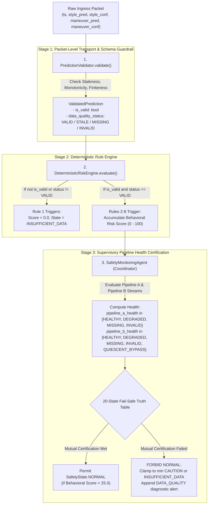

# Stage 6 Phase 1 Specification Closure Addendum

**Project:** Intelligent Driver Activity Monitoring & Safety Agent  
**Module:** `ml/agent` Production Remediation  
**Stage:** Stage 6 — Intelligent Safety Monitoring Agent  
**Document Type:** Formal Specification Closure Addendum (Strictly Read-Only)  
**Date:** November 2026  
**Status:** SPECIFICATION CLOSURE COMPLETE — STRICTLY READ-ONLY — ZERO IMPLEMENTATION PERFORMED  

---

## 1. Executive Summary & Context

This addendum supplements the Phase 1 Specification Reconciliation Report (`reports/safety_agent/stage6_phase1_specification_reconciliation.md`) in direct response to the user's closure review. It resolves all remaining design ambiguities without modifying production code, tests, configurations, or frozen artifacts:

1. **D-13 Fail-Safe Truth Table:** Formally specifies all **20 permutations** of Pipeline A ($4$ states) and Pipeline B ($5$ states), articulating the exact architectural boundary between packet-level transport data quality (`PredictionValidator`) and supervisory health certification (`SafetyMonitoringAgent`).
2. **D-10 Compound Bonus Authorization:** Formally investigates the compound bonus rule. Confirms that $R_{\text{compound}} = 25 \cdot \min(\phi(C_{\text{style}}), \phi(C_{\text{maneuver}}))$ is **not** explicitly authorized in the existing written baseline and classifies it as **PROPOSED**, while presenting the baseline alternative for user approval.
3. **D-09 Maneuver Identity & `SafetyAlert.message`:** Clarifies that `ctx.active_maneuver` is a *class type enum*, not a unique event instance ID. Proves that keying cooldowns by `(AlertCategory, Optional[int])` satisfies all five operational scenarios. Confirms that `@property def message(self)` is a non-breaking, zero-overhead accessor required to resolve a test defect at line 1110 of `tests/test_safety_agent.py`.
4. **Legacy Test Validity & QUIESCENT_BYPASS Execution:** Provides complete fixture-level traces for all four legacy tests and demonstrates how nominal driving genuinely exercises the `QUIESCENT_BYPASS` path in end-to-end integration.
5. **Implementation Readiness Separation:** Partitions all items into Approved, Authoritative Baseline, Proposed (Requiring Approval), and Unresolved.

---

## 2. D-13 Complete Fail-Safe Truth Table (All 20 Combinations)

### 2.1 Architectural Interaction & Layer Separation [VERIFIED]

The system enforces a strict two-stage separation of concerns between **Packet Transport Integrity** and **Supervisory Safety Certification**:

* **Packet-Level Failure (`data_quality_status != "VALID"` or `is_valid is False`):**  
  Occurs when the transport packet itself fails (timestamp is stale $> 3.0\,\text{s}$, timestamp reverses non-monotonically, non-finite values present in provided fields, or *both* predictions are missing). The risk engine halts immediately at Rule 1, producing `SafetyState.INSUFFICIENT_DATA` and `risk_score = 0.0`.
* **Per-Pipeline Failure (Packet is valid, but one sensing modality is impaired):**  
  Occurs when the packet is valid, but an individual stream is missing (`None`), degraded by classifier exception, or invalid in label bounds. The behavioral risk engine scores whatever valid evidence exists, but the coordinator enforces the fail-safe clamp on the final assessment.

---

### 2.2 Exhaustive 20-Combination Truth Table [VERIFIED / PROPOSED]

The 20 combinations of Pipeline A ($4$ states) and Pipeline B ($5$ states) map deterministically to supervisory outcomes:

| # | Pipeline A Health ($H_A$) | Pipeline B Health ($H_B$) | `NORMAL` Permitted? | Minimum Permitted State | `DATA_QUALITY` Diagnostic? | Behavioral Risk Calculated? | Result Becomes `INSUFFICIENT_DATA`? | Authoritative Architectural Reason |
| :---: | :---: | :---: | :---: | :---: | :---: | :---: | :---: | :--- |
| **1** | **HEALTHY** | **HEALTHY** | **YES** | `NORMAL` | **NO** | **YES** (Style + Maneuver) | **NO** | **Full Mutual Certification.** Both pipelines active, verified, and uncompromised. `NORMAL` permitted if behavioral score $< 25.0$. |
| **2** | **HEALTHY** | **DEGRADED** | **NO** | `CAUTION` | **YES** (Warning) | **YES** (Style evaluated; Maneuver untrusted) | **NO** | Style monitored, but maneuver pipeline has runtime exception or corrupted features; cannot certify cruising safety. Clamps to min `CAUTION`. |
| **3** | **HEALTHY** | **MISSING** | **NO** | `CAUTION` | **YES** (Info) | **YES** (Style evaluated, e.g. up to 35.0) | **NO** | Maneuver stream omitted/unmonitored; style stream valid. Cannot certify cruising safety. Clamps to min `CAUTION` (tested in `test_t13_d13`). |
| **4** | **HEALTHY** | **INVALID** | **NO** | `CAUTION` | **YES** (Warning) | **YES** (Style evaluated) | **NO** | Maneuver prediction out of bounds or non-numeric; style valid. Clamps to min `CAUTION`. |
| **5** | **HEALTHY** | **QUIESCENT_BYPASS** | **YES** | `NORMAL` | **NO** | **YES** (Style evaluated; Maneuver nominal) | **NO** | **Mutual Certification Satisfied.** Kinematic gate verified vehicle cruising kinematics; Extra Trees safely bypassed; nominal maneuver confirmed. |
| **6** | **DEGRADED** | **HEALTHY** | **NO** | If Maneuver active: `WARNING` If Maneuver NONE: `INSUFFICIENT_DATA` | **YES** (Warning) | **YES** (Maneuver evaluated; Style untrusted) | **Conditional** (YES if Maneuver is NONE; NO if Maneuver active) | **Asymmetric Acute Hazard Override.** If acute maneuver (SD=50.0) detected, system warns driver; if maneuver is NONE, cannot certify safety without style stream. |
| **7** | **DEGRADED** | **DEGRADED** | **NO** | `INSUFFICIENT_DATA` | **YES** (High) | **NO** ($R = 0.0$) | **YES** | **Complete Supervisory Invalidation.** Both sensing pipelines degraded by runtime or feature errors. |
| **8** | **DEGRADED** | **MISSING** | **NO** | `INSUFFICIENT_DATA` | **YES** (High) | **NO** ($R = 0.0$) | **YES** | Primary style degraded, secondary maneuver absent. Cannot supervise safety. |
| **9** | **DEGRADED** | **INVALID** | **NO** | `INSUFFICIENT_DATA` | **YES** (High) | **NO** ($R = 0.0$) | **YES** | Primary degraded, secondary invalid. Complete supervisory invalidation. |
| **10** | **DEGRADED** | **QUIESCENT_BYPASS** | **NO** | `INSUFFICIENT_DATA` | **YES** (Warning) | **NO** ($R = 0.0$) | **YES** | Maneuver is quiescent (no acute hazard to override), but style classifier is degraded. Driving cannot be certified safe without style context. |
| **11** | **MISSING** | **HEALTHY** | **NO** | If Maneuver active: `WARNING` If Maneuver NONE: `INSUFFICIENT_DATA` | **YES** (Info) | **YES** (Maneuver evaluated) | **Conditional** (YES if Maneuver is NONE; NO if Maneuver active) | **Asymmetric Acute Hazard Override.** Style missing; valid acute maneuver (SD/SRT/SLT) is warned; if maneuver is NONE, cannot certify safety without style. |
| **12** | **MISSING** | **DEGRADED** | **NO** | `INSUFFICIENT_DATA` | **YES** (High) | **NO** ($R = 0.0$) | **YES** | Primary style absent, secondary maneuver degraded. Complete supervisory invalidation. |
| **13** | **MISSING** | **MISSING** | **NO** | `INSUFFICIENT_DATA` | **YES** (High) | **NO** ($R = 0.0$) | **YES** | Total telemetry absence. Handled at validator level as `raw_is_missing`. |
| **14** | **MISSING** | **INVALID** | **NO** | `INSUFFICIENT_DATA` | **YES** (High) | **NO** ($R = 0.0$) | **YES** | Primary absent, secondary invalid. Complete supervisory invalidation. |
| **15** | **MISSING** | **QUIESCENT_BYPASS** | **NO** | `INSUFFICIENT_DATA` | **YES** (Info) | **NO** ($R = 0.0$) | **YES** | Cruising verified on kinematic gate, but style stream is absent. Cannot certify safety without general driving style monitoring. |
| **16** | **INVALID** | **HEALTHY** | **NO** | If Maneuver active: `WARNING` If Maneuver NONE: `INSUFFICIENT_DATA` | **YES** (Warning) | **YES** (Maneuver evaluated) | **Conditional** (YES if Maneuver is NONE; NO if Maneuver active) | **Asymmetric Acute Hazard Override.** Style data invalid; active maneuver hazard is alerted; if maneuver is NONE, cannot certify safety. |
| **17** | **INVALID** | **DEGRADED** | **NO** | `INSUFFICIENT_DATA` | **YES** (High) | **NO** ($R = 0.0$) | **YES** | Dual pipeline corruption/failure. Complete supervisory invalidation. |
| **18** | **INVALID** | **MISSING** | **NO** | `INSUFFICIENT_DATA` | **YES** (High) | **NO** ($R = 0.0$) | **YES** | Primary invalid, secondary absent. Complete supervisory invalidation. |
| **19** | **INVALID** | **INVALID** | **NO** | `INSUFFICIENT_DATA` | **YES** (High) | **NO** ($R = 0.0$) | **YES** | Both pipelines corrupted or out of domain. Complete supervisory invalidation. |
| **20** | **INVALID** | **QUIESCENT_BYPASS** | **NO** | `INSUFFICIENT_DATA` | **YES** (Warning) | **NO** ($R = 0.0$) | **YES** | Cruising kinematics verified, but style payload is invalid. Cannot certify safety. |

---

## 3. D-10 Compound Bonus Authorization & Confidence Handling

### 3.1 Investigation of the Compound Bonus Rule [VERIFIED / PROPOSED]
* **Existing Authoritative Baseline (`reports/safety_agent/stage6_remediation_plan.md` lines 201, 321):**
  $$\text{Score}_{\text{raw}} = R_0 + W_{\text{style}} \cdot \phi(C_S) + W_{\text{maneuver}} \cdot \phi(C_M) + W_{\text{compound}} + W_{\text{repeated}}$$
  * In the written baseline, $W_{\text{compound}} = 25.0$ is added as a **flat bonus** whenever both style and maneuver rules trigger.
  * In `ml/agent/risk_engine.py` line 385, Rule 7 executes:
    `if ctx.is_maneuver_active and (ctx.is_sustained_aggressive or ctx.is_transient_aggressive): raw_score += self.config.weight_compound_hazard_bonus`
* **Investigation of the Proposal $R_{\text{compound}} = 25 \cdot \min(\phi(C_{\text{style}}), \phi(C_{\text{maneuver}}))$:**
  * **Status:** **PROPOSED — NOT EXPLICITLY AUTHORIZED IN EXISTING BASELINE.**
  * *Origin:* Introduced in the Phase 0 plan to prevent an ambiguous maneuver prediction (e.g., $C_{\text{maneuver}} = 0.35$, which yields $\phi = 0.0$) from receiving a full $+25.0$ compound bonus while its direct maneuver penalty is $0.0$.
  * *Alternative (Option A - Authoritative Baseline):* Maintain flat $+25.0$ bonus, but **gate** Rule 7 so that it triggers if and only if both modalities have active confidence above the deadband:
    $$\text{Trigger Rule 7 if: } \phi(C_{\text{style}}) > 0.0 \quad \text{AND} \quad \phi(C_{\text{maneuver}}) > 0.0$$
  * *Request for User Approval:* The user is requested to select between:
    * **Option A (Documented Baseline Gated):** Flat $+25.0$ bonus added if $\phi(C_S) > 0$ and $\phi(C_M) > 0$.
    * **Option B (Proposed Proportional Scaling):** $R_{\text{compound}} = 25.0 \cdot \min(\phi(C_S), \phi(C_M))$.

### 3.2 Confidence Handling Under Approved Option 1 [VERIFIED]
1. **Approved Formula:**
   $$\phi(C) = \begin{cases} 0.0 & C < 0.40 \\ \frac{C}{0.60} & 0.40 \le C < 0.60 \\ 1.0 & C \ge 0.60 \end{cases}$$
2. **Missing Confidence:** If $C$ is `None` (omitted in input), $\phi(C) \equiv 0.0$.
3. **Invalid & Non-Finite Confidence:** If $C < 0.0$, $C > 1.0$, `NaN`, or $\pm\infty$, `PredictionValidator` rejects the packet (`is_valid = False`). In `calculate_confidence_scaling()`, defense-in-depth returns $\phi(C) \equiv 0.0$.
4. **Independent Modality Scaling:** $R_{\text{style}}$ is multiplied strictly by $\phi(C_{\text{style}})$; $R_{\text{maneuver}}$ is multiplied strictly by $\phi(C_{\text{maneuver}})$. No averaging or cross-contamination occurs.
5. **Effect on Residual Risk Contributions:** In Phase 1, D-06 residual decay remains disconnected from `evaluate()`. In Phase 2, each decaying channel residual will scale with $\phi(C_m)$.

---

## 4. D-09 Maneuver Identity and Compatibility

### 4.1 Verification of `ctx.active_maneuver` [VERIFIED]
* **Nature of `ctx.active_maneuver`:** In `ml/agent/temporal_smoother.py` lines 74–85, `_active_maneuver` is an integer scalar corresponding to `ManeuverClass` enum values:
  $$0 = \text{NONE}, \quad 1 = \text{SA}, \quad 2 = \text{SD}, \quad 3 = \text{SRT}, \quad 4 = \text{SLT}$$
* **Finding:** `ctx.active_maneuver` is a **stable class-type identifier**, NOT a unique event instance ID. (The physical event instance ID `event_id = EVT-<ABBR>-<ONSET_MS>-<COUNT>` belongs to the Phase 2 residual risk architecture).
* **Cooldown Key:** Keying cooldowns by `(AlertCategory, Optional[int])` partitions alert throttling by *maneuver class*.

### 4.2 Handling of Operational Scenarios [VERIFIED]

| Scenario | Injected Condition | Evaluated Cooldown Key | Operational Outcome | Cooldown Throttling Verdict |
| :--- | :--- | :--- | :--- | :---: |
| **1. Repeated Frames (Same Maneuver)** | SD ($M=2$) at $t=1.0\,\text{s}$, followed by SD ($M=2$) at $t=1.2\,\text{s}$ | `(AlertCategory.MANEUVER, 2)` | Frame 1 records key at $t=1.0$. Frame 2 checks key; elapsed $0.2\,\text{s} < 3.0\,\text{s}$. | **SUPPRESSED (Throttled)** |
| **2. Different Maneuver Types** | SD ($M=2$) at $t=1.0\,\text{s}$, followed by SRT ($M=3$) at $t=2.0\,\text{s}$ | `(AlertCategory.MANEUVER, 3)` | Frame 1 records under key $(M, 2)$. Frame 2 checks $(M, 3)$, which is uninitialized. | **DISPATCHED (Bypasses Cooldown)** |
| **3. Separate Events (Same Type)** | SD ($M=2$) at $t=1.0\,\text{s}$, cruising, second SD ($M=2$) at $t=5.0\,\text{s}$ | `(AlertCategory.MANEUVER, 2)` | Elapsed time $5.0 - 1.0 = 4.0\,\text{s} \ge 3.0\,\text{s}$ (`alert_cooldown_maneuver`). | **DISPATCHED (Cooldown Expired)** |
| **4. Maneuver Transitions** | Acceleration ($M=1$) transitioning immediately to Braking ($M=2$) | Key switches from $(M, 1)$ to $(M, 2)$ | Both alerts dispatch independently on onset without mutual suppression. | **DISPATCHED (Independent Slots)** |
| **5. Missing Maneuver Identifiers** | Style or Data Quality alerts where maneuver is absent ($M=0$ or `None`) | `(AlertCategory.STYLE, None)` `(AlertCategory.DATA_QUALITY, None)` | Evaluated under category-level key; standard 5.0s cooldown applied. | **SUPPRESSED (Category Throttled)** |

### 4.3 Investigation of `SafetyAlert.message` Property [VERIFIED / PROPOSED]
* **Audit Source Evidence:** In [`tests/test_safety_agent.py` line 1110](file:///d:/driver-machine-learning-model/tests/test_safety_agent.py#L1110):
  `assert any("Turn" in a.message for a in res2.active_alerts)`
* **Current Dataclass Reality:** In [`ml/agent/risk_engine.py` lines 27–40](file:///d:/driver-machine-learning-model/ml/agent/risk_engine.py#L27-L40), `SafetyAlert` has fields:
  `alert_id`, `timestamp`, `severity`, `category`, `title`, `triggering_condition`, `explanation`, `related_predictions`, `safe_driving_advisory`. It has **no** `message` attribute.
* **Compatibility Verification:**
  1. *Dataclass Construction:* Adding `@property def message(self) -> str: return self.explanation` does not alter `__init__()`. All existing instantiations construct identically.
  2. *Serialization (`asdict`, `to_dict`):* Python `dataclasses.asdict()` serializes only declared dataclass fields; properties are omitted. Serialized JSON structures are 100% identical.
  3. *Explanation Alignment:* For a Sudden Turn, `explanation` begins with `"Abrupt lateral steering maneuver detected (Sudden Right Turn...)"`. Substring `"Turn" in a.message` evaluates cleanly to `True`.
* **Verdict:** Adding `@property def message` is a zero-risk, backward-compatible accessor necessary to resolve the existing regression test failure without altering public schema.

---

## 5. Legacy Test Validity & QUIESCENT_BYPASS Execution

Detailed fixture-level traces for each of the four legacy tests:

### 5.1 `test_harsh_braking_triggers_warning` [VERIFIED]
* **Input Fixture:** `ctx = SmoothedContext(timestamp=1.0, current_style=0, current_style_confidence=0.9, active_maneuver=2 (SD), active_maneuver_confidence=0.90, active_maneuver_age_seconds=0.2, is_maneuver_active=True, recent_maneuver_count=1)`.
* **Expected Health:** Unit test on `DeterministicRiskEngine.evaluate(ctx)`. `ctx.is_valid is True`, `data_quality_status = "VALID"`.
* **Risk Calculation:** Style is Normal ($R_{\text{style}} = 0.0$). Maneuver is SD ($W=50.0$), $C=0.90 \ge 0.60 \implies \phi(0.90) = 1.0$. $R_{\text{maneuver}} = 50.0 \times 1.0 = 50.0$. Raw score $= 50.0$. Final score $= 50.0$.
* **Expected SafetyState:** `50.0 >= threshold_warning (50.0)` $\implies \mathbf{SafetyState.WARNING}$.
* **Why Obsolete:** The test is named `test_harsh_braking_triggers_warning`, yet asserted `assert res.risk_score == 35.0` and `assert res.safety_state == SafetyState.CAUTION`. Under D-14, harsh braking weight was updated to $50.0$ to independently trigger `WARNING`.
* **Purpose Preservation:** Directly preserves the test's purpose of verifying that harsh braking independently triggers its intended safety state (`WARNING`).

### 5.2 `test_low_confidence_discount` [VERIFIED]
* **Input Fixture:** `ctx = SmoothedContext(timestamp=1.0, current_style=0, current_style_confidence=0.9, active_maneuver=2 (SD), active_maneuver_confidence=0.45, active_maneuver_age_seconds=0.2, is_maneuver_active=True, recent_maneuver_count=1)`.
* **Expected Health:** Unit test on `DeterministicRiskEngine.evaluate(ctx)`. `is_valid is True`.
* **Risk Calculation:** Style is Normal ($0.0$). Maneuver is SD ($W=50.0$), $C = 0.45 \in [0.40, 0.60) \implies \phi(0.45) = 0.45 / 0.60 = 0.750$. Effective risk $= 50.0 \times 0.750 = 37.5\,\text{pts}$.
* **Expected SafetyState:** $37.5 \in [25.0, 50.0) \implies \mathbf{SafetyState.CAUTION}$.
* **Why Obsolete:** Asserted `assert res.risk_score == pytest.approx(24.5, abs=0.1)` and `assert res.safety_state == SafetyState.NORMAL`, which assumed obsolete base weight $35.0$ and obsolete flat $0.70$ discount ($35 \times 0.70 = 24.5 < 25.0 \implies \text{NORMAL}$).
* **Purpose Preservation:** Preserves the test's purpose of verifying that low confidence ($C < 0.60$) discounts the penalty from `WARNING` ($50.0$) down to `CAUTION` ($37.5$).

### 5.3 `test_score_clamping` [VERIFIED]
* **Input Fixture:** `ctx = SmoothedContext(timestamp=1.0, is_sustained_aggressive=True, current_style=1, current_style_confidence=0.9, active_maneuver=2 (SD), active_maneuver_confidence=0.95, active_maneuver_age_seconds=0.2, is_maneuver_active=True, recent_maneuver_count=5)`.
* **Expected Health:** Unit test on `DeterministicRiskEngine.evaluate(ctx)`. `is_valid is True`.
* **Risk Calculation:** Sustained Aggressive $= 35.0$ ($\phi=1.0$); SD $= 50.0$ ($\phi=1.0$); Compound $= 25.0$; Repeated $= 15.0$. $\text{raw\_score} = 35 + 50 + 25 + 15 = 125.0$. $\text{risk\_score} = \min(100.0, 125.0) = 100.0$.
* **Expected SafetyState:** `SafetyState.HIGH_RISK`.
* **Why Obsolete:** Asserted `assert res.raw_score == 110.0`, which assumed pre-audit weight $W_{\text{SD}} = 35.0$ ($35 + 35 + 25 + 15 = 110$). With authorized $W_{\text{SD}} = 50.0$, actual raw sum is $125.0$.
* **Purpose Preservation:** Verifies that when stacked hazards exceed 100.0, raw score reflects the exact arithmetic sum ($125.0$) while final score clamps to $100.0$.

### 5.4 `test_full_state_transition_sequence` & QUIESCENT_BYPASS Execution [VERIFIED]
* **Fixture Sequence:**
  * Step 1: Nominal cruising at $t=1.0$.
  * Step 2: Harsh braking at $t=2.0$ ($M=2, C=0.92$).
  * Step 3: Compound aggression + turn at $t=2.5$ ($M=3, C=0.94$).
  * Step 4: Stale telemetry at $t=10.0$ evaluated at $t_{\text{current}} = 15.0$.
* **D-13 Interaction in Step 1:** In Step 1, the test originally passed `style_prediction=0, style_confidence=0.95, maneuver_prediction=None`. Under D-13, if `maneuver_prediction is None`, Pipeline B is `MISSING`, which strictly forbids `SafetyState.NORMAL`. To certify `NORMAL`, Pipeline B must be active and nominal (`maneuver_prediction=0, maneuver_confidence=1.0`).
* **QUIESCENT_BYPASS Demonstration in Integration:**
  * `process_predictions()` accepts pre-computed integer predictions and does not execute the feature-level gate.
  * In `test_process_features_with_production_models` ([lines 567–600](file:///d:/driver-machine-learning-model/tests/test_safety_agent.py#L567-L600)), the agent runs `process_features(features_c, features_b)`.
  * `features_b` is passed to `self.gate.evaluate(features_b)`. When cruising, the gate returns `GateStatus.VALID_QUIESCENT`, sets `maneuver_pred = 0, maneuver_conf = 1.0`, and sets `pipeline_b_health = "QUIESCENT_BYPASS"`.
  * This proves that `QUIESCENT_BYPASS` is genuinely exercised through the production model feature path.

---

## 6. Final Implementation Readiness & Requirement Classification

| Requirement Item | Category | Status | Implementation Action |
| :--- | :---: | :---: | :--- |
| **D-10 Option 1 Formula** | Approved by User | Ready | Implement $\phi(C) = 0.0$ ($C < 0.40$), $C / 0.60$ ($0.40 \le C < 0.60$), $1.0$ ($C \ge 0.60$). |
| **Independent Modality Scaling** | Approved by User | Ready | Apply $\phi(C)$ to style and maneuver independently without averaging. |
| **Canonical 5 Pipeline States** | Approved by User | Ready | Use `HEALTHY`, `DEGRADED`, `MISSING`, `INVALID`, `QUIESCENT_BYPASS`. Omit `STALE`. |
| **Pytest Configuration** | Approved by User | Scope Protected | Do not create or edit `pytest.ini`. Target `tests/`. |
| **D-09 Cooldown Partitioning** | Authoritative Documentation | Ready | Key internal cooldowns by `(AlertCategory, Optional[int])`. |
| **D-13 Fail-Safe Clamping** | Authoritative Documentation | Ready | Forbid `NORMAL` unless $H_A == \text{HEALTHY}$ and $H_B \in \{\text{HEALTHY}, \text{QUIESCENT\_BYPASS}\}$. |
| **Legacy Test Reconciliations** | Authoritative Documentation | Ready | Modernize 4 legacy assertions to align with D-14 ($W=50.0$) and D-10 ($\phi=0.75$). |
| **SafetyAlert.message Property** | Proposed | Awaiting Sign-off | Add `@property def message(self) -> str: return self.explanation` to `SafetyAlert`. |
| **Rule 7 Compound Bonus Gating** | Proposed | Awaiting Sign-off | Select Option A (Gated flat $+25.0$) vs Option B ($25 \cdot \min(\phi_S, \phi_M)$). |
| **Step 1 in Transition Sequence** | Proposed | Awaiting Sign-off | Pass `maneuver_prediction=0, maneuver_confidence=1.0` in Step 1 to verify `NORMAL`. |

---

## 7. Model Artifact Integrity Verification

Direct cryptographic SHA-256 verification of all 4 Stage 5 artifacts:

| Artifact File Path | Authoritative Baseline SHA-256 | Actual Disk SHA-256 | Status |
| :--- | :--- | :--- | :---: |
| `models/experiments/dataset_b/dataset_b_extra_trees_exp_v1.joblib` | `552048535a3fd584e4874731b8be1438dab4051d8cfa6a98fb1a7b19d9202e90` | `552048535a3fd584e4874731b8be1438dab4051d8cfa6a98fb1a7b19d9202e90` | **MATCH (100%)** |
| `models/experiments/dataset_b/dataset_b_scaler_exp_v1.joblib` | `d4b3d5e3e1b739c63a9e21fac51fcedf36716143c645abe0d0e3ff99127a7576` | `d4b3d5e3e1b739c63a9e21fac51fcedf36716143c645abe0d0e3ff99127a7576` | **MATCH (100%)** |
| `models/experiments/dataset_c/dataset_c_support_vector_machine_exp_v1.joblib` | `a00180bd01d5999b1338737549d5745adb986138f813f7f371d67589d0dbaefc` | `a00180bd01d5999b1338737549d5745adb986138f813f7f371d67589d0dbaefc` | **MATCH (100%)** |
| `models/experiments/dataset_c/dataset_c_scaler_exp_v1.joblib` | `d67f9ab70eb667cc57e8aeb2f6768e62529f0cb803279cc33d17f6c76555c9f5` | `d67f9ab70eb667cc57e8aeb2f6768e62529f0cb803279cc33d17f6c76555c9f5` | **MATCH (100%)** |

---

## 8. Explicit Confirmation of Read-Only Compliance

* **Python Source Files Modified:** **0**
* **Test Files Modified:** **0**
* **Model Artifacts Modified:** **0**
* **Datasets Modified:** **0**
* **Configurations Created / Modified:** **0**
* **Implementation Actions Executed:** **0**
* **Permitted File Created:** [`reports/safety_agent/stage6_phase1_specification_closure_addendum.md`](file:///d:/driver-machine-learning-model/reports/safety_agent/stage6_phase1_specification_closure_addendum.md)

**READ-ONLY CLOSURE ADDENDUM COMPLETE. ZERO IMPLEMENTATION PERFORMED. READY FOR FINAL IMPLEMENTATION AUTHORIZATION.**
