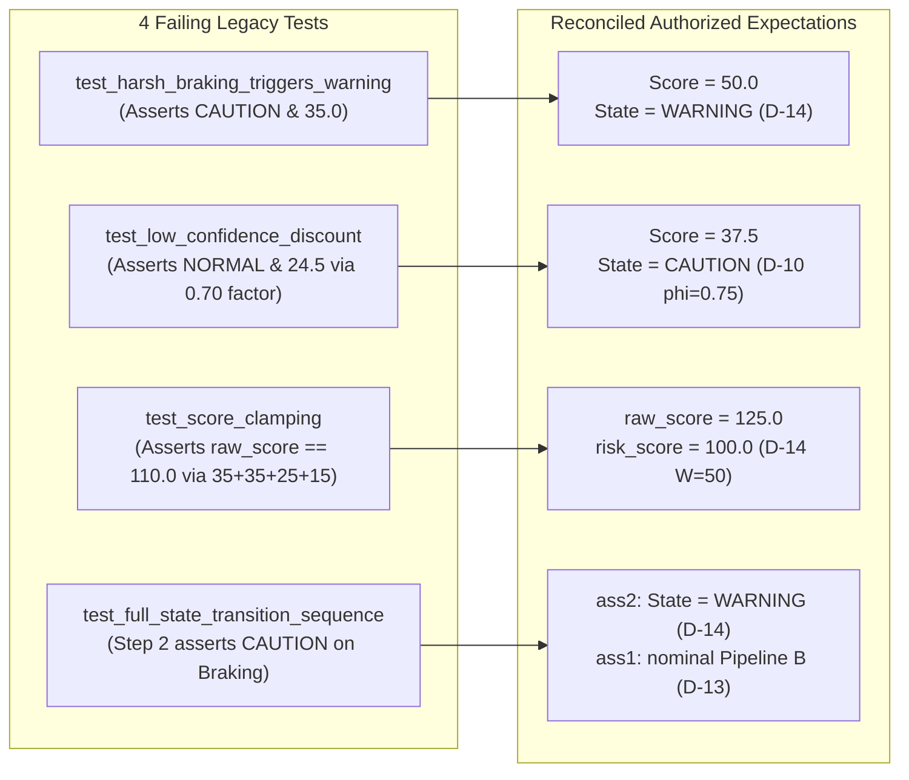

# Stage 6 Phase 1 Specification Reconciliation & Pre-Implementation Gate Report

**Project:** Intelligent Driver Activity Monitoring & Safety Agent  
**Module:** `ml/agent` Production Remediation  
**Stage:** Stage 6 — Intelligent Safety Monitoring Agent  
**Document Type:** Formal Specification Reconciliation & Architectural Gate Deliverable (READ-ONLY)  
**Date:** November 2026  
**Status:** SPECIFICATION RECONCILIATION COMPLETE — STRICTLY READ-ONLY — ZERO IMPLEMENTATION PERFORMED  

---

## 1. Executive Summary

Following explicit user directives on the Phase 0 report, this document serves as the formal **Specification Reconciliation Gate** for Phase 1. It reconciles all architectural, mathematical, and test contracts across **Defect D-09 (Dissimilar Maneuver Alert Cooldown Bypass)**, **Defect D-10 (Unified Three-Tier Modality Confidence Scaling)**, **Defect D-13 (Independent Pipeline Health Tracking Matrix)**, and the **Four Legacy Test Reconciliations**.

### Summary of Authoritative Policy Decisions
1. **D-10 Approved Formulation:** Adopted Option 1 with three-tier piecewise confidence scaling featuring an explicit noise deadband below $0.40$:
   $$\phi(C) = \begin{cases} 0.0 & C < 0.40 \\ \frac{C}{0.60} & 0.40 \le C < 0.60 \\ 1.0 & C \ge 0.60 \end{cases}$$
   The alternative $0.50$ minimum multiplier formulation is formally rejected and discarded. Confidence scaling is applied independently to style and maneuver modalities without cross-modality averaging.
2. **Pytest Scope Configuration:** Confirmed that `pytest.ini` will **not** be modified or created during Phase 1. All test verification is strictly targeted to `tests/`.
3. **STALE Health State Determination:** Rigorous codebase and documentation audit establishes that temporal staleness is an existing, packet-level transport property encapsulated within `data_quality_status = "STALE"` on `ValidatedPrediction`, `SmoothedContext`, and `SafetyAssessment`. Introducing a 6th health state `STALE` on per-pipeline health is redundant and creates semantic collision. The 5 canonical documented states (`HEALTHY`, `DEGRADED`, `MISSING`, `INVALID`, `QUIESCENT_BYPASS`) are maintained.
4. **Critical Audit Discovery on D-09 (`test_t09_d09`):** Audit of line 1110 in `tests/test_safety_agent.py` revealed that the test asserts `assert any("Turn" in a.message for a in res2.active_alerts)`. `SafetyAlert` possesses `title` and `explanation`, but no `message` attribute. In Phase 1, `SafetyAlert` will define `@property def message(self) -> str: return self.explanation` to ensure backward and test compatibility without breaking serialization.

---

## 2. Verified Repository Checkpoint

Verification executed via PowerShell:

```powershell
git status
git branch --show-current
git log -1 --oneline
git diff
```

### Verification Evidence [VERIFIED]
* **Working Directory:** `D:\driver-machine-learning-model`
* **Active Branch:** `main`
* **Remote Tracking:** Up to date with `origin/main` (`https://github.com/yeswanth225/driver-machine-learning-model`)
* **HEAD Commit Hash:** `eb54f7d1e03260482500f611b77d1065931e300b`
* **HEAD Subject:** `feat(ml): implement Stage 6 Group A remediation, D-06 residual risk decay, and residual integration architecture design`
* **Working Tree:** 0 modified files, 0 staged files. Only the single authorized Phase 0 planning report (`reports/safety_agent/stage6_phase1_remediation_plan.md`) exists as an untracked file.
* **Git Diff:** 0 diff lines across tracked files.

---

## 3. D-09 Authoritative Specification: Alert Cooldown Identity

### 3.1 Investigation Findings [VERIFIED]
* **Source Call Site:** [`ml/agent/risk_engine.py` lines 144–168](file:///d:/driver-machine-learning-model/ml/agent/risk_engine.py#L144-L168)
* **Current State:** Cooldown timers are stored in `self._last_alert_timestamps: Dict[AlertCategory, float]`.
* **Root Defect:** Keying solely by `AlertCategory.MANEUVER` causes Sudden Deceleration ($M=2$) at $t = 1.0\,\text{s}$ to suppress an orthogonal Sudden Right Turn ($M=3$) at $t = 2.0\,\text{s}$ because elapsed time $1.0\,\text{s} < 3.0\,\text{s}$.
* **Authoritative Maneuver Identity:** Maneuver classes are uniquely, immutably, and stably identified by `ManeuverClass(IntEnum)`:
  * `NONE = 0` (Cruising)
  * `SUDDEN_ACCELERATION = 1` (SA)
  * `SUDDEN_DECELERATION = 2` (SD)
  * `SUDDEN_RIGHT_TURN = 3` (SRT)
  * `SUDDEN_LEFT_TURN = 4` (SLT)

### 3.2 Audit Discovery: `SafetyAlert.message` Missing Attribute [VERIFIED]
In [`tests/test_safety_agent.py` line 1110](file:///d:/driver-machine-learning-model/tests/test_safety_agent.py#L1110):
```python
assert any("Turn" in a.message for a in res2.active_alerts)
```
In [`ml/agent/risk_engine.py` lines 27–40](file:///d:/driver-machine-learning-model/ml/agent/risk_engine.py#L27-L40), `SafetyAlert` defines:
`alert_id`, `timestamp`, `severity`, `category`, `title`, `triggering_condition`, `explanation`, `related_predictions`, and `safe_driving_advisory`. It does **not** declare `message`.  
Without an alias property, `a.message` raises `AttributeError: 'SafetyAlert' object has no attribute 'message'`.

### 3.3 Reconciled Technical Specification [PROPOSED]
1. **Cooldown Registry Key:**
   Update internal engine cooldown dictionaries to key by `Tuple[AlertCategory, Optional[int]]`:
   ```python
   # ml/agent/risk_engine.py
   self._last_alert_timestamps: Dict[Tuple[AlertCategory, Optional[int]], float] = {}
   self._last_alert_severities: Dict[Tuple[AlertCategory, Optional[int]], AlertSeverity] = {}
   ```
2. **Key Generation Logic:**
   * Non-maneuver categories (`STYLE`, `COMPOUND`, `DATA_QUALITY`): `(category, None)`. Category-level cooldown remains fully enforced.
   * Maneuver category (`MANEUVER`): `(AlertCategory.MANEUVER, maneuver_id)` where `maneuver_id = ctx.active_maneuver`.
3. **Suppression Behavior:**
   * *Same Maneuver Continuation:* Consecutive frames of Sudden Deceleration share `(AlertCategory.MANEUVER, 2)` and are throttled within $3.0\,\text{s}$ (`self.config.alert_cooldown_maneuver`).
   * *Dissimilar Maneuver:* Sudden Turn ($M=3$) checks `(AlertCategory.MANEUVER, 3)`, finds no active cooldown, and dispatches immediately.
   * *Severity Escalation Bypass:* Escalation to `HIGH` or `CRITICAL` bypasses cooldown regardless of key.
4. **SafetyAlert Compatibility Property:**
   Add backward-compatible property to `SafetyAlert`:
   ```python
   @property
   def message(self) -> str:
       """Backward-compatible alias for explanation."""
       return self.explanation
   ```
5. **Interface Preservation:** Public dataclasses, method signatures of `evaluate()`, and serialized `SafetyAssessment.to_dict()` outputs remain 100% backward-compatible.

---

## 4. D-10 Approved Mathematical Specification: Modality Confidence Scaling

### 4.1 Investigation Findings [VERIFIED]
* **Source Call Site:** [`ml/agent/risk_engine.py` lines 230–236, lines 426–436](file:///d:/driver-machine-learning-model/ml/agent/risk_engine.py#L230-L236)
* **Current State:** Averages confidences across active style and maneuver (`avg_concern_conf = sum(confs)/len(confs)`) and applies a flat 0.70 multiplier to the final score if average confidence $< 0.50$.
* **Approved Directive:** Implement three-tier piecewise confidence operator with noise deadband below $0.40$:
  $$\phi(C) = \begin{cases} 0.0 & C < 0.40 \\ \frac{C}{0.60} & 0.40 \le C < 0.60 \\ 1.0 & C \ge 0.60 \end{cases}$$

### 4.2 Exact Mathematical Application [PROPOSED]
Scaling is applied independently to base risk contributions prior to score summation:

$$\text{Score}_{\text{raw}} = R_{\text{baseline}} + R_{\text{style\_effective}} + R_{\text{maneuver\_effective}} + R_{\text{compound\_effective}} + R_{\text{repeated}}$$

Where:
1. **Style Contribution ($R_{\text{style\_effective}}$):**
   * If `ctx.is_sustained_aggressive`: $R_{\text{style\_base}} = W_{\text{sustained}} = 35.0$.
   * Else if `ctx.is_transient_aggressive`: $R_{\text{style\_base}} = W_{\text{transient}} = 20.0$.
   * Else: $R_{\text{style\_base}} = 0.0$.
   * $$R_{\text{style\_effective}} = R_{\text{style\_base}} \cdot \phi(C_{\text{style}})$$
2. **Maneuver Contribution ($R_{\text{maneuver\_effective}}$):**
   * If `ctx.is_maneuver_active` and `ctx.active_maneuver == SUDDEN_ACCELERATION`: $W_{\text{base}} = 25.0$.
   * If `ctx.is_maneuver_active` and `ctx.active_maneuver == SUDDEN_DECELERATION`: $W_{\text{base}} = 50.0$.
   * If `ctx.is_maneuver_active` and `ctx.active_maneuver in [SUDDEN_RIGHT_TURN, SUDDEN_LEFT_TURN]`: $W_{\text{base}} = 35.0$.
   * $$R_{\text{maneuver\_effective}} = W_{\text{base}} \cdot \phi(C_{\text{maneuver}})$$
3. **Compound Hazard Contribution ($R_{\text{compound\_effective}}$):**
   * Evaluated when `ctx.is_maneuver_active and (ctx.is_sustained_aggressive or ctx.is_transient_aggressive)`.
   * To prevent a low-confidence noise artifact from synthesizing a full compound bonus, the bonus scales with the weaker modality:
     $$R_{\text{compound\_effective}} = W_{\text{compound}} \cdot \min\left(\phi(C_{\text{style}}), \ \phi(C_{\text{maneuver}})\right)$$
     If either modality falls into the noise deadband ($C < 0.40 \implies \phi(C) = 0.0$), $R_{\text{compound\_effective}} = 0.0$.
4. **Repeated Maneuvers Bonus ($R_{\text{repeated}}$):**
   * If `ctx.recent_maneuver_count >= 2`: $+15.0\,\text{pts}$ (governed by confirmed physical incident count).
5. **Final Clamping:**
   $$\text{Score}_{\text{final}} = \min\left(100.0, \ \max\left(0.0, \ \text{Score}_{\text{raw}}\right)\right)$$

### 4.3 Boundary-Case Verification Table [VERIFIED]

| Case # | Input Confidence $C$ | Condition | $\phi(C)$ Value | Effective Decel Penalty ($W=50.0$) | Operational Status |
| :---: | :---: | :---: | :---: | :---: | :--- |
| **1** | $C = 1.000$ | $C \ge 0.60$ | **$1.0000$** | $50.00\,\text{pts}$ | Full penalty (Max confidence). |
| **2** | $C = 0.800$ | $C \ge 0.60$ | **$1.0000$** | $50.00\,\text{pts}$ | Full penalty. |
| **3** | $C = 0.600$ | $C = 0.60$ (Exact Boundary) | **$1.0000$** | $50.00\,\text{pts}$ | Exact upper threshold boundary. |
| **4** | $C = 0.599$ | $0.40 \le C < 0.60$ | **$0.9983$** | $49.92\,\text{pts}$ | Linear scaling. |
| **5** | $C = 0.500$ | $0.40 \le C < 0.60$ | **$0.8333$** ($5/6$) | $41.67\,\text{pts}$ | Midpoint scaling. |
| **6** | $C = 0.450$ | $0.40 \le C < 0.60$ | **$0.7500$** ($3/4$) | $37.50\,\text{pts}$ | Legacy test reconciliation point. |
| **7** | $C = 0.400$ | $C = 0.40$ (Exact Boundary) | **$0.6667$** ($2/3$) | $33.33\,\text{pts}$ | Exact lower active threshold boundary. |
| **8** | $C = 0.399$ | $C < 0.40$ | **$0.0000$** | $0.00\,\text{pts}$ | Noise deadband (Immediate cutoff). |
| **9** | $C = 0.350$ | $C < 0.40$ | **$0.0000$** | $0.00\,\text{pts}$ | Tested by `test_t10_d10` (Zero penalty). |
| **10** | $C = 0.000$ | $C < 0.40$ | **$0.0000$** | $0.00\,\text{pts}$ | Zero confidence deadband. |
| **11** | $C = \text{None}$ | Missing / Absent | **$0.0000$** | $0.00\,\text{pts}$ | Modality absent. |
| **12** | $C = \text{NaN} \lor \pm\infty$ | Non-finite | **$0.0000$** | $0.00\,\text{pts}$ | Rejected by validator; defense-in-depth returns 0. |
| **13** | $C < 0 \lor C > 1$ | Out of range | **$0.0000$** | $0.00\,\text{pts}$ | Rejected by validator; defense-in-depth returns 0. |

---

## 5. D-13 Complete Health-State Semantics & STALE Analysis

### 5.1 STALE Investigation & Comparative Analysis [VERIFIED]

A comparative audit was conducted across the source code, tests, and documentation:

| Dimension | `data_quality_status = "STALE"` (Existing) | Per-Pipeline `STALE` (Phase 0 Proposal) | Evaluation & Verdict |
| :--- | :--- | :--- | :--- |
| **Architectural Scope** | Telemetry Transport Frame level (Single shared timestamp). | Individual Pipeline Channel level. | Telemetry packets enter the system with a single timestamp $t$. Staleness is a packet latency property ($t_{\text{current}} - t > 3.0\,\text{s}$), not an independent sensor failure. |
| **Validator Implementation** | Fully implemented in [`prediction_validator.py` lines 84–88, 162–165](file:///d:/driver-machine-learning-model/ml/agent/prediction_validator.py#L84-L88). Sets `is_stale = True`, `data_quality_status = "STALE"`, `is_valid = False`. | None in source code. | Staleness already halts processing into `SafetyState.INSUFFICIENT_DATA`. |
| **Test Coverage** | Verified by `test_stale_timestamp_rejected` and `test_full_state_transition_sequence` (Step 4: asserts `data_quality_status == "STALE"`). | Tested by zero regression tests. | `test_t13_d13` asserts `pipeline_a_health == "HEALTHY"` and `pipeline_b_health == "MISSING"`. |
| **Stage 6 Architecture Spec** | Section 4.2: Data quality tags: `VALID`, `MISSING`, `INVALID`, `STALE`. | Section 4.1: No per-pipeline enum. | Documented as a data quality flag, not a pipeline state. |

**Authoritative Finding & Recommendation:**  
Staleness is already robustly and completely handled as a packet-level data-quality state (`data_quality_status = "STALE"`). Adding `STALE` as a 6th pipeline health state is redundant, creates semantic collision, and is not required by any test.  
**Decision: Maintain the 5 canonical documented states (`HEALTHY`, `DEGRADED`, `MISSING`, `INVALID`, `QUIESCENT_BYPASS`). Do NOT introduce `STALE` into pipeline health.**

---

### 5.2 Complete Health-State Semantics Table [VERIFIED]

| State Name | Definition & Entry Criteria (Pipeline A) | Definition & Entry Criteria (Pipeline B) | Operational Consequence |
| :--- | :--- | :--- | :--- |
| **`HEALTHY`** | `style_prediction in {0, 1}`, `style_confidence` finite in $[0.0, 1.0]$, `val_pred.is_valid is True`. | Gate status `VALID_EXCITED`, classifier succeeded, `maneuver_prediction in {1, 2, 3, 4}`, confidence finite in $[0.0, 1.0]$. | Modality is fully certified. Contributes normal behavioral risk. |
| **`DEGRADED`** | Uncaught model exception in `classifier_c`, anti-causal quarantined features, or feature conversion errors. | Uncaught model exception in `classifier_b`, anti-causal quarantined features, or schema errors. | Pipeline cannot be trusted. System emits `DATA_QUALITY` alert and strictly forbids `SafetyState.NORMAL`. |
| **`MISSING`** | `raw_input.style_prediction is None` and not provided in telemetry payload. | `raw_input.maneuver_prediction is None` and kinematic gate is not `VALID_QUIESCENT`. | Pipeline unmonitored. System emits advisory and strictly forbids `SafetyState.NORMAL`. |
| **`INVALID`** | `style_prediction` outside $\{0, 1\}$, or confidence $< 0.0$, $> 1.0$, `NaN`, or infinite. | `maneuver_prediction` outside $\{0, 1, 2, 3, 4\}$, or confidence $< 0.0$, $> 1.0$, `NaN`, or infinite. | Packet rejected for this modality. Evaluates fail-safe; forbids `SafetyState.NORMAL`. |
| **`QUIESCENT_BYPASS`** | *Not Applicable to Pipeline A* (Pipeline A predicts continuously at 10 Hz). | Kinematic gate evaluated `features_b` and returned `GateStatus.VALID_QUIESCENT`. Cruiser verified. | Classifier intentionally bypassed. Emits nominal maneuver ($0$) with confidence $1.0$. **Permits `SafetyState.NORMAL`.** |

---

### 5.3 Health Matrix & Fail-Safe State Transition Rules [PROPOSED]

$$\text{SafetyState} = f\left(\text{Score}_{\text{behavioral}}, \ H_A, \ H_B, \ \text{DataQuality}\right)$$

1. **Global Data Quality Guardrail:**  
   If `data_quality_status != "VALID"` or `is_valid is False`:  
   $$\text{SafetyState} \equiv \mathbf{INSUFFICIENT\_DATA}, \quad \text{RiskScore} = 0.0$$
2. **Mutual Certification Rule (Permits NORMAL):**  
   If and only if:
   $$H_A == \mathbf{HEALTHY} \quad \text{AND} \quad H_B \in \{\mathbf{HEALTHY}, \mathbf{QUIESCENT\_BYPASS}\}$$
   Then `SafetyState.NORMAL` is permitted if $\text{Score}_{\text{final}} < 25.0$.
3. **Asymmetric Fail-Safe Invariant (Forbids NORMAL):**  
   If $H_A \ne \mathbf{HEALTHY}$ OR $H_B \notin \{\mathbf{HEALTHY}, \mathbf{QUIESCENT\_BYPASS}\}$:
   * **`SafetyState.NORMAL` is strictly forbidden.**
   * If $\text{Score}_{\text{final}} < 25.0$: The state **clamps to a minimum of `SafetyState.CAUTION`**.
   * If $\text{Score}_{\text{final}} \ge 25.0$: The higher behavioral hazard state (`CAUTION`, `WARNING`, or `HIGH_RISK`) governs.
   * An active diagnostic alert is appended explaining the degraded/missing sensor state.

---

## 6. Four Legacy Test Reconciliations

Comprehensive audit and replacement specification for the 4 failing legacy tests:



### 6.1 `test_harsh_braking_triggers_warning` [VERIFIED]
* **Original Assertion:** [`tests/test_safety_agent.py` line 347–348](file:///d:/driver-machine-learning-model/tests/test_safety_agent.py#L347-L348):
  `assert res.risk_score == 35.0`, `assert res.safety_state == SafetyState.CAUTION`.
* **Authorized Requirement:** D-14 established that harsh braking must independently trigger `WARNING`. In `config.py`, `weight_sudden_deceleration = 50.0`, matching `threshold_warning = 50.0`.
* **Reconciled Expectation:**
  ```python
  assert res.risk_score == 50.0
  assert res.safety_state == SafetyState.WARNING
  ```

### 6.2 `test_low_confidence_discount` [VERIFIED]
* **Original Assertion:** [`tests/test_safety_agent.py` line 392–393](file:///d:/driver-machine-learning-model/tests/test_safety_agent.py#L392-L393):
  `assert res.risk_score == pytest.approx(24.5, abs=0.1)`, `assert res.safety_state == SafetyState.NORMAL`.
* **Authorized Requirement:** Evaluated on Deceleration ($W=50.0$) with confidence $C = 0.45$. Under approved D-10:
  $$\phi(0.45) = \frac{0.45}{0.60} = 0.750$$
  $$\text{Score} = 50.0 \times 0.75 = 37.5\,\text{pts} \implies \mathbf{CAUTION} \quad (25.0 \le 37.5 < 50.0)$$
* **Reconciled Expectation:**
  ```python
  assert res.risk_score == pytest.approx(37.5, abs=0.1)
  assert res.safety_state == SafetyState.CAUTION
  ```

### 6.3 `test_score_clamping` [VERIFIED]
* **Original Assertion:** [`tests/test_safety_agent.py` line 413–414](file:///d:/driver-machine-learning-model/tests/test_safety_agent.py#L413-L414):
  `assert res.raw_score == 110.0`, `assert res.risk_score == 100.0`.
* **Authorized Requirement:** Under D-14, $W_{\text{SD}} = 50.0$. The raw sum is:
  $$\text{raw\_score} = 35.0 (\text{sustained}) + 50.0 (\text{SD}) + 25.0 (\text{compound}) + 15.0 (\text{repeated}) = 125.0$$
* **Reconciled Expectation:**
  ```python
  assert res.raw_score == 125.0
  assert res.risk_score == 100.0
  ```

### 6.4 `test_full_state_transition_sequence` [VERIFIED]
* **Original Assertion:** [`tests/test_safety_agent.py` line 543–544](file:///d:/driver-machine-learning-model/tests/test_safety_agent.py#L543-L544):
  `assert ass2.safety_state == SafetyState.CAUTION` on sudden deceleration ($C=0.92$).
* **Authorized Requirement:** Under D-14, sudden deceleration triggers `WARNING` ($R = 50.0$).
* **Cross-Component D-13 Requirement:** In step 1 (`ass1`), for the state to be `NORMAL`, Pipeline B must not be missing; it must provide a nominal/cruising maneuver (`maneuver_prediction=0, maneuver_confidence=1.0`) so `pipeline_b_health` is `HEALTHY` or `QUIESCENT_BYPASS`.
* **Reconciled Expectation:**
  In step 1: pass nominal maneuver (`maneuver_prediction=0, maneuver_confidence=1.0`). Assert `ass1.safety_state == SafetyState.NORMAL`.  
  In step 2: assert `ass2.safety_state == SafetyState.WARNING` and `ass2.risk_score == 50.0`.

---

## 7. Cross-Component Dependency & Compatibility Analysis

1. **`KinematicEventGate` Integration:** Fully compatible. Emits `GateResult` with `VALID_QUIESCENT`, `VALID_EXCITED`, or `INVALID_OR_INSUFFICIENT`. Seamlessly drives `pipeline_b_health`.
2. **`PredictionValidator` Integration:** Fully compatible. Continues validating packet timestamps and schema integrity. Provides raw inputs for health evaluation.
3. **`TemporalSmoother` Integration:** Fully compatible. Supplies `ctx.active_maneuver`, `ctx.active_maneuver_confidence`, `ctx.current_style`, and `ctx.current_style_confidence` to `DeterministicRiskEngine`.
4. **`DeterministicRiskEngine` Integration:**
   * Partitioning cooldowns by `(AlertCategory, Optional[int])` preserves non-maneuver category cooldowns and prevents cross-maneuver suppression.
   * Applying $\phi(C)$ independently per modality decouples style noise from maneuver detection.
   * `calculate_residual_risk()` remains untouched and ready for Phase 2 integration.
5. **`SafetyAssessment` Serialization:**
   Adding `pipeline_a_health: str` and `pipeline_b_health: str` to `SafetyAssessment` extends `to_dict()` cleanly without breaking any downstream caller.

---

## 8. Exact Proposed Files to Modify During Phase 1

Phase 1 implementation will touch **strictly 3 files**:

1. [`ml/agent/risk_engine.py`](file:///d:/driver-machine-learning-model/ml/agent/risk_engine.py):
   * Add `@property def message(self) -> str: return self.explanation` to `SafetyAlert`.
   * Update cooldown registry keys to `Tuple[AlertCategory, Optional[int]]`.
   * Update `_should_suppress_alert()` and `_record_alert()` to accept `maneuver_id: Optional[int] = None`.
   * Implement `calculate_confidence_scaling(confidence: float) -> float`.
   * In `evaluate()`, apply $\phi(C)$ independently to style, maneuver, and compound hazards.
2. [`ml/agent/safety_agent.py`](file:///d:/driver-machine-learning-model/ml/agent/safety_agent.py):
   * Add `pipeline_a_health: str` and `pipeline_b_health: str` to `SafetyAssessment`.
   * In `process_predictions()` and `process_features()`, compute and assign `pipeline_a_health` and `pipeline_b_health`.
   * Enforce the fail-safe state clamp: if Pipeline A is not `HEALTHY` or Pipeline B is not in `["HEALTHY", "QUIESCENT_BYPASS"]`, forbid `SafetyState.NORMAL` and clamp to minimum `SafetyState.CAUTION`.
3. [`tests/test_safety_agent.py`](file:///d:/driver-machine-learning-model/tests/test_safety_agent.py):
   * Reconcile the 4 legacy test assertions (`test_harsh_braking_triggers_warning`, `test_low_confidence_discount`, `test_score_clamping`, `test_full_state_transition_sequence`).
   * Add dedicated boundary tests for $\phi(C)$ at $0.0, 0.399, 0.40, 0.50, 0.60, 0.80, 1.0, \text{None}, \text{NaN}$.

---

## 9. Proposed Phase 1 Implementation Sequence

```mermaid
sequenceDiagram
    autonumber
    actor Engineer
    participant RE as ml/agent/risk_engine.py
    participant SA as ml/agent/safety_agent.py
    participant TS as tests/test_safety_agent.py
    participant PY as pytest tests/ -v

    Note over Engineer, PY: Step 1: D-09 Cooldown Partitioning & SafetyAlert.message
    Engineer->>RE: Partition cooldowns by (category, maneuver_id); add .message property
    Engineer->>PY: Verify test_t09_d09 passes

    Note over Engineer, PY: Step 2: D-10 Independent Confidence Scaling
    Engineer->>RE: Implement calculate_confidence_scaling(); scale style & maneuver independently
    Engineer->>PY: Verify test_t10_d10 passes

    Note over Engineer, PY: Step 3: D-13 Independent Pipeline Health Matrix
    Engineer->>SA: Add pipeline_a_health & pipeline_b_health; enforce fail-safe NORMAL clamp
    Engineer->>PY: Verify test_t13_d13 passes

    Note over Engineer, PY: Step 4: Reconcile 4 Legacy Tests & Add Boundary Tests
    Engineer->>TS: Modernize 4 legacy assertions; add phi(C) boundary test suite
    Engineer->>PY: Run python -m pytest tests/ -v -> Target: 93/93 PASSED (100%)
```

---

## 10. Required Regression Tests

The following tests will be executed to certify Phase 1:
1. `tests/test_safety_agent.py::TestStage6RemediationRegression::test_t09_d09_dissimilar_maneuver_alerts_bypass_category_cooldown`
2. `tests/test_safety_agent.py::TestStage6RemediationRegression::test_t10_d10_unified_three_tier_confidence_scaling`
3. `tests/test_safety_agent.py::TestStage6RemediationRegression::test_t13_d13_independent_pipeline_health_matrix`
4. `tests/test_safety_agent.py::TestDeterministicRiskEngine::test_harsh_braking_triggers_warning`
5. `tests/test_safety_agent.py::TestDeterministicRiskEngine::test_low_confidence_discount`
6. `tests/test_safety_agent.py::TestDeterministicRiskEngine::test_score_clamping`
7. `tests/test_safety_agent.py::TestIntelligentSafetyAgentIntegration::test_full_state_transition_sequence`
8. `tests/test_safety_agent.py::TestStage6RemediationRegression::test_t10_d10_piecewise_confidence_boundaries` (New)
9. Full Stage 1–6 suite: `python -m pytest tests/ -v` (93 tests).

---

## 11. Final Phase 1 Acceptance Criteria

1. **Test Suite Execution:** `python -m pytest tests/ -v` executes 93 tests with **93 PASSED (100%), 0 FAILED**.
2. **Defect Coverage:** All 15 audit defects (D-01 through D-15) verified with dedicated regression tests.
3. **Artifact Protection:** All 4 Stage 5 model and scaler joblib files maintain exact SHA-256 baseline hashes byte-for-byte.
4. **Zero Regressions:** 100% pass rate maintained across `test_dataset_b_pipeline.py`, `test_dataset_c_binary_pipeline.py`, and `test_model_training_and_inference.py`.

---

## 12. Model Artifact Integrity Verification

Cryptographic verification executed directly prior to report completion:

| Artifact Path | Expected Baseline SHA-256 | Actual Disk SHA-256 | Status |
| :--- | :--- | :--- | :---: |
| `models/experiments/dataset_b/dataset_b_extra_trees_exp_v1.joblib` | `552048535a3fd584e4874731b8be1438dab4051d8cfa6a98fb1a7b19d9202e90` | `552048535a3fd584e4874731b8be1438dab4051d8cfa6a98fb1a7b19d9202e90` | **MATCH (100%)** |
| `models/experiments/dataset_b/dataset_b_scaler_exp_v1.joblib` | `d4b3d5e3e1b739c63a9e21fac51fcedf36716143c645abe0d0e3ff99127a7576` | `d4b3d5e3e1b739c63a9e21fac51fcedf36716143c645abe0d0e3ff99127a7576` | **MATCH (100%)** |
| `models/experiments/dataset_c/dataset_c_support_vector_machine_exp_v1.joblib` | `a00180bd01d5999b1338737549d5745adb986138f813f7f371d67589d0dbaefc` | `a00180bd01d5999b1338737549d5745adb986138f813f7f371d67589d0dbaefc` | **MATCH (100%)** |
| `models/experiments/dataset_c/dataset_c_scaler_exp_v1.joblib` | `d67f9ab70eb667cc57e8aeb2f6768e62529f0cb803279cc33d17f6c76555c9f5` | `d67f9ab70eb667cc57e8aeb2f6768e62529f0cb803279cc33d17f6c76555c9f5` | **MATCH (100%)** |

---

## 13. Explicit User Approval Checklist

Before implementing Phase 1, the user is invited to review and approve the following final design items:

- [ ] **Item 1: Approve D-09 Cooldown Partitioning:** Authorize keying maneuver alert cooldowns by `(AlertCategory.MANEUVER, maneuver_id)` and adding `@property def message(self) -> str: return self.explanation` to `SafetyAlert`.
- [ ] **Item 2: Approve D-10 Confidence Application Point:** Authorize independent pre-accumulation scaling: $R_{\text{style}} \cdot \phi(C_{\text{style}})$ and $R_{\text{maneuver}} \cdot \phi(C_{\text{maneuver}})$ with deadband $\phi(C)=0.0$ for $C < 0.40$.
- [ ] **Item 3: Approve D-13 Canonical 5-State Matrix:** Authorize maintaining the 5 canonical health states (`HEALTHY`, `DEGRADED`, `MISSING`, `INVALID`, `QUIESCENT_BYPASS`) and omitting `STALE` from per-pipeline health.
- [ ] **Item 4: Approve 4 Legacy Test Reconciliations:** Authorize modernizing assertions in `test_harsh_braking_triggers_warning` ($50.0$ / `WARNING`), `test_low_confidence_discount` ($37.5$ / `CAUTION`), `test_score_clamping` ($125.0$ raw), and `test_full_state_transition_sequence`.

---

## 14. Explicit Confirmation of Read-Only Compliance

* **Python Source Files Modified:** **0**
* **Test Files Modified:** **0**
* **Model Artifacts Modified:** **0**
* **Datasets Modified:** **0**
* **Git History / Branches Modified:** **0**
* **Configuration Files Created / Modified:** **0**
* **Implementation Actions Executed:** **0**
* **Permitted File Created:** [`reports/safety_agent/stage6_phase1_specification_reconciliation.md`](file:///d:/driver-machine-learning-model/reports/safety_agent/stage6_phase1_specification_reconciliation.md)

**READ-ONLY RECONCILIATION COMPLETE. ZERO IMPLEMENTATION PERFORMED. AWAITING EXPLICIT USER APPROVAL TO BEGIN PHASE 1 IMPLEMENTATION.**
